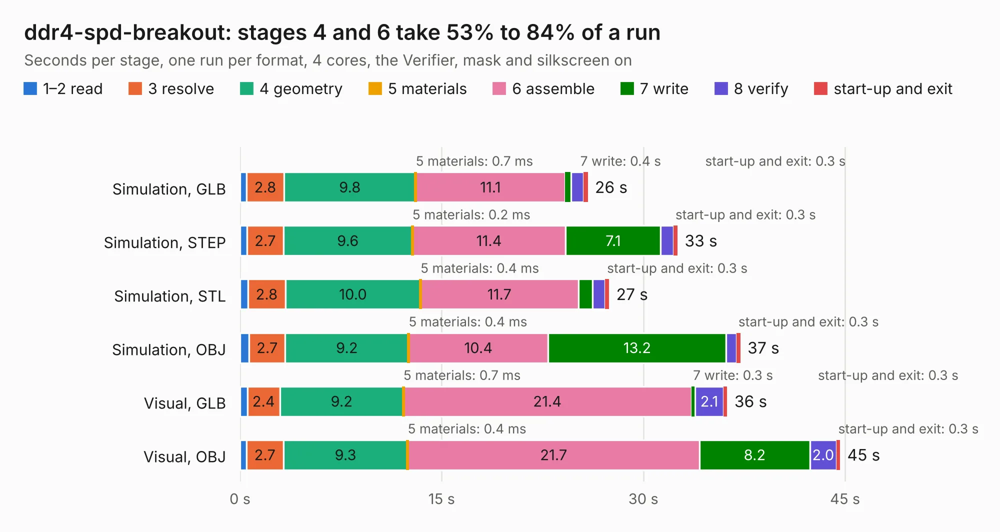

# 345 ddr4-spd-breakout

Board 345 of the 3,138 of [Corpus Testing](../Corpus-Testing.md), on [Corpus Page 4](../CorpusTestingPages/Corpus-Testing-04.md#345-ddr4-spd-breakout).

| Mode and format | 1–2 read | 3 resolve | 4 geometry | 5 materials | 6 assemble | 7 write | 8 verify | start-up and exit | Total |
|---|---:|---:|---:|---:|---:|---:|---:|---:|---:|
| Simulation, GLB | 0.5 | 2.8 | 9.8 | 0.7&nbsp;ms | 11.1 | 0.4 | 0.9 | 0.3 | 25.9 |
| Simulation, STEP | 0.5 | 2.7 | 9.6 | 0.2&nbsp;ms | 11.4 | 7.1 | 0.9 | 0.3 | 32.5 |
| Simulation, STL | 0.6 | 2.8 | 10.0 | 0.4&nbsp;ms | 11.7 | 1.0 | 0.9 | 0.3 | 27.4 |
| Simulation, OBJ | 0.7 | 2.7 | 9.2 | 0.4&nbsp;ms | 10.4 | 13.2 | 0.8 | 0.3 | 37.2 |
| Visual, GLB | 0.5 | 2.4 | 9.2 | 0.7&nbsp;ms | 21.4 | 0.3 | 2.1 | 0.3 | 36.2 |
| Visual, OBJ | 0.5 | 2.7 | 9.3 | 0.4&nbsp;ms | 21.7 | 8.2 | 2.0 | 0.3 | 44.6 |

<table align="center"><tr><td valign="top">

| Board | Repo: [antmicro/ddr4-spd-breakout-board](https://github.com/antmicro/ddr4-spd-breakout-board) Board: `ddr4-spd-breakout.kicad_pcb` |
|---|---|
| Complexity | 306&nbsp;/&nbsp;1000 (size&nbsp;241, features&nbsp;65) |
| KESE&nbsp;features | through vias, slotted holes, rounded, trapezoid or chamfered pads, filled zones, copper text |
| Tested | 9th November 2026 |
| Copper&nbsp;layers | 4 |
| File&nbsp;format | KiCad 5 (20171130) |
| Parts,&nbsp;tracks,&nbsp;vias | 57, 505, 450 |
| Triangles,&nbsp;simulation | 2,164,064 in 47 parts |
| Verifier | PASS in all six runs |

</td><td valign="top">

<table>
<tr><th>File type</th><th>File size</th><th>Peak memory used</th></tr>
<tr><th colspan="3" align="left">Simulation</th></tr>
<tr><td>GLB</td><td align="right">74&nbsp;MB</td><td align="right">807&nbsp;MB</td></tr>
<tr><td>STEP</td><td align="right">270&nbsp;MB</td><td align="right">1.1&nbsp;GB</td></tr>
<tr><td>STL</td><td align="right">108&nbsp;MB</td><td align="right">799&nbsp;MB</td></tr>
<tr><td>OBJ</td><td align="right">226&nbsp;MB</td><td align="right">1.4&nbsp;GB</td></tr>
<tr><th colspan="3" align="left">Visual</th></tr>
<tr><td>GLB</td><td align="right">47&nbsp;MB</td><td align="right">926&nbsp;MB</td></tr>
<tr><td>OBJ</td><td align="right">144&nbsp;MB</td><td align="right">1.0&nbsp;GB</td></tr>
</table>

</td></tr></table>

| Previous | Next |
|:---|---:|
| [344 dc-scm-rot-jumper-card](b0344b_dc-scm-rot-jumper-card_dc-scm-rot-jumper-card.md) | [346 ddr5-testbed](b0346b_ddr5-testbed_ddr5-testbed.md) |
