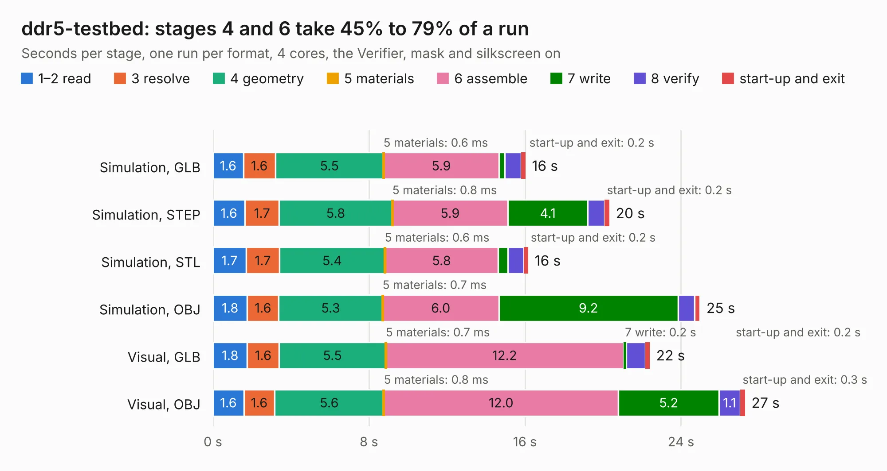

# 345. ddr5-testbed

Board 345 of the 3,129 of [Corpus Testing](../Corpus-Testing.md), on [Corpus Page 4](../CorpusTestingPages/Corpus-Testing-04.md#345-ddr5-testbed).

| Mode and format | 1–2 read | 3 resolve | 4 geometry | 5 materials | 6 assemble | 7 write | 8 verify | start-up and exit | Total |
|---|---:|---:|---:|---:|---:|---:|---:|---:|---:|
| Simulation, GLB | 1.6 | 1.6 | 5.5 | 0.6&nbsp;ms | 5.9 | 0.3 | 0.8 | 0.2 | 16.0 |
| Simulation, STEP | 1.6 | 1.7 | 5.8 | 0.8&nbsp;ms | 5.9 | 4.1 | 0.9 | 0.2 | 20.3 |
| Simulation, STL | 1.7 | 1.7 | 5.4 | 0.6&nbsp;ms | 5.8 | 0.5 | 0.8 | 0.2 | 16.2 |
| Simulation, OBJ | 1.8 | 1.6 | 5.3 | 0.7&nbsp;ms | 6.0 | 9.2 | 0.8 | 0.3 | 25.0 |
| Visual, GLB | 1.8 | 1.6 | 5.5 | 0.7&nbsp;ms | 12.2 | 0.2 | 1.0 | 0.2 | 22.4 |
| Visual, OBJ | 1.6 | 1.6 | 5.6 | 0.8&nbsp;ms | 12.0 | 5.2 | 1.1 | 0.3 | 27.3 |

<table align="center"><tr><td valign="top">

| Board | Repo: [antmicro/ddr5-testbed](https://github.com/antmicro/ddr5-testbed) Board: `ddr5-testbed.kicad_pcb` |
|---|---|
| Complexity | 379&nbsp;/&nbsp;1000 (size&nbsp;284, features&nbsp;95) |
| KESE&nbsp;features | through vias, rounded, trapezoid or chamfered pads, filled zones, copper text, curved board outline, stack-up, dielectric εr and tanδ |
| Tested | 9th November 2026 |
| Copper&nbsp;layers | 6 |
| File&nbsp;format | KiCad 9 (20241229) |
| Parts,&nbsp;tracks,&nbsp;vias | 59, 5,140, 180 |
| Triangles,&nbsp;simulation | 1,652,750 in 238 parts |
| Verifier | PASS in all six runs |

</td><td valign="top">

<table>
<tr><th>File type</th><th>File size</th><th>Peak memory used</th></tr>
<tr><th colspan="3" align="left">Simulation</th></tr>
<tr><td>GLB</td><td align="right">57&nbsp;MB</td><td align="right">655&nbsp;MB</td></tr>
<tr><td>STEP</td><td align="right">245&nbsp;MB</td><td align="right">736&nbsp;MB</td></tr>
<tr><td>STL</td><td align="right">83&nbsp;MB</td><td align="right">618&nbsp;MB</td></tr>
<tr><td>OBJ</td><td align="right">175&nbsp;MB</td><td align="right">1.2&nbsp;GB</td></tr>
<tr><th colspan="3" align="left">Visual</th></tr>
<tr><td>GLB</td><td align="right">31&nbsp;MB</td><td align="right">750&nbsp;MB</td></tr>
<tr><td>OBJ</td><td align="right">97&nbsp;MB</td><td align="right">809&nbsp;MB</td></tr>
</table>

</td></tr></table>

| Previous | Next |
|:---|---:|
| [344. ddr4-spd-breakout](b0344b_ddr4-spd-breakout-board_ddr4-spd-breakout.md) | [346. data-center-rdimm-ddr5-tester](b0346b_ddr5-tester_data-center-rdimm-ddr5-tester.md) |
