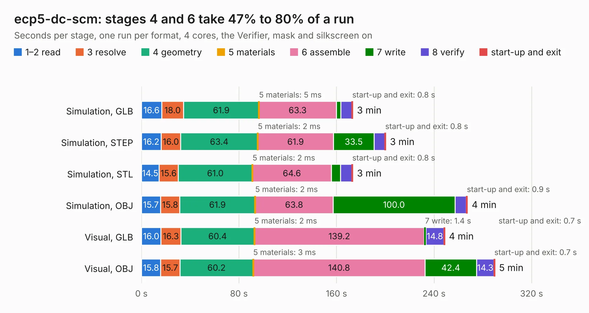

# 345. ecp5-dc-scm

Board 345 of the 3,102 of [Corpus Testing](../Corpus-Testing.md), on [Corpus Page 4](../CorpusTestingPages/Corpus-Testing-04.md#345-ecp5-dc-scm).

| Mode and format | 1–2 read | 3 resolve | 4 geometry | 5 materials | 6 assemble | 7 write | 8 verify | start-up and exit | Total |
|---|---:|---:|---:|---:|---:|---:|---:|---:|---:|
| Simulation, GLB | 16.6 | 18.0 | 61.9 | 5&nbsp;ms | 63.3 | 3.7 | 9.1 | 0.8 | 173.4 |
| Simulation, STEP | 16.2 | 16.0 | 63.4 | 2&nbsp;ms | 61.9 | 33.5 | 8.7 | 0.8 | 200.4 |
| Simulation, STL | 14.5 | 15.6 | 61.0 | 2&nbsp;ms | 64.6 | 7.6 | 9.2 | 0.8 | 173.4 |
| Simulation, OBJ | 15.7 | 15.8 | 61.9 | 2&nbsp;ms | 63.8 | 100.0 | 9.4 | 0.9 | 267.5 |
| Visual, GLB | 16.0 | 16.3 | 60.4 | 2&nbsp;ms | 139.2 | 1.4 | 14.8 | 0.7 | 248.8 |
| Visual, OBJ | 15.8 | 15.7 | 60.2 | 3&nbsp;ms | 140.8 | 42.4 | 14.3 | 0.7 | 289.8 |

<table align="center"><tr><td valign="top">

| Board | Repo: [antmicro/ecp5-dc-scm](https://github.com/antmicro/ecp5-dc-scm) Board: `ecp5-dc-scm.kicad_pcb` |
|---|---|
| Complexity | 508&nbsp;/&nbsp;1000 (size&nbsp;343, features&nbsp;165) |
| KESE&nbsp;features | through vias, blind and buried vias, custom pads, rounded, trapezoid or chamfered pads, filled zones, copper drawings, copper text, curved board outline, stack-up, dielectric εr and tanδ, mask and silkscreen colours |
| Tested | 9th November 2026 |
| Copper&nbsp;layers | 8 |
| File&nbsp;format | KiCad 7 (20221018) |
| Parts,&nbsp;tracks,&nbsp;vias | 488, 12,884, 1,545 |
| Triangles,&nbsp;simulation | 13,991,872 in 803 parts |
| Verifier | PASS in all six runs |

</td><td valign="top">

<table>
<tr><th>File type</th><th>File size</th><th>Peak memory used</th></tr>
<tr><th colspan="3" align="left">Simulation</th></tr>
<tr><td>GLB</td><td align="right">480&nbsp;MB</td><td align="right">3.1&nbsp;GB</td></tr>
<tr><td>STEP</td><td align="right">1.8&nbsp;GB</td><td align="right">4.6&nbsp;GB</td></tr>
<tr><td>STL</td><td align="right">700&nbsp;MB</td><td align="right">3.4&nbsp;GB</td></tr>
<tr><td>OBJ</td><td align="right">1.5&nbsp;GB</td><td align="right">9.2&nbsp;GB</td></tr>
<tr><th colspan="3" align="left">Visual</th></tr>
<tr><td>GLB</td><td align="right">231&nbsp;MB</td><td align="right">4.2&nbsp;GB</td></tr>
<tr><td>OBJ</td><td align="right">763&nbsp;MB</td><td align="right">5.5&nbsp;GB</td></tr>
</table>

</td></tr></table>

| Previous | Next |
|:---|---:|
| [344. dual-ipex-csi-interposer](b0344b_dual-ipex-csi-interposer_dual-ipex-csi-interposer.md) | [346. environment-sensor](b0346b_environment-sensor_environment-sensor.md) |
