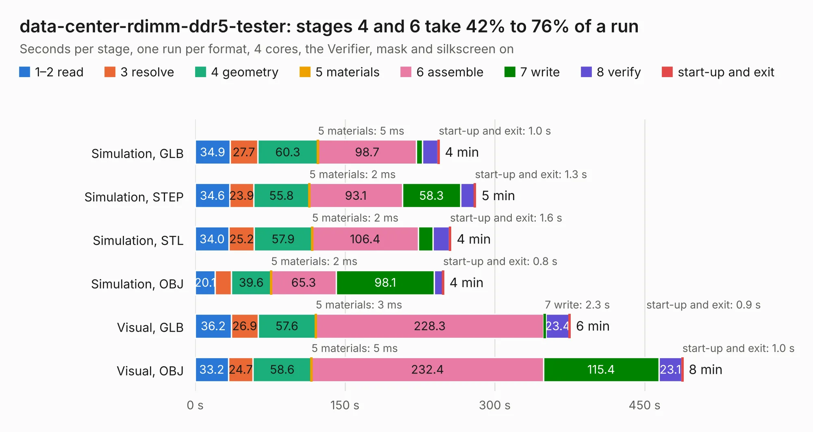

# 346. data-center-rdimm-ddr5-tester

Board 346 of the 3,118 of [Corpus Testing](../Corpus-Testing.md), on [Corpus Page 4](../CorpusTestingPages/Corpus-Testing-04.md#346-data-center-rdimm-ddr5-tester).

| Mode and format | 1–2 read | 3 resolve | 4 geometry | 5 materials | 6 assemble | 7 write | 8 verify | start-up and exit | Total |
|---|---:|---:|---:|---:|---:|---:|---:|---:|---:|
| Simulation, GLB | 34.9 | 27.7 | 60.3 | 5&nbsp;ms | 98.7 | 5.8 | 15.7 | 1.0 | 244.2 |
| Simulation, STEP | 34.6 | 23.9 | 55.8 | 2&nbsp;ms | 93.1 | 58.3 | 13.8 | 1.3 | 280.9 |
| Simulation, STL | 34.0 | 25.2 | 57.9 | 2&nbsp;ms | 106.4 | 14.7 | 16.3 | 1.6 | 256.0 |
| Simulation, OBJ | 20.1 | 16.2 | 39.6 | 2&nbsp;ms | 65.3 | 98.1 | 8.5 | 0.8 | 248.7 |
| Visual, GLB | 36.2 | 26.9 | 57.6 | 3&nbsp;ms | 228.3 | 2.3 | 23.4 | 0.9 | 375.5 |
| Visual, OBJ | 33.2 | 24.7 | 58.6 | 5&nbsp;ms | 232.4 | 115.4 | 23.1 | 1.0 | 488.4 |

<table align="center"><tr><td valign="top">

| Board | Repo: [antmicro/ddr5-tester](https://github.com/antmicro/ddr5-tester) Board: `data-center-rdimm-ddr5-tester.kicad_pcb` |
|---|---|
| Complexity | 560&nbsp;/&nbsp;1000 (size&nbsp;365, features&nbsp;195) |
| KESE&nbsp;features | through vias, slotted holes, custom pads, rounded, trapezoid or chamfered pads, arc tracks, filled zones, copper drawings, copper text, curved board outline, knockout text, TrueType text, stack-up, dielectric εr and tanδ, copper finish, mask and silkscreen colours |
| Tested | 9th November 2026 to 10th November 2026 |
| Copper&nbsp;layers | 12 |
| File&nbsp;format | KiCad 9 (20241229) |
| Parts,&nbsp;tracks,&nbsp;vias | 761, 19,710, 2,625 |
| Triangles,&nbsp;simulation | 22,023,050 in 849 parts |
| Verifier | PASS in all six runs |
| Run&nbsp;again | Simulation, OBJ: failed in the corpus run, run again with the memory cap raised from 11 GB to 14.5 GB, and passed |

</td><td valign="top">

<table>
<tr><th>File type</th><th>File size</th><th>Peak memory used</th></tr>
<tr><th colspan="3" align="left">Simulation</th></tr>
<tr><td>GLB</td><td align="right">698&nbsp;MB</td><td align="right">6.0&nbsp;GB</td></tr>
<tr><td>STEP</td><td align="right">2.2&nbsp;GB</td><td align="right">6.9&nbsp;GB</td></tr>
<tr><td>STL</td><td align="right">1.1&nbsp;GB</td><td align="right">5.9&nbsp;GB</td></tr>
<tr><td>OBJ</td><td align="right">2.4&nbsp;GB</td><td align="right">14&nbsp;GB</td></tr>
<tr><th colspan="3" align="left">Visual</th></tr>
<tr><td>GLB</td><td align="right">361&nbsp;MB</td><td align="right">6.7&nbsp;GB</td></tr>
<tr><td>OBJ</td><td align="right">1.2&nbsp;GB</td><td align="right">8.2&nbsp;GB</td></tr>
</table>

</td></tr></table>

| Previous | Next |
|:---|---:|
| [345. ddr5-testbed](b0345b_ddr5-testbed_ddr5-testbed.md) | [347. dual-camera-to-gmsl-serializer-csi-adapter](b0347b_dual-gmsl-serializer-adapter_dual-camera-to-gmsl-serializer-csi-adapter.md) |
