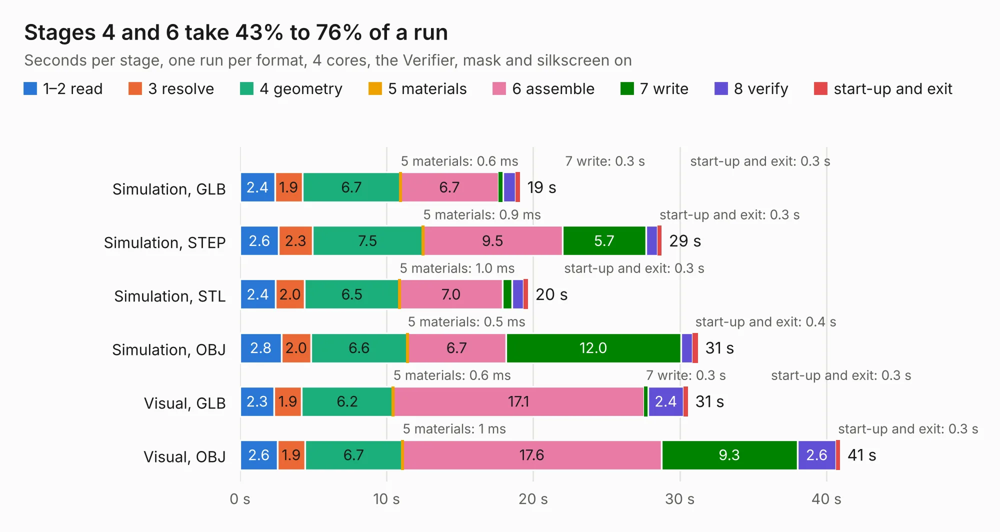

# 348 dual-camera-to-gmsl-serializer-csi-adapter

Board 348 of the 3,138 of [Corpus Testing](../Corpus-Testing.md), on [Corpus Page 4](../CorpusTestingPages/Corpus-Testing-04.md#348-dual-camera-to-gmsl-serializer-csi-adapter).

| Mode and format | 1–2 read | 3 resolve | 4 geometry | 5 materials | 6 assemble | 7 write | 8 verify | start-up and exit | Total |
|---|---:|---:|---:|---:|---:|---:|---:|---:|---:|
| Simulation, GLB | 2.4 | 1.9 | 6.7 | 0.6&nbsp;ms | 6.7 | 0.3 | 0.8 | 0.3 | 19.1 |
| Simulation, STEP | 2.6 | 2.3 | 7.5 | 0.9&nbsp;ms | 9.5 | 5.7 | 0.8 | 0.3 | 28.8 |
| Simulation, STL | 2.4 | 2.0 | 6.5 | 1.0&nbsp;ms | 7.0 | 0.6 | 0.8 | 0.3 | 19.7 |
| Simulation, OBJ | 2.8 | 2.0 | 6.6 | 0.5&nbsp;ms | 6.7 | 12.0 | 0.8 | 0.4 | 31.2 |
| Visual, GLB | 2.3 | 1.9 | 6.2 | 0.6&nbsp;ms | 17.1 | 0.3 | 2.4 | 0.3 | 30.6 |
| Visual, OBJ | 2.6 | 1.9 | 6.7 | 1&nbsp;ms | 17.6 | 9.3 | 2.6 | 0.3 | 40.9 |

<table align="center"><tr><td valign="top">

| Board | Repo: [antmicro/dual-gmsl-serializer-adapter](https://github.com/antmicro/dual-gmsl-serializer-adapter) Board: `dual-camera-to-gmsl-serializer-csi-adapter.kicad_pcb` |
|---|---|
| Complexity | 357&nbsp;/&nbsp;1000 (size&nbsp;212, features&nbsp;145) |
| KESE&nbsp;features | through vias, custom pads, rounded, trapezoid or chamfered pads, arc tracks, filled zones, copper drawings, copper text, knockout text, stack-up, dielectric εr and tanδ, mask and silkscreen colours |
| Tested | 9th November 2026 |
| Copper&nbsp;layers | 4 |
| File&nbsp;format | KiCad 8 (20240108) |
| Parts,&nbsp;tracks,&nbsp;vias | 95, 1,730, 289 |
| Triangles,&nbsp;simulation | 1,904,014 in 141 parts |
| Verifier | PASS in all six runs |

</td><td valign="top">

<table>
<tr><th>File type</th><th>File size</th><th>Peak memory used</th></tr>
<tr><th colspan="3" align="left">Simulation</th></tr>
<tr><td>GLB</td><td align="right">66&nbsp;MB</td><td align="right">850&nbsp;MB</td></tr>
<tr><td>STEP</td><td align="right">246&nbsp;MB</td><td align="right">891&nbsp;MB</td></tr>
<tr><td>STL</td><td align="right">95&nbsp;MB</td><td align="right">836&nbsp;MB</td></tr>
<tr><td>OBJ</td><td align="right">202&nbsp;MB</td><td align="right">1.4&nbsp;GB</td></tr>
<tr><th colspan="3" align="left">Visual</th></tr>
<tr><td>GLB</td><td align="right">48&nbsp;MB</td><td align="right">911&nbsp;MB</td></tr>
<tr><td>OBJ</td><td align="right">150&nbsp;MB</td><td align="right">1.1&nbsp;GB</td></tr>
</table>

</td></tr></table>

| Previous | Next |
|:---|---:|
| [347 data-center-rdimm-ddr5-tester](b0347b_ddr5-tester_data-center-rdimm-ddr5-tester.md) | [349 dual-ipex-csi-interposer](b0349b_dual-ipex-csi-interposer_dual-ipex-csi-interposer.md) |
