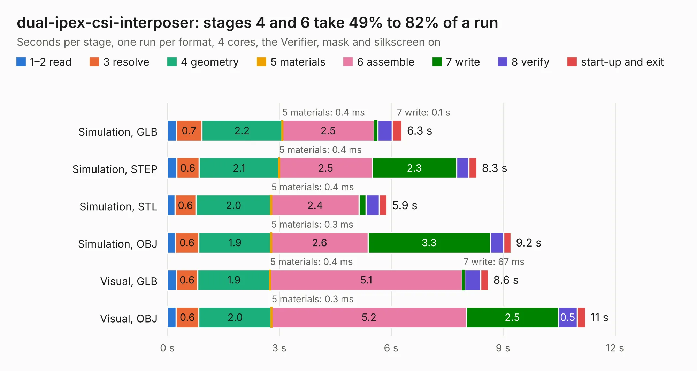

# 348. dual-ipex-csi-interposer

Board 348 of the 3,123 of [Corpus Testing](../Corpus-Testing.md), on [Corpus Page 4](../CorpusTestingPages/Corpus-Testing-04.md#348-dual-ipex-csi-interposer).

| Mode and format | 1–2 read | 3 resolve | 4 geometry | 5 materials | 6 assemble | 7 write | 8 verify | start-up and exit | Total |
|---|---:|---:|---:|---:|---:|---:|---:|---:|---:|
| Simulation, GLB | 0.2 | 0.7 | 2.2 | 0.4&nbsp;ms | 2.5 | 0.1 | 0.4 | 0.3 | 6.3 |
| Simulation, STEP | 0.3 | 0.6 | 2.1 | 0.4&nbsp;ms | 2.5 | 2.3 | 0.3 | 0.2 | 8.3 |
| Simulation, STL | 0.2 | 0.6 | 2.0 | 0.4&nbsp;ms | 2.4 | 0.2 | 0.4 | 0.2 | 5.9 |
| Simulation, OBJ | 0.2 | 0.6 | 1.9 | 0.3&nbsp;ms | 2.6 | 3.3 | 0.4 | 0.2 | 9.2 |
| Visual, GLB | 0.2 | 0.6 | 1.9 | 0.4&nbsp;ms | 5.1 | 67&nbsp;ms | 0.4 | 0.2 | 8.6 |
| Visual, OBJ | 0.2 | 0.6 | 2.0 | 0.3&nbsp;ms | 5.2 | 2.5 | 0.5 | 0.2 | 11.2 |

<table align="center"><tr><td valign="top">

| Board | Repo: [antmicro/dual-ipex-csi-interposer](https://github.com/antmicro/dual-ipex-csi-interposer) Board: `dual-ipex-csi-interposer.kicad_pcb` |
|---|---|
| Complexity | 267&nbsp;/&nbsp;1000 (size&nbsp;172, features&nbsp;95) |
| KESE&nbsp;features | through vias, rounded, trapezoid or chamfered pads, filled zones, copper text, curved board outline, stack-up, dielectric εr and tanδ |
| Tested | 9th November 2026 |
| Copper&nbsp;layers | 4 |
| File&nbsp;format | KiCad 6 (20211014) |
| Parts,&nbsp;tracks,&nbsp;vias | 13, 511, 107 |
| Triangles,&nbsp;simulation | 645,608 in 69 parts |
| Verifier | PASS in all six runs |

</td><td valign="top">

<table>
<tr><th>File type</th><th>File size</th><th>Peak memory used</th></tr>
<tr><th colspan="3" align="left">Simulation</th></tr>
<tr><td>GLB</td><td align="right">22&nbsp;MB</td><td align="right">348&nbsp;MB</td></tr>
<tr><td>STEP</td><td align="right">103&nbsp;MB</td><td align="right">417&nbsp;MB</td></tr>
<tr><td>STL</td><td align="right">32&nbsp;MB</td><td align="right">350&nbsp;MB</td></tr>
<tr><td>OBJ</td><td align="right">65&nbsp;MB</td><td align="right">479&nbsp;MB</td></tr>
<tr><th colspan="3" align="left">Visual</th></tr>
<tr><td>GLB</td><td align="right">15&nbsp;MB</td><td align="right">457&nbsp;MB</td></tr>
<tr><td>OBJ</td><td align="right">45&nbsp;MB</td><td align="right">455&nbsp;MB</td></tr>
</table>

</td></tr></table>

| Previous | Next |
|:---|---:|
| [347. dual-camera-to-gmsl-serializer-csi-adapter](b0347b_dual-gmsl-serializer-adapter_dual-camera-to-gmsl-serializer-csi-adapter.md) | [349. ecp5-dc-scm](b0349b_ecp5-dc-scm_ecp5-dc-scm.md) |
