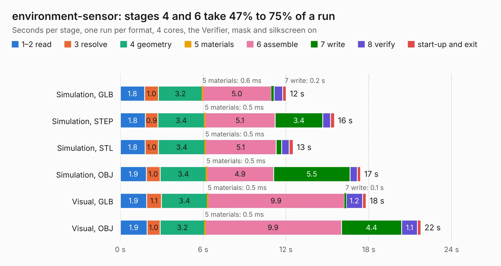

# 350. environment-sensor

Board 350 of the 3,123 of [Corpus Testing](../Corpus-Testing.md), on [Corpus Page 4](../CorpusTestingPages/Corpus-Testing-04.md#350-environment-sensor).

| Mode and format | 1–2 read | 3 resolve | 4 geometry | 5 materials | 6 assemble | 7 write | 8 verify | start-up and exit | Total |
|---|---:|---:|---:|---:|---:|---:|---:|---:|---:|
| Simulation, GLB | 1.8 | 1.0 | 3.2 | 0.6&nbsp;ms | 5.0 | 0.2 | 0.6 | 0.3 | 12.0 |
| Simulation, STEP | 1.8 | 0.9 | 3.4 | 0.5&nbsp;ms | 5.1 | 3.4 | 0.6 | 0.3 | 15.5 |
| Simulation, STL | 1.8 | 1.0 | 3.4 | 0.5&nbsp;ms | 5.1 | 0.4 | 0.5 | 0.3 | 12.5 |
| Simulation, OBJ | 1.9 | 1.0 | 3.4 | 0.5&nbsp;ms | 4.9 | 5.5 | 0.5 | 0.2 | 17.4 |
| Visual, GLB | 1.9 | 1.1 | 3.4 | 0.5&nbsp;ms | 9.9 | 0.1 | 1.2 | 0.3 | 17.8 |
| Visual, OBJ | 1.9 | 1.0 | 3.2 | 0.5&nbsp;ms | 9.9 | 4.4 | 1.1 | 0.2 | 21.8 |

<table align="center"><tr><td valign="top">

| Board | Repo: [antmicro/environment-sensor](https://github.com/antmicro/environment-sensor) Board: `environment-sensor.kicad_pcb` |
|---|---|
| Complexity | 341&nbsp;/&nbsp;1000 (size&nbsp;246, features&nbsp;95) |
| KESE&nbsp;features | through vias, slotted holes, rounded, trapezoid or chamfered pads, filled zones, curved board outline, stack-up, dielectric εr and tanδ |
| Tested | 9th November 2026 |
| Copper&nbsp;layers | 4 |
| File&nbsp;format | KiCad 9 (20241229) |
| Parts,&nbsp;tracks,&nbsp;vias | 92, 863, 144 |
| Triangles,&nbsp;simulation | 1,221,012 in 105 parts |
| Verifier | PASS in all six runs |

</td><td valign="top">

<table>
<tr><th>File type</th><th>File size</th><th>Peak memory used</th></tr>
<tr><th colspan="3" align="left">Simulation</th></tr>
<tr><td>GLB</td><td align="right">42&nbsp;MB</td><td align="right">559&nbsp;MB</td></tr>
<tr><td>STEP</td><td align="right">208&nbsp;MB</td><td align="right">681&nbsp;MB</td></tr>
<tr><td>STL</td><td align="right">61&nbsp;MB</td><td align="right">555&nbsp;MB</td></tr>
<tr><td>OBJ</td><td align="right">126&nbsp;MB</td><td align="right">890&nbsp;MB</td></tr>
<tr><th colspan="3" align="left">Visual</th></tr>
<tr><td>GLB</td><td align="right">30&nbsp;MB</td><td align="right">803&nbsp;MB</td></tr>
<tr><td>OBJ</td><td align="right">91&nbsp;MB</td><td align="right">793&nbsp;MB</td></tr>
</table>

</td></tr></table>

| Previous | Next |
|:---|---:|
| [349. ecp5-dc-scm](b0349b_ecp5-dc-scm_ecp5-dc-scm.md) | [351. environment-sensor-sip-baseboard](b0351b_environment-sensor-myra-baseboard_environment-sensor-sip-baseboard.md) |
