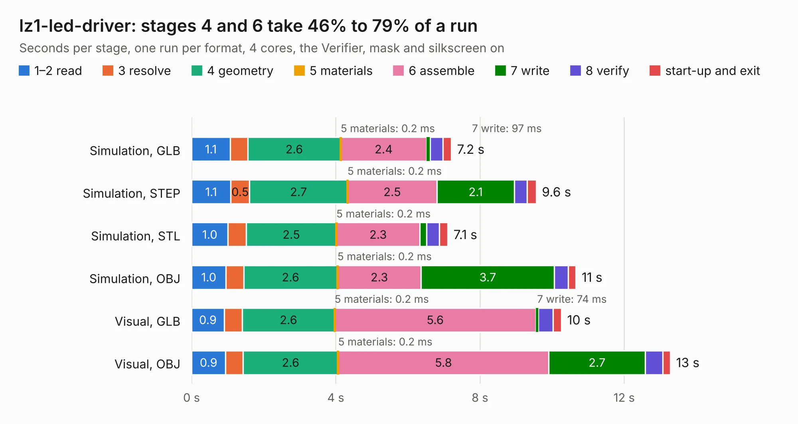

# 350. lz1-led-driver

Board 350 of the 3,116 of [Corpus Testing](../Corpus-Testing.md), on [Corpus Page 4](../CorpusTestingPages/Corpus-Testing-04.md#350-lz1-led-driver).

| Mode and format | 1–2 read | 3 resolve | 4 geometry | 5 materials | 6 assemble | 7 write | 8 verify | start-up and exit | Total |
|---|---:|---:|---:|---:|---:|---:|---:|---:|---:|
| Simulation, GLB | 1.1 | 0.5 | 2.6 | 0.2&nbsp;ms | 2.4 | 97&nbsp;ms | 0.4 | 0.2 | 7.2 |
| Simulation, STEP | 1.1 | 0.5 | 2.7 | 0.2&nbsp;ms | 2.5 | 2.1 | 0.4 | 0.3 | 9.6 |
| Simulation, STL | 1.0 | 0.5 | 2.5 | 0.2&nbsp;ms | 2.3 | 0.2 | 0.4 | 0.2 | 7.1 |
| Simulation, OBJ | 1.0 | 0.5 | 2.6 | 0.2&nbsp;ms | 2.3 | 3.7 | 0.4 | 0.2 | 10.7 |
| Visual, GLB | 0.9 | 0.5 | 2.6 | 0.2&nbsp;ms | 5.6 | 74&nbsp;ms | 0.4 | 0.2 | 10.3 |
| Visual, OBJ | 0.9 | 0.5 | 2.6 | 0.2&nbsp;ms | 5.8 | 2.7 | 0.5 | 0.2 | 13.3 |

<table align="center"><tr><td valign="top">

| Board | Repo: [antmicro/flickerless-led-driver](https://github.com/antmicro/flickerless-led-driver) Board: `lz1-led-driver.kicad_pcb` |
|---|---|
| Complexity | 253&nbsp;/&nbsp;1000 (size&nbsp;158, features&nbsp;95) |
| KESE&nbsp;features | through vias, slotted holes, rounded, trapezoid or chamfered pads, filled zones, copper text, stack-up, dielectric εr and tanδ |
| Tested | 9th November 2026 |
| Copper&nbsp;layers | 2 |
| File&nbsp;format | KiCad 7 (20221018) |
| Parts,&nbsp;tracks,&nbsp;vias | 41, 161, 101 |
| Triangles,&nbsp;simulation | 675,574 in 39 parts |
| Verifier | PASS in all six runs |

</td><td valign="top">

<table>
<tr><th>File type</th><th>File size</th><th>Peak memory used</th></tr>
<tr><th colspan="3" align="left">Simulation</th></tr>
<tr><td>GLB</td><td align="right">23&nbsp;MB</td><td align="right">391&nbsp;MB</td></tr>
<tr><td>STEP</td><td align="right">135&nbsp;MB</td><td align="right">447&nbsp;MB</td></tr>
<tr><td>STL</td><td align="right">34&nbsp;MB</td><td align="right">391&nbsp;MB</td></tr>
<tr><td>OBJ</td><td align="right">69&nbsp;MB</td><td align="right">512&nbsp;MB</td></tr>
<tr><th colspan="3" align="left">Visual</th></tr>
<tr><td>GLB</td><td align="right">16&nbsp;MB</td><td align="right">460&nbsp;MB</td></tr>
<tr><td>OBJ</td><td align="right">49&nbsp;MB</td><td align="right">490&nbsp;MB</td></tr>
</table>

</td></tr></table>

| Previous | Next |
|:---|---:|
| [349. environment-sensor-sip-baseboard](b0349b_environment-sensor-myra-baseboard_environment-sensor-sip-baseboard.md) | [351. fmc2sata](b0351b_fmc-sata-adapter_fmc2sata.md) |
