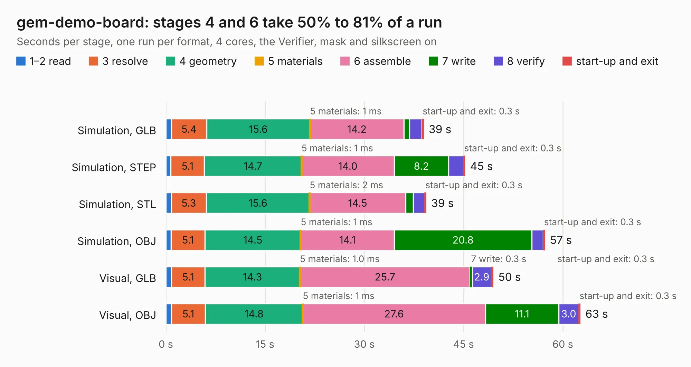

# 351. gem-demo-board

Board 351 of the 3,101 of [Corpus Testing](../Corpus-Testing.md), on [Corpus Page 4](../CorpusTestingPages/Corpus-Testing-04.md#351-gem-demo-board).

| Mode and format | 1–2 read | 3 resolve | 4 geometry | 5 materials | 6 assemble | 7 write | 8 verify | start-up and exit | Total |
|---|---:|---:|---:|---:|---:|---:|---:|---:|---:|
| Simulation, GLB | 0.8 | 5.4 | 15.6 | 1&nbsp;ms | 14.2 | 0.8 | 1.8 | 0.3 | 39.0 |
| Simulation, STEP | 0.7 | 5.1 | 14.7 | 1&nbsp;ms | 14.0 | 8.2 | 2.2 | 0.3 | 45.2 |
| Simulation, STL | 0.8 | 5.3 | 15.6 | 2&nbsp;ms | 14.5 | 1.2 | 1.7 | 0.3 | 39.4 |
| Simulation, OBJ | 0.8 | 5.1 | 14.5 | 1&nbsp;ms | 14.1 | 20.8 | 1.7 | 0.3 | 57.3 |
| Visual, GLB | 0.8 | 5.1 | 14.3 | 1.0&nbsp;ms | 25.7 | 0.3 | 2.9 | 0.3 | 49.5 |
| Visual, OBJ | 0.8 | 5.1 | 14.8 | 1&nbsp;ms | 27.6 | 11.1 | 3.0 | 0.3 | 62.7 |

<table align="center"><tr><td valign="top">

| Board | Repo: [antmicro/gem-baseboard](https://github.com/antmicro/gem-baseboard) Board: `gem-demo-board.kicad_pcb` |
|---|---|
| Complexity | 290&nbsp;/&nbsp;1000 (size&nbsp;235, features&nbsp;55) |
| KESE&nbsp;features | through vias, rounded, trapezoid or chamfered pads, filled zones, copper text |
| Tested | 9th November 2026 |
| Copper&nbsp;layers | 6 |
| File&nbsp;format | KiCad 5 (20171130) |
| Parts,&nbsp;tracks,&nbsp;vias | 122, 3,756, 417 |
| Triangles,&nbsp;simulation | 3,761,442 in 229 parts |
| Verifier | PASS in all six runs |

</td><td valign="top">

<table>
<tr><th>File type</th><th>File size</th><th>Peak memory used</th></tr>
<tr><th colspan="3" align="left">Simulation</th></tr>
<tr><td>GLB</td><td align="right">130&nbsp;MB</td><td align="right">988&nbsp;MB</td></tr>
<tr><td>STEP</td><td align="right">482&nbsp;MB</td><td align="right">1.2&nbsp;GB</td></tr>
<tr><td>STL</td><td align="right">188&nbsp;MB</td><td align="right">954&nbsp;MB</td></tr>
<tr><td>OBJ</td><td align="right">403&nbsp;MB</td><td align="right">2.5&nbsp;GB</td></tr>
<tr><th colspan="3" align="left">Visual</th></tr>
<tr><td>GLB</td><td align="right">64&nbsp;MB</td><td align="right">1.3&nbsp;GB</td></tr>
<tr><td>OBJ</td><td align="right">206&nbsp;MB</td><td align="right">1.5&nbsp;GB</td></tr>
</table>

</td></tr></table>

| Previous | Next |
|:---|---:|
| [350. framos-csi-adapter](b0350b_framos-csi-adapter_framos-csi-adapter.md) | [352. zglue-gem1-adapter](b0352b_gem1-adapter_zglue-gem1-adapter.md) |
