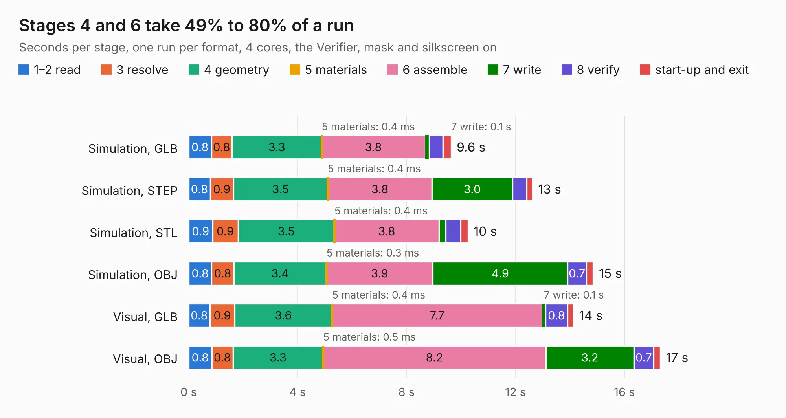

# 352. environment-sensor-sip-baseboard

Board 352 of the 3,131 of [Corpus Testing](../Corpus-Testing.md), on [Corpus Page 4](../CorpusTestingPages/Corpus-Testing-04.md#352-environment-sensor-sip-baseboard).

| Mode and format | 1–2 read | 3 resolve | 4 geometry | 5 materials | 6 assemble | 7 write | 8 verify | start-up and exit | Total |
|---|---:|---:|---:|---:|---:|---:|---:|---:|---:|
| Simulation, GLB | 0.8 | 0.8 | 3.3 | 0.4&nbsp;ms | 3.8 | 0.1 | 0.5 | 0.3 | 9.6 |
| Simulation, STEP | 0.8 | 0.9 | 3.5 | 0.4&nbsp;ms | 3.8 | 3.0 | 0.5 | 0.2 | 12.6 |
| Simulation, STL | 0.9 | 0.9 | 3.5 | 0.4&nbsp;ms | 3.8 | 0.2 | 0.6 | 0.3 | 10.3 |
| Simulation, OBJ | 0.8 | 0.8 | 3.4 | 0.3&nbsp;ms | 3.9 | 4.9 | 0.7 | 0.3 | 14.9 |
| Visual, GLB | 0.8 | 0.9 | 3.6 | 0.4&nbsp;ms | 7.7 | 0.1 | 0.8 | 0.2 | 14.1 |
| Visual, OBJ | 0.8 | 0.8 | 3.3 | 0.5&nbsp;ms | 8.2 | 3.2 | 0.7 | 0.2 | 17.3 |

<table align="center"><tr><td valign="top">

| Board | Repo: [antmicro/environment-sensor-myra-baseboard](https://github.com/antmicro/environment-sensor-myra-baseboard) Board: `environment-sensor-sip-baseboard.kicad_pcb` |
|---|---|
| Complexity | 372&nbsp;/&nbsp;1000 (size&nbsp;232, features&nbsp;140) |
| KESE&nbsp;features | through vias, slotted holes, rounded, trapezoid or chamfered pads, arc tracks, filled zones, copper text, curved board outline, knockout text, stack-up, dielectric εr and tanδ, mask and silkscreen colours |
| Tested | 9th November 2026 |
| Copper&nbsp;layers | 4 |
| File&nbsp;format | KiCad 7 (20221018) |
| Parts,&nbsp;tracks,&nbsp;vias | 33, 434, 106 |
| Triangles,&nbsp;simulation | 824,680 in 64 parts |
| Verifier | PASS in all six runs |

</td><td valign="top">

<table>
<tr><th>File type</th><th>File size</th><th>Peak memory used</th></tr>
<tr><th colspan="3" align="left">Simulation</th></tr>
<tr><td>GLB</td><td align="right">28&nbsp;MB</td><td align="right">410&nbsp;MB</td></tr>
<tr><td>STEP</td><td align="right">133&nbsp;MB</td><td align="right">482&nbsp;MB</td></tr>
<tr><td>STL</td><td align="right">41&nbsp;MB</td><td align="right">407&nbsp;MB</td></tr>
<tr><td>OBJ</td><td align="right">84&nbsp;MB</td><td align="right">636&nbsp;MB</td></tr>
<tr><th colspan="3" align="left">Visual</th></tr>
<tr><td>GLB</td><td align="right">19&nbsp;MB</td><td align="right">545&nbsp;MB</td></tr>
<tr><td>OBJ</td><td align="right">58&nbsp;MB</td><td align="right">550&nbsp;MB</td></tr>
</table>

</td></tr></table>

| Previous | Next |
|:---|---:|
| [351. environment-sensor](b0351b_environment-sensor_environment-sensor.md) | [353. lz1-led-driver](b0353b_flickerless-led-driver_lz1-led-driver.md) |
