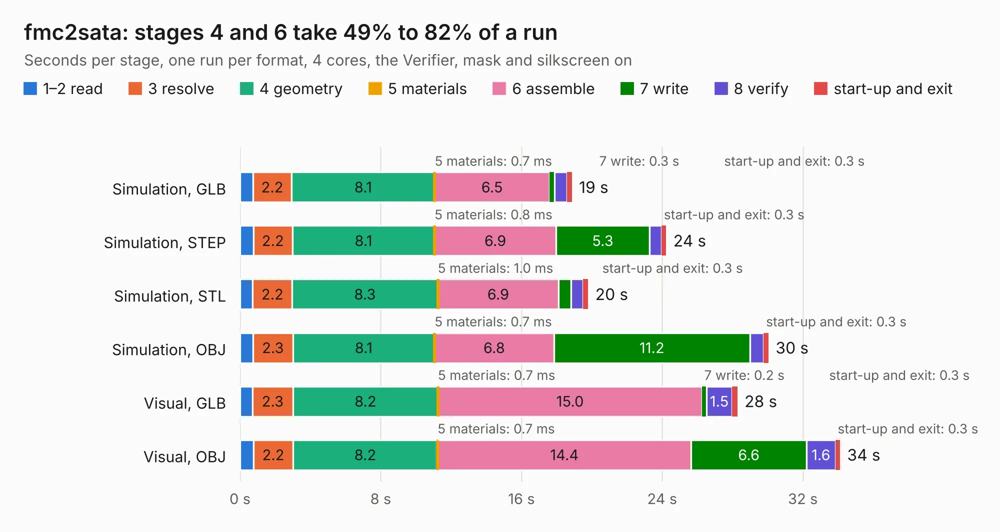

# 353. fmc2sata

Board 353 of the 3,128 of [Corpus Testing](../Corpus-Testing.md), on [Corpus Page 4](../CorpusTestingPages/Corpus-Testing-04.md#353-fmc2sata).

| Mode and format | 1–2 read | 3 resolve | 4 geometry | 5 materials | 6 assemble | 7 write | 8 verify | start-up and exit | Total |
|---|---:|---:|---:|---:|---:|---:|---:|---:|---:|
| Simulation, GLB | 0.7 | 2.2 | 8.1 | 0.7&nbsp;ms | 6.5 | 0.3 | 0.7 | 0.3 | 18.9 |
| Simulation, STEP | 0.8 | 2.2 | 8.1 | 0.8&nbsp;ms | 6.9 | 5.3 | 0.7 | 0.3 | 24.2 |
| Simulation, STL | 0.7 | 2.2 | 8.3 | 1.0&nbsp;ms | 6.9 | 0.7 | 0.7 | 0.3 | 19.8 |
| Simulation, OBJ | 0.7 | 2.3 | 8.1 | 0.7&nbsp;ms | 6.8 | 11.2 | 0.8 | 0.3 | 30.0 |
| Visual, GLB | 0.7 | 2.3 | 8.2 | 0.7&nbsp;ms | 15.0 | 0.2 | 1.5 | 0.3 | 28.3 |
| Visual, OBJ | 0.8 | 2.2 | 8.2 | 0.7&nbsp;ms | 14.4 | 6.6 | 1.6 | 0.3 | 34.1 |

<table align="center"><tr><td valign="top">

| Board | Repo: [antmicro/fmc-sata-adapter](https://github.com/antmicro/fmc-sata-adapter) Board: `fmc2sata.kicad_pcb` |
|---|---|
| Complexity | 253&nbsp;/&nbsp;1000 (size&nbsp;198, features&nbsp;55) |
| KESE&nbsp;features | through vias, rounded, trapezoid or chamfered pads, filled zones, copper text |
| Tested | 9th November 2026 |
| Copper&nbsp;layers | 4 |
| File&nbsp;format | KiCad 5 (20171130) |
| Parts,&nbsp;tracks,&nbsp;vias | 59, 769, 258 |
| Triangles,&nbsp;simulation | 1,824,356 in 179 parts |
| Verifier | PASS in all six runs |

</td><td valign="top">

<table>
<tr><th>File type</th><th>File size</th><th>Peak memory used</th></tr>
<tr><th colspan="3" align="left">Simulation</th></tr>
<tr><td>GLB</td><td align="right">63&nbsp;MB</td><td align="right">888&nbsp;MB</td></tr>
<tr><td>STEP</td><td align="right">287&nbsp;MB</td><td align="right">891&nbsp;MB</td></tr>
<tr><td>STL</td><td align="right">91&nbsp;MB</td><td align="right">821&nbsp;MB</td></tr>
<tr><td>OBJ</td><td align="right">193&nbsp;MB</td><td align="right">1.3&nbsp;GB</td></tr>
<tr><th colspan="3" align="left">Visual</th></tr>
<tr><td>GLB</td><td align="right">39&nbsp;MB</td><td align="right">865&nbsp;MB</td></tr>
<tr><td>OBJ</td><td align="right">119&nbsp;MB</td><td align="right">887&nbsp;MB</td></tr>
</table>

</td></tr></table>

| Previous | Next |
|:---|---:|
| [352. lz1-led-driver](b0352b_flickerless-led-driver_lz1-led-driver.md) | [354. framos-csi-adapter](b0354b_framos-csi-adapter_framos-csi-adapter.md) |
