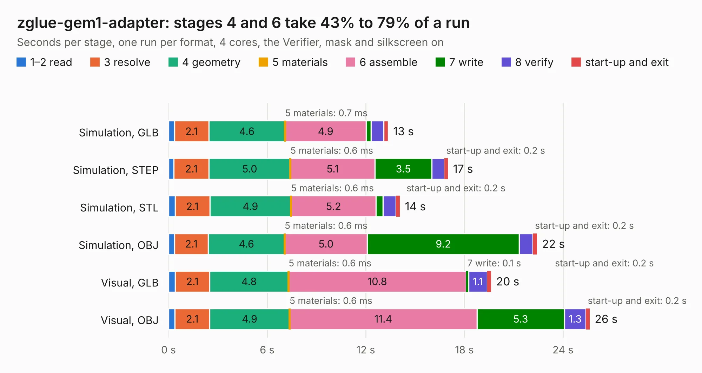

# 353. zglue-gem1-adapter

Board 353 of the 3,103 of [Corpus Testing](../Corpus-Testing.md), on [Corpus Page 4](../CorpusTestingPages/Corpus-Testing-04.md#353-zglue-gem1-adapter).

| Mode and format | 1–2 read | 3 resolve | 4 geometry | 5 materials | 6 assemble | 7 write | 8 verify | start-up and exit | Total |
|---|---:|---:|---:|---:|---:|---:|---:|---:|---:|
| Simulation, GLB | 0.4 | 2.1 | 4.6 | 0.7&nbsp;ms | 4.9 | 0.3 | 0.8 | 0.3 | 13.4 |
| Simulation, STEP | 0.3 | 2.1 | 5.0 | 0.6&nbsp;ms | 5.1 | 3.5 | 0.8 | 0.2 | 17.0 |
| Simulation, STL | 0.4 | 2.1 | 4.9 | 0.6&nbsp;ms | 5.2 | 0.4 | 0.8 | 0.2 | 14.1 |
| Simulation, OBJ | 0.4 | 2.1 | 4.6 | 0.6&nbsp;ms | 5.0 | 9.2 | 0.8 | 0.2 | 22.4 |
| Visual, GLB | 0.4 | 2.1 | 4.8 | 0.6&nbsp;ms | 10.8 | 0.1 | 1.1 | 0.2 | 19.6 |
| Visual, OBJ | 0.4 | 2.1 | 4.9 | 0.6&nbsp;ms | 11.4 | 5.3 | 1.3 | 0.2 | 25.6 |

<table align="center"><tr><td valign="top">

| Board | Repo: [antmicro/gem1-adapter](https://github.com/antmicro/gem1-adapter) Board: `zglue-gem1-adapter.kicad_pcb` |
|---|---|
| Complexity | 315&nbsp;/&nbsp;1000 (size&nbsp;270, features&nbsp;45) |
| KESE&nbsp;features | through vias, rounded, trapezoid or chamfered pads, filled zones |
| Tested | 9th November 2026 |
| Copper&nbsp;layers | 6 |
| File&nbsp;format | KiCad 5 (20171130) |
| Parts,&nbsp;tracks,&nbsp;vias | 44, 2,794, 221 |
| Triangles,&nbsp;simulation | 1,631,130 in 133 parts |
| Verifier | PASS in all six runs |

</td><td valign="top">

<table>
<tr><th>File type</th><th>File size</th><th>Peak memory used</th></tr>
<tr><th colspan="3" align="left">Simulation</th></tr>
<tr><td>GLB</td><td align="right">54&nbsp;MB</td><td align="right">571&nbsp;MB</td></tr>
<tr><td>STEP</td><td align="right">188&nbsp;MB</td><td align="right">658&nbsp;MB</td></tr>
<tr><td>STL</td><td align="right">82&nbsp;MB</td><td align="right">574&nbsp;MB</td></tr>
<tr><td>OBJ</td><td align="right">170&nbsp;MB</td><td align="right">1.1&nbsp;GB</td></tr>
<tr><th colspan="3" align="left">Visual</th></tr>
<tr><td>GLB</td><td align="right">29&nbsp;MB</td><td align="right">717&nbsp;MB</td></tr>
<tr><td>OBJ</td><td align="right">91&nbsp;MB</td><td align="right">714&nbsp;MB</td></tr>
</table>

</td></tr></table>

| Previous | Next |
|:---|---:|
| [352. gem-demo-board](b0352b_gem-baseboard_gem-demo-board.md) | [354. gem2-adapter](b0354b_gem2-adapter_gem2-adapter.md) |
