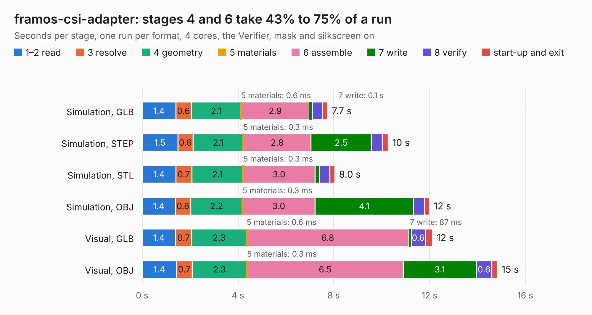

# 354. framos-csi-adapter

Board 354 of the 3,125 of [Corpus Testing](../Corpus-Testing.md), on [Corpus Page 4](../CorpusTestingPages/Corpus-Testing-04.md#354-framos-csi-adapter).

| Mode and format | 1–2 read | 3 resolve | 4 geometry | 5 materials | 6 assemble | 7 write | 8 verify | start-up and exit | Total |
|---|---:|---:|---:|---:|---:|---:|---:|---:|---:|
| Simulation, GLB | 1.4 | 0.6 | 2.1 | 0.6&nbsp;ms | 2.9 | 0.1 | 0.4 | 0.2 | 7.7 |
| Simulation, STEP | 1.5 | 0.6 | 2.1 | 0.3&nbsp;ms | 2.8 | 2.5 | 0.5 | 0.2 | 10.3 |
| Simulation, STL | 1.4 | 0.7 | 2.1 | 0.3&nbsp;ms | 3.0 | 0.2 | 0.4 | 0.2 | 8.0 |
| Simulation, OBJ | 1.4 | 0.6 | 2.2 | 0.3&nbsp;ms | 3.0 | 4.1 | 0.5 | 0.2 | 12.0 |
| Visual, GLB | 1.4 | 0.7 | 2.3 | 0.6&nbsp;ms | 6.8 | 87&nbsp;ms | 0.6 | 0.3 | 12.1 |
| Visual, OBJ | 1.4 | 0.7 | 2.3 | 0.3&nbsp;ms | 6.5 | 3.1 | 0.6 | 0.2 | 14.8 |

<table align="center"><tr><td valign="top">

| Board | Repo: [antmicro/framos-csi-adapter](https://github.com/antmicro/framos-csi-adapter) Board: `framos-csi-adapter.kicad_pcb` |
|---|---|
| Complexity | 297&nbsp;/&nbsp;1000 (size&nbsp;187, features&nbsp;110) |
| KESE&nbsp;features | through vias, rounded, trapezoid or chamfered pads, arc tracks, filled zones, copper text, curved board outline, stack-up, dielectric εr and tanδ |
| Tested | 9th November 2026 |
| Copper&nbsp;layers | 4 |
| File&nbsp;format | KiCad 7 (20221018) |
| Parts,&nbsp;tracks,&nbsp;vias | 41, 705, 87 |
| Triangles,&nbsp;simulation | 762,210 in 81 parts |
| Verifier | PASS in all six runs |

</td><td valign="top">

<table>
<tr><th>File type</th><th>File size</th><th>Peak memory used</th></tr>
<tr><th colspan="3" align="left">Simulation</th></tr>
<tr><td>GLB</td><td align="right">26&nbsp;MB</td><td align="right">418&nbsp;MB</td></tr>
<tr><td>STEP</td><td align="right">131&nbsp;MB</td><td align="right">457&nbsp;MB</td></tr>
<tr><td>STL</td><td align="right">38&nbsp;MB</td><td align="right">415&nbsp;MB</td></tr>
<tr><td>OBJ</td><td align="right">77&nbsp;MB</td><td align="right">589&nbsp;MB</td></tr>
<tr><th colspan="3" align="left">Visual</th></tr>
<tr><td>GLB</td><td align="right">19&nbsp;MB</td><td align="right">554&nbsp;MB</td></tr>
<tr><td>OBJ</td><td align="right">58&nbsp;MB</td><td align="right">541&nbsp;MB</td></tr>
</table>

</td></tr></table>

| Previous | Next |
|:---|---:|
| [353. fmc2sata](b0353b_fmc-sata-adapter_fmc2sata.md) | [355. gem-demo-board](b0355b_gem-baseboard_gem-demo-board.md) |
