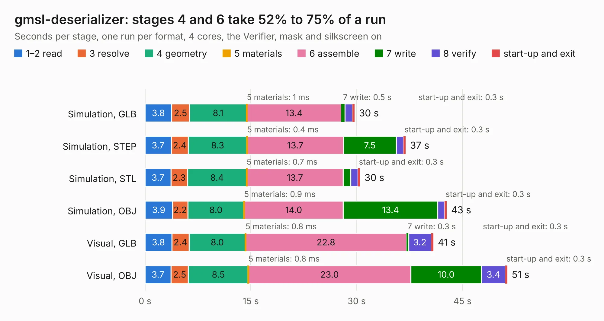

# 356. gmsl-deserializer

Board 356 of the 3,110 of [Corpus Testing](../Corpus-Testing.md), on [Corpus Page 4](../CorpusTestingPages/Corpus-Testing-04.md#356-gmsl-deserializer).

| Mode and format | 1–2 read | 3 resolve | 4 geometry | 5 materials | 6 assemble | 7 write | 8 verify | start-up and exit | Total |
|---|---:|---:|---:|---:|---:|---:|---:|---:|---:|
| Simulation, GLB | 3.8 | 2.5 | 8.1 | 1&nbsp;ms | 13.4 | 0.5 | 1.1 | 0.3 | 29.7 |
| Simulation, STEP | 3.7 | 2.4 | 8.3 | 0.4&nbsp;ms | 13.7 | 7.5 | 1.0 | 0.3 | 37.0 |
| Simulation, STL | 3.7 | 2.3 | 8.4 | 0.7&nbsp;ms | 13.7 | 1.0 | 1.0 | 0.3 | 30.5 |
| Simulation, OBJ | 3.9 | 2.2 | 8.0 | 0.9&nbsp;ms | 14.0 | 13.4 | 1.0 | 0.3 | 42.8 |
| Visual, GLB | 3.8 | 2.4 | 8.0 | 0.8&nbsp;ms | 22.8 | 0.3 | 3.2 | 0.3 | 40.9 |
| Visual, OBJ | 3.7 | 2.5 | 8.5 | 0.8&nbsp;ms | 23.0 | 10.0 | 3.4 | 0.3 | 51.4 |

<table align="center"><tr><td valign="top">

| Board | Repo: [antmicro/gmsl-deserializer](https://github.com/antmicro/gmsl-deserializer) Board: `gmsl-deserializer.kicad_pcb` |
|---|---|
| Complexity | 420&nbsp;/&nbsp;1000 (size&nbsp;265, features&nbsp;155) |
| KESE&nbsp;features | through vias, custom pads, rounded, trapezoid or chamfered pads, arc tracks, filled zones, copper drawings, copper text, curved board outline, knockout text, stack-up, dielectric εr and tanδ, mask and silkscreen colours |
| Tested | 9th November 2026 |
| Copper&nbsp;layers | 4 |
| File&nbsp;format | KiCad 9 (20241229) |
| Parts,&nbsp;tracks,&nbsp;vias | 206, 2,413, 362 |
| Triangles,&nbsp;simulation | 2,685,502 in 163 parts |
| Verifier | PASS in all six runs |

</td><td valign="top">

<table>
<tr><th>File type</th><th>File size</th><th>Peak memory used</th></tr>
<tr><th colspan="3" align="left">Simulation</th></tr>
<tr><td>GLB</td><td align="right">91&nbsp;MB</td><td align="right">1.0&nbsp;GB</td></tr>
<tr><td>STEP</td><td align="right">412&nbsp;MB</td><td align="right">1.3&nbsp;GB</td></tr>
<tr><td>STL</td><td align="right">134&nbsp;MB</td><td align="right">1.0&nbsp;GB</td></tr>
<tr><td>OBJ</td><td align="right">281&nbsp;MB</td><td align="right">1.8&nbsp;GB</td></tr>
<tr><th colspan="3" align="left">Visual</th></tr>
<tr><td>GLB</td><td align="right">69&nbsp;MB</td><td align="right">1.2&nbsp;GB</td></tr>
<tr><td>OBJ</td><td align="right">215&nbsp;MB</td><td align="right">1.5&nbsp;GB</td></tr>
</table>

</td></tr></table>

| Previous | Next |
|:---|---:|
| [355. gem2-adapter](b0355b_gem2-adapter_gem2-adapter.md) | [357. gmsl-serializer](b0357b_gmsl-serializer_gmsl-serializer.md) |
