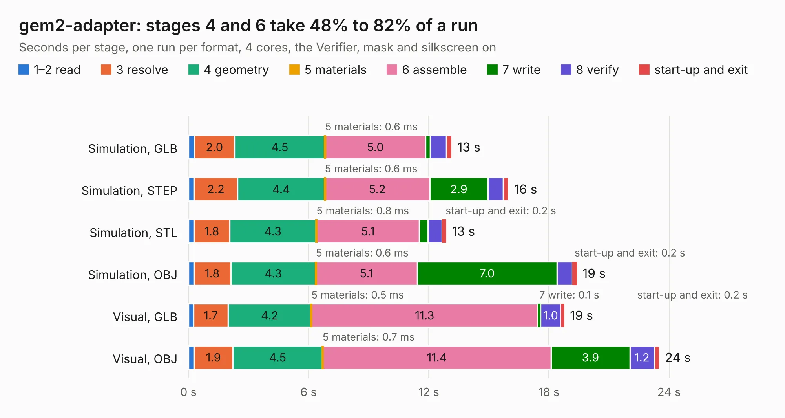

# 357. gem2-adapter

Board 357 of the 3,130 of [Corpus Testing](../Corpus-Testing.md), on [Corpus Page 4](../CorpusTestingPages/Corpus-Testing-04.md#357-gem2-adapter).

| Mode and format | 1–2 read | 3 resolve | 4 geometry | 5 materials | 6 assemble | 7 write | 8 verify | start-up and exit | Total |
|---|---:|---:|---:|---:|---:|---:|---:|---:|---:|
| Simulation, GLB | 0.3 | 2.0 | 4.5 | 0.6&nbsp;ms | 5.0 | 0.2 | 0.8 | 0.3 | 13.1 |
| Simulation, STEP | 0.3 | 2.2 | 4.4 | 0.6&nbsp;ms | 5.2 | 2.9 | 0.8 | 0.3 | 16.0 |
| Simulation, STL | 0.3 | 1.8 | 4.3 | 0.8&nbsp;ms | 5.1 | 0.4 | 0.7 | 0.2 | 12.9 |
| Simulation, OBJ | 0.3 | 1.8 | 4.3 | 0.6&nbsp;ms | 5.1 | 7.0 | 0.8 | 0.2 | 19.4 |
| Visual, GLB | 0.3 | 1.7 | 4.2 | 0.5&nbsp;ms | 11.3 | 0.1 | 1.0 | 0.2 | 18.8 |
| Visual, OBJ | 0.3 | 1.9 | 4.5 | 0.7&nbsp;ms | 11.4 | 3.9 | 1.2 | 0.3 | 23.5 |

<table align="center"><tr><td valign="top">

| Board | Repo: [antmicro/gem2-adapter](https://github.com/antmicro/gem2-adapter) Board: `gem2-adapter.kicad_pcb` |
|---|---|
| Complexity | 313&nbsp;/&nbsp;1000 (size&nbsp;268, features&nbsp;45) |
| KESE&nbsp;features | through vias, rounded, trapezoid or chamfered pads, filled zones |
| Tested | 9th November 2026 |
| Copper&nbsp;layers | 6 |
| File&nbsp;format | KiCad 5 (20171130) |
| Parts,&nbsp;tracks,&nbsp;vias | 46, 2,404, 212 |
| Triangles,&nbsp;simulation | 1,644,764 in 133 parts |
| Verifier | PASS in all six runs |

</td><td valign="top">

<table>
<tr><th>File type</th><th>File size</th><th>Peak memory used</th></tr>
<tr><th colspan="3" align="left">Simulation</th></tr>
<tr><td>GLB</td><td align="right">55&nbsp;MB</td><td align="right">576&nbsp;MB</td></tr>
<tr><td>STEP</td><td align="right">198&nbsp;MB</td><td align="right">633&nbsp;MB</td></tr>
<tr><td>STL</td><td align="right">82&nbsp;MB</td><td align="right">541&nbsp;MB</td></tr>
<tr><td>OBJ</td><td align="right">172&nbsp;MB</td><td align="right">1.1&nbsp;GB</td></tr>
<tr><th colspan="3" align="left">Visual</th></tr>
<tr><td>GLB</td><td align="right">30&nbsp;MB</td><td align="right">747&nbsp;MB</td></tr>
<tr><td>OBJ</td><td align="right">94&nbsp;MB</td><td align="right">769&nbsp;MB</td></tr>
</table>

</td></tr></table>

| Previous | Next |
|:---|---:|
| [356. zglue-gem1-adapter](b0356b_gem1-adapter_zglue-gem1-adapter.md) | [358. gmsl-deserializer](b0358b_gmsl-deserializer_gmsl-deserializer.md) |
