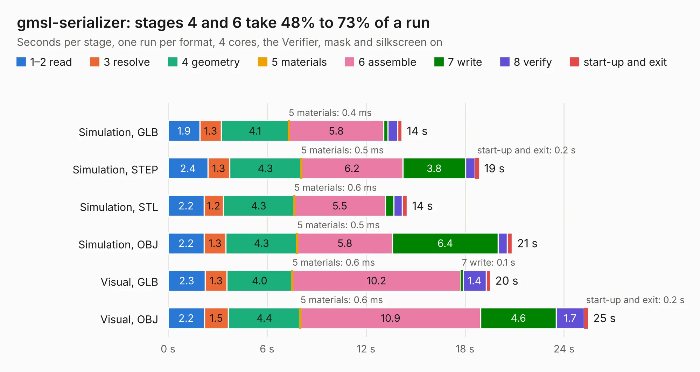

# 357. gmsl-serializer

Board 357 of the 3,109 of [Corpus Testing](../Corpus-Testing.md), on [Corpus Page 4](../CorpusTestingPages/Corpus-Testing-04.md#357-gmsl-serializer).

| Mode and format | 1–2 read | 3 resolve | 4 geometry | 5 materials | 6 assemble | 7 write | 8 verify | start-up and exit | Total |
|---|---:|---:|---:|---:|---:|---:|---:|---:|---:|
| Simulation, GLB | 1.9 | 1.3 | 4.1 | 0.4&nbsp;ms | 5.8 | 0.3 | 0.6 | 0.3 | 14.2 |
| Simulation, STEP | 2.4 | 1.3 | 4.3 | 0.5&nbsp;ms | 6.2 | 3.8 | 0.6 | 0.2 | 18.9 |
| Simulation, STL | 2.2 | 1.2 | 4.3 | 0.6&nbsp;ms | 5.5 | 0.5 | 0.5 | 0.3 | 14.5 |
| Simulation, OBJ | 2.2 | 1.3 | 4.3 | 0.5&nbsp;ms | 5.8 | 6.4 | 0.6 | 0.3 | 20.9 |
| Visual, GLB | 2.3 | 1.3 | 4.0 | 0.6&nbsp;ms | 10.2 | 0.1 | 1.4 | 0.3 | 19.5 |
| Visual, OBJ | 2.2 | 1.5 | 4.4 | 0.6&nbsp;ms | 10.9 | 4.6 | 1.7 | 0.2 | 25.5 |

<table align="center"><tr><td valign="top">

| Board | Repo: [antmicro/gmsl-serializer](https://github.com/antmicro/gmsl-serializer) Board: `gmsl-serializer.kicad_pcb` |
|---|---|
| Complexity | 374&nbsp;/&nbsp;1000 (size&nbsp;244, features&nbsp;130) |
| KESE&nbsp;features | through vias, custom pads, rounded, trapezoid or chamfered pads, arc tracks, filled zones, copper drawings, knockout text, stack-up, dielectric εr and tanδ |
| Tested | 9th November 2026 |
| Copper&nbsp;layers | 4 |
| File&nbsp;format | KiCad 8 (20240108) |
| Parts,&nbsp;tracks,&nbsp;vias | 104, 878, 206 |
| Triangles,&nbsp;simulation | 1,204,088 in 110 parts |
| Verifier | PASS in all six runs |

</td><td valign="top">

<table>
<tr><th>File type</th><th>File size</th><th>Peak memory used</th></tr>
<tr><th colspan="3" align="left">Simulation</th></tr>
<tr><td>GLB</td><td align="right">42&nbsp;MB</td><td align="right">561&nbsp;MB</td></tr>
<tr><td>STEP</td><td align="right">154&nbsp;MB</td><td align="right">643&nbsp;MB</td></tr>
<tr><td>STL</td><td align="right">60&nbsp;MB</td><td align="right">558&nbsp;MB</td></tr>
<tr><td>OBJ</td><td align="right">125&nbsp;MB</td><td align="right">876&nbsp;MB</td></tr>
<tr><th colspan="3" align="left">Visual</th></tr>
<tr><td>GLB</td><td align="right">30&nbsp;MB</td><td align="right">709&nbsp;MB</td></tr>
<tr><td>OBJ</td><td align="right">90&nbsp;MB</td><td align="right">792&nbsp;MB</td></tr>
</table>

</td></tr></table>

| Previous | Next |
|:---|---:|
| [356. gmsl-deserializer](b0356b_gmsl-deserializer_gmsl-deserializer.md) | [358. gpu-cluster-backplane](b0358b_gpu-cluster-backplane_gpu-cluster-backplane.md) |
