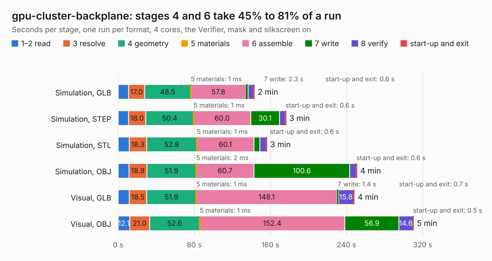

# 358. gpu-cluster-backplane

Board 358 of the 3,105 of [Corpus Testing](../Corpus-Testing.md), on [Corpus Page 4](../CorpusTestingPages/Corpus-Testing-04.md#358-gpu-cluster-backplane).

| Mode and format | 1–2 read | 3 resolve | 4 geometry | 5 materials | 6 assemble | 7 write | 8 verify | start-up and exit | Total |
|---|---:|---:|---:|---:|---:|---:|---:|---:|---:|
| Simulation, GLB | 10.8 | 17.0 | 48.5 | 1&nbsp;ms | 57.8 | 2.3 | 5.8 | 0.6 | 143.0 |
| Simulation, STEP | 10.8 | 18.0 | 50.4 | 1&nbsp;ms | 60.0 | 30.1 | 6.2 | 0.6 | 176.2 |
| Simulation, STL | 11.6 | 18.3 | 52.8 | 1&nbsp;ms | 60.1 | 6.3 | 6.6 | 0.6 | 156.2 |
| Simulation, OBJ | 11.2 | 18.9 | 51.9 | 2&nbsp;ms | 60.7 | 100.6 | 6.9 | 0.6 | 250.7 |
| Visual, GLB | 11.5 | 18.5 | 51.9 | 1&nbsp;ms | 148.1 | 1.4 | 15.8 | 0.7 | 248.0 |
| Visual, OBJ | 12.1 | 21.0 | 52.6 | 1&nbsp;ms | 152.4 | 56.9 | 14.6 | 0.5 | 310.2 |

<table align="center"><tr><td valign="top">

| Board | Repo: [antmicro/gpu-cluster-backplane](https://github.com/antmicro/gpu-cluster-backplane) Board: `gpu-cluster-backplane.kicad_pcb` |
|---|---|
| Complexity | 457&nbsp;/&nbsp;1000 (size&nbsp;307, features&nbsp;150) |
| KESE&nbsp;features | through vias, slotted holes, custom pads, rounded, trapezoid or chamfered pads, filled zones, copper drawings, copper text, curved board outline, knockout text, stack-up, dielectric εr and tanδ, mask and silkscreen colours |
| Tested | 9th November 2026 |
| Copper&nbsp;layers | 4 |
| File&nbsp;format | KiCad 7 (20221018) |
| Parts,&nbsp;tracks,&nbsp;vias | 541, 4,646, 3,885 |
| Triangles,&nbsp;simulation | 13,710,074 in 399 parts |
| Verifier | PASS in all six runs |

</td><td valign="top">

<table>
<tr><th>File type</th><th>File size</th><th>Peak memory used</th></tr>
<tr><th colspan="3" align="left">Simulation</th></tr>
<tr><td>GLB</td><td align="right">448&nbsp;MB</td><td align="right">3.3&nbsp;GB</td></tr>
<tr><td>STEP</td><td align="right">1.3&nbsp;GB</td><td align="right">4.9&nbsp;GB</td></tr>
<tr><td>STL</td><td align="right">686&nbsp;MB</td><td align="right">3.5&nbsp;GB</td></tr>
<tr><td>OBJ</td><td align="right">1.5&nbsp;GB</td><td align="right">8.7&nbsp;GB</td></tr>
<tr><th colspan="3" align="left">Visual</th></tr>
<tr><td>GLB</td><td align="right">294&nbsp;MB</td><td align="right">5.0&nbsp;GB</td></tr>
<tr><td>OBJ</td><td align="right">956&nbsp;MB</td><td align="right">6.3&nbsp;GB</td></tr>
</table>

</td></tr></table>

| Previous | Next |
|:---|---:|
| [357. gmsl-serializer](b0357b_gmsl-serializer_gmsl-serializer.md) | [359. hdmi-edid-debug-board](b0359b_hdmi-edid-debug-board_hdmi-edid-debug-board.md) |
