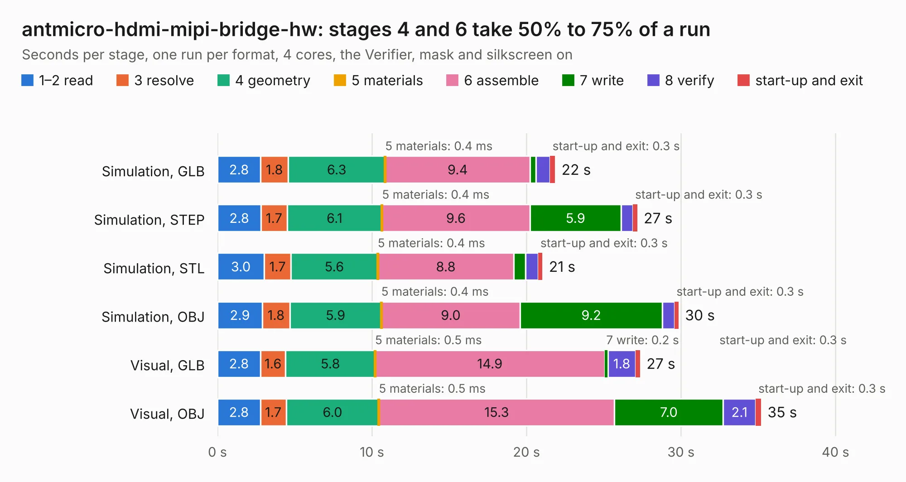

# 358. antmicro-hdmi-mipi-bridge-hw

Board 358 of the 3,100 of [Corpus Testing](../Corpus-Testing.md), on [Corpus Page 4](../CorpusTestingPages/Corpus-Testing-04.md#358-antmicro-hdmi-mipi-bridge-hw).

| Mode and format | 1–2 read | 3 resolve | 4 geometry | 5 materials | 6 assemble | 7 write | 8 verify | start-up and exit | Total |
|---|---:|---:|---:|---:|---:|---:|---:|---:|---:|
| Simulation, GLB | 2.8 | 1.8 | 6.3 | 0.4&nbsp;ms | 9.4 | 0.4 | 0.9 | 0.3 | 21.8 |
| Simulation, STEP | 2.8 | 1.7 | 6.1 | 0.4&nbsp;ms | 9.6 | 5.9 | 0.8 | 0.3 | 27.2 |
| Simulation, STL | 3.0 | 1.7 | 5.6 | 0.4&nbsp;ms | 8.8 | 0.7 | 0.8 | 0.3 | 21.0 |
| Simulation, OBJ | 2.9 | 1.8 | 5.9 | 0.4&nbsp;ms | 9.0 | 9.2 | 0.8 | 0.3 | 29.8 |
| Visual, GLB | 2.8 | 1.6 | 5.8 | 0.5&nbsp;ms | 14.9 | 0.2 | 1.8 | 0.3 | 27.4 |
| Visual, OBJ | 2.8 | 1.7 | 6.0 | 0.5&nbsp;ms | 15.3 | 7.0 | 2.1 | 0.3 | 35.2 |

<table align="center"><tr><td valign="top">

| Board | Repo: [antmicro/hdmi-mipi-bridge](https://github.com/antmicro/hdmi-mipi-bridge) Board: `antmicro-hdmi-mipi-bridge-hw.kicad_pcb` |
|---|---|
| Complexity | 404&nbsp;/&nbsp;1000 (size&nbsp;274, features&nbsp;130) |
| KESE&nbsp;features | through vias, slotted holes, custom pads, rounded, trapezoid or chamfered pads, arc tracks, filled zones, copper drawings, stack-up, dielectric εr and tanδ, mask and silkscreen colours |
| Tested | 9th November 2026 |
| Copper&nbsp;layers | 4 |
| File&nbsp;format | KiCad 7 (20221018) |
| Parts,&nbsp;tracks,&nbsp;vias | 111, 1,960, 312 |
| Triangles,&nbsp;simulation | 2,009,788 in 160 parts |
| Verifier | PASS in all six runs |

</td><td valign="top">

<table>
<tr><th>File type</th><th>File size</th><th>Peak memory used</th></tr>
<tr><th colspan="3" align="left">Simulation</th></tr>
<tr><td>GLB</td><td align="right">67&nbsp;MB</td><td align="right">813&nbsp;MB</td></tr>
<tr><td>STEP</td><td align="right">298&nbsp;MB</td><td align="right">974&nbsp;MB</td></tr>
<tr><td>STL</td><td align="right">101&nbsp;MB</td><td align="right">807&nbsp;MB</td></tr>
<tr><td>OBJ</td><td align="right">209&nbsp;MB</td><td align="right">1.4&nbsp;GB</td></tr>
<tr><th colspan="3" align="left">Visual</th></tr>
<tr><td>GLB</td><td align="right">49&nbsp;MB</td><td align="right">1.1&nbsp;GB</td></tr>
<tr><td>OBJ</td><td align="right">152&nbsp;MB</td><td align="right">1.1&nbsp;GB</td></tr>
</table>

</td></tr></table>

| Previous | Next |
|:---|---:|
| [357. hdmi-edid-debug-board](b0357b_hdmi-edid-debug-board_hdmi-edid-debug-board.md) | [359. icicle-hdmi-breakout](b0359b_icicle-hdmi-breakout_icicle-hdmi-breakout.md) |
