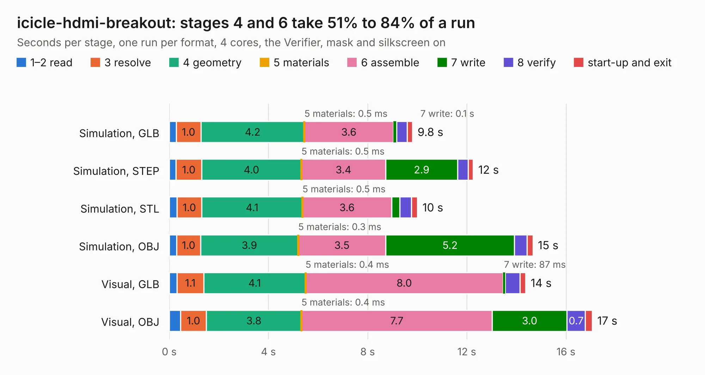

# 361. icicle-hdmi-breakout

Board 361 of the 3,104 of [Corpus Testing](../Corpus-Testing.md), on [Corpus Page 4](../CorpusTestingPages/Corpus-Testing-04.md#361-icicle-hdmi-breakout).

| Mode and format | 1–2 read | 3 resolve | 4 geometry | 5 materials | 6 assemble | 7 write | 8 verify | start-up and exit | Total |
|---|---:|---:|---:|---:|---:|---:|---:|---:|---:|
| Simulation, GLB | 0.3 | 1.0 | 4.2 | 0.5&nbsp;ms | 3.6 | 0.1 | 0.4 | 0.2 | 9.8 |
| Simulation, STEP | 0.3 | 1.0 | 4.0 | 0.5&nbsp;ms | 3.4 | 2.9 | 0.4 | 0.2 | 12.3 |
| Simulation, STL | 0.3 | 1.0 | 4.1 | 0.5&nbsp;ms | 3.6 | 0.3 | 0.5 | 0.2 | 10.0 |
| Simulation, OBJ | 0.3 | 1.0 | 3.9 | 0.3&nbsp;ms | 3.5 | 5.2 | 0.5 | 0.2 | 14.7 |
| Visual, GLB | 0.3 | 1.1 | 4.1 | 0.4&nbsp;ms | 8.0 | 87&nbsp;ms | 0.6 | 0.2 | 14.4 |
| Visual, OBJ | 0.5 | 1.0 | 3.8 | 0.4&nbsp;ms | 7.7 | 3.0 | 0.7 | 0.3 | 17.1 |

<table align="center"><tr><td valign="top">

| Board | Repo: [antmicro/icicle-hdmi-breakout](https://github.com/antmicro/icicle-hdmi-breakout) Board: `icicle-hdmi-breakout.kicad_pcb` |
|---|---|
| Complexity | 254&nbsp;/&nbsp;1000 (size&nbsp;189, features&nbsp;65) |
| KESE&nbsp;features | through vias, slotted holes, rounded, trapezoid or chamfered pads, filled zones, copper text |
| Tested | 9th November 2026 |
| Copper&nbsp;layers | 4 |
| File&nbsp;format | KiCad 5 (20171130) |
| Parts,&nbsp;tracks,&nbsp;vias | 34, 1,178, 41 |
| Triangles,&nbsp;simulation | 851,176 in 64 parts |
| Verifier | PASS in all six runs |

</td><td valign="top">

<table>
<tr><th>File type</th><th>File size</th><th>Peak memory used</th></tr>
<tr><th colspan="3" align="left">Simulation</th></tr>
<tr><td>GLB</td><td align="right">29&nbsp;MB</td><td align="right">401&nbsp;MB</td></tr>
<tr><td>STEP</td><td align="right">166&nbsp;MB</td><td align="right">464&nbsp;MB</td></tr>
<tr><td>STL</td><td align="right">43&nbsp;MB</td><td align="right">404&nbsp;MB</td></tr>
<tr><td>OBJ</td><td align="right">88&nbsp;MB</td><td align="right">637&nbsp;MB</td></tr>
<tr><th colspan="3" align="left">Visual</th></tr>
<tr><td>GLB</td><td align="right">17&nbsp;MB</td><td align="right">457&nbsp;MB</td></tr>
<tr><td>OBJ</td><td align="right">50&nbsp;MB</td><td align="right">468&nbsp;MB</td></tr>
</table>

</td></tr></table>

| Previous | Next |
|:---|---:|
| [360. antmicro-hdmi-mipi-bridge-hw](b0360b_hdmi-mipi-bridge_antmicro-hdmi-mipi-bridge-hw.md) | [362. ict-baseboard](b0362b_ict-baseboard_ict-baseboard.md) |
