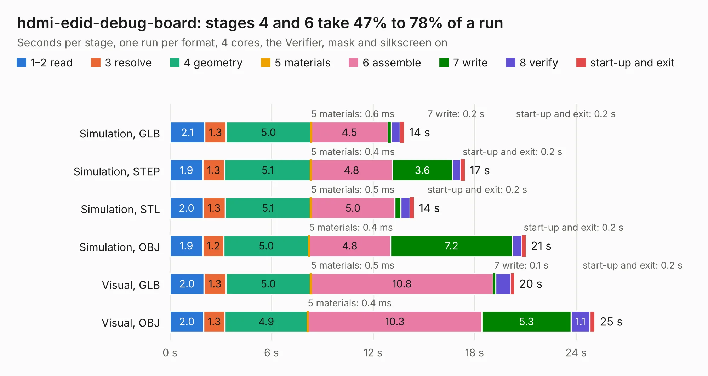

# 362. hdmi-edid-debug-board

Board 362 of the 3,139 of [Corpus Testing](../Corpus-Testing.md), on [Corpus Page 4](../CorpusTestingPages/Corpus-Testing-04.md#362-hdmi-edid-debug-board).

| Mode and format | 1–2 read | 3 resolve | 4 geometry | 5 materials | 6 assemble | 7 write | 8 verify | start-up and exit | Total |
|---|---:|---:|---:|---:|---:|---:|---:|---:|---:|
| Simulation, GLB | 2.1 | 1.3 | 5.0 | 0.6&nbsp;ms | 4.5 | 0.2 | 0.5 | 0.2 | 13.8 |
| Simulation, STEP | 1.9 | 1.3 | 5.1 | 0.4&nbsp;ms | 4.8 | 3.6 | 0.5 | 0.2 | 17.4 |
| Simulation, STL | 2.0 | 1.3 | 5.1 | 0.5&nbsp;ms | 5.0 | 0.4 | 0.5 | 0.2 | 14.4 |
| Simulation, OBJ | 1.9 | 1.2 | 5.0 | 0.4&nbsp;ms | 4.8 | 7.2 | 0.6 | 0.2 | 21.0 |
| Visual, GLB | 2.0 | 1.3 | 5.0 | 0.5&nbsp;ms | 10.8 | 0.1 | 0.9 | 0.2 | 20.3 |
| Visual, OBJ | 2.0 | 1.3 | 4.9 | 0.4&nbsp;ms | 10.3 | 5.3 | 1.1 | 0.3 | 25.1 |

<table align="center"><tr><td valign="top">

| Board | Repo: [antmicro/hdmi-edid-debug-board](https://github.com/antmicro/hdmi-edid-debug-board) Board: `hdmi-edid-debug-board.kicad_pcb` |
|---|---|
| Complexity | 396&nbsp;/&nbsp;1000 (size&nbsp;246, features&nbsp;150) |
| KESE&nbsp;features | through vias, slotted holes, custom pads, rounded, trapezoid or chamfered pads, arc tracks, filled zones, copper drawings, copper text, knockout text, stack-up, dielectric εr and tanδ |
| Tested | 9th November 2026 |
| Copper&nbsp;layers | 4 |
| File&nbsp;format | KiCad 8 (20240108) |
| Parts,&nbsp;tracks,&nbsp;vias | 98, 1,266, 175 |
| Triangles,&nbsp;simulation | 1,401,090 in 109 parts |
| Verifier | PASS in all six runs |

</td><td valign="top">

<table>
<tr><th>File type</th><th>File size</th><th>Peak memory used</th></tr>
<tr><th colspan="3" align="left">Simulation</th></tr>
<tr><td>GLB</td><td align="right">49&nbsp;MB</td><td align="right">634&nbsp;MB</td></tr>
<tr><td>STEP</td><td align="right">193&nbsp;MB</td><td align="right">732&nbsp;MB</td></tr>
<tr><td>STL</td><td align="right">70&nbsp;MB</td><td align="right">613&nbsp;MB</td></tr>
<tr><td>OBJ</td><td align="right">146&nbsp;MB</td><td align="right">1.0&nbsp;GB</td></tr>
<tr><th colspan="3" align="left">Visual</th></tr>
<tr><td>GLB</td><td align="right">36&nbsp;MB</td><td align="right">882&nbsp;MB</td></tr>
<tr><td>OBJ</td><td align="right">109&nbsp;MB</td><td align="right">882&nbsp;MB</td></tr>
</table>

</td></tr></table>

| Previous | Next |
|:---|---:|
| [361. gpu-cluster-backplane](b0361b_gpu-cluster-backplane_gpu-cluster-backplane.md) | [363. antmicro-hdmi-mipi-bridge-hw](b0363b_hdmi-mipi-bridge_antmicro-hdmi-mipi-bridge-hw.md) |
