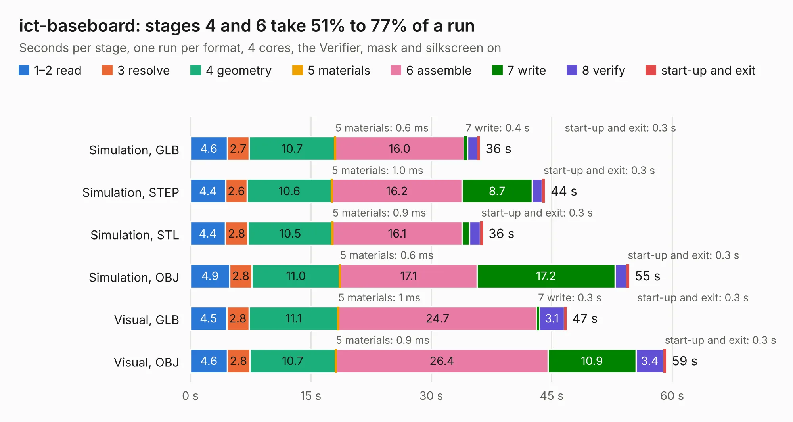

# 362. ict-baseboard

Board 362 of the 3,104 of [Corpus Testing](../Corpus-Testing.md), on [Corpus Page 4](../CorpusTestingPages/Corpus-Testing-04.md#362-ict-baseboard).

| Mode and format | 1–2 read | 3 resolve | 4 geometry | 5 materials | 6 assemble | 7 write | 8 verify | start-up and exit | Total |
|---|---:|---:|---:|---:|---:|---:|---:|---:|---:|
| Simulation, GLB | 4.6 | 2.7 | 10.7 | 0.6&nbsp;ms | 16.0 | 0.4 | 1.2 | 0.3 | 36.0 |
| Simulation, STEP | 4.4 | 2.6 | 10.6 | 1.0&nbsp;ms | 16.2 | 8.7 | 1.2 | 0.3 | 44.2 |
| Simulation, STL | 4.4 | 2.8 | 10.5 | 0.9&nbsp;ms | 16.1 | 1.0 | 1.3 | 0.3 | 36.4 |
| Simulation, OBJ | 4.9 | 2.8 | 11.0 | 0.6&nbsp;ms | 17.1 | 17.2 | 1.4 | 0.3 | 54.7 |
| Visual, GLB | 4.5 | 2.8 | 11.1 | 1&nbsp;ms | 24.7 | 0.3 | 3.1 | 0.3 | 46.9 |
| Visual, OBJ | 4.6 | 2.8 | 10.7 | 0.9&nbsp;ms | 26.4 | 10.9 | 3.4 | 0.3 | 59.3 |

<table align="center"><tr><td valign="top">

| Board | Repo: [antmicro/ict-baseboard](https://github.com/antmicro/ict-baseboard) Board: `ict-baseboard.kicad_pcb` |
|---|---|
| Complexity | 413&nbsp;/&nbsp;1000 (size&nbsp;258, features&nbsp;155) |
| KESE&nbsp;features | through vias, slotted holes, custom pads, rounded, trapezoid or chamfered pads, filled zones, copper drawings, copper text, knockout text, TrueType text, stack-up, dielectric εr and tanδ, mask and silkscreen colours |
| Tested | 9th November 2026 |
| Copper&nbsp;layers | 4 |
| File&nbsp;format | KiCad 9 (20241229) |
| Parts,&nbsp;tracks,&nbsp;vias | 206, 1,672, 214 |
| Triangles,&nbsp;simulation | 2,622,894 in 218 parts |
| Verifier | PASS in all six runs |

</td><td valign="top">

<table>
<tr><th>File type</th><th>File size</th><th>Peak memory used</th></tr>
<tr><th colspan="3" align="left">Simulation</th></tr>
<tr><td>GLB</td><td align="right">89&nbsp;MB</td><td align="right">1.0&nbsp;GB</td></tr>
<tr><td>STEP</td><td align="right">384&nbsp;MB</td><td align="right">1.2&nbsp;GB</td></tr>
<tr><td>STL</td><td align="right">131&nbsp;MB</td><td align="right">1.0&nbsp;GB</td></tr>
<tr><td>OBJ</td><td align="right">276&nbsp;MB</td><td align="right">1.8&nbsp;GB</td></tr>
<tr><th colspan="3" align="left">Visual</th></tr>
<tr><td>GLB</td><td align="right">60&nbsp;MB</td><td align="right">1.3&nbsp;GB</td></tr>
<tr><td>OBJ</td><td align="right">185&nbsp;MB</td><td align="right">1.3&nbsp;GB</td></tr>
</table>

</td></tr></table>

| Previous | Next |
|:---|---:|
| [361. icicle-hdmi-breakout](b0361b_icicle-hdmi-breakout_icicle-hdmi-breakout.md) | [363. ir-irradiance-probe](b0363b_infrared-irradiance-probe_ir-irradiance-probe.md) |
