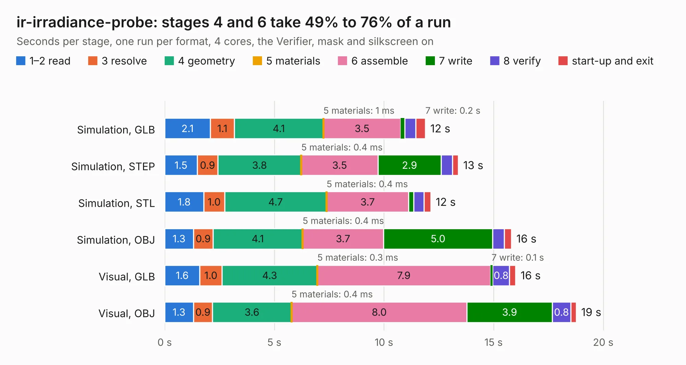

# 366. ir-irradiance-probe

Board 366 of the 3,139 of [Corpus Testing](../Corpus-Testing.md), on [Corpus Page 4](../CorpusTestingPages/Corpus-Testing-04.md#366-ir-irradiance-probe).

| Mode and format | 1–2 read | 3 resolve | 4 geometry | 5 materials | 6 assemble | 7 write | 8 verify | start-up and exit | Total |
|---|---:|---:|---:|---:|---:|---:|---:|---:|---:|
| Simulation, GLB | 2.1 | 1.1 | 4.1 | 1&nbsp;ms | 3.5 | 0.2 | 0.5 | 0.4 | 11.9 |
| Simulation, STEP | 1.5 | 0.9 | 3.8 | 0.4&nbsp;ms | 3.5 | 2.9 | 0.5 | 0.3 | 13.4 |
| Simulation, STL | 1.8 | 1.0 | 4.7 | 0.4&nbsp;ms | 3.7 | 0.2 | 0.5 | 0.3 | 12.1 |
| Simulation, OBJ | 1.3 | 0.9 | 4.1 | 0.4&nbsp;ms | 3.7 | 5.0 | 0.5 | 0.3 | 15.8 |
| Visual, GLB | 1.6 | 1.0 | 4.3 | 0.3&nbsp;ms | 7.9 | 0.1 | 0.8 | 0.3 | 16.0 |
| Visual, OBJ | 1.3 | 0.9 | 3.6 | 0.4&nbsp;ms | 8.0 | 3.9 | 0.8 | 0.3 | 18.8 |

<table align="center"><tr><td valign="top">

| Board | Repo: [antmicro/infrared-irradiance-probe](https://github.com/antmicro/infrared-irradiance-probe) Board: `ir-irradiance-probe.kicad_pcb` |
|---|---|
| Complexity | 282&nbsp;/&nbsp;1000 (size&nbsp;172, features&nbsp;110) |
| KESE&nbsp;features | through vias, slotted holes, rounded, trapezoid or chamfered pads, filled zones, copper text, knockout text, stack-up, dielectric εr and tanδ |
| Tested | 9th November 2026 |
| Copper&nbsp;layers | 2 |
| File&nbsp;format | KiCad 7 (20221018) |
| Parts,&nbsp;tracks,&nbsp;vias | 52, 330, 196 |
| Triangles,&nbsp;simulation | 735,330 in 43 parts |
| Verifier | PASS in all six runs |

</td><td valign="top">

<table>
<tr><th>File type</th><th>File size</th><th>Peak memory used</th></tr>
<tr><th colspan="3" align="left">Simulation</th></tr>
<tr><td>GLB</td><td align="right">26&nbsp;MB</td><td align="right">490&nbsp;MB</td></tr>
<tr><td>STEP</td><td align="right">124&nbsp;MB</td><td align="right">484&nbsp;MB</td></tr>
<tr><td>STL</td><td align="right">37&nbsp;MB</td><td align="right">482&nbsp;MB</td></tr>
<tr><td>OBJ</td><td align="right">77&nbsp;MB</td><td align="right">563&nbsp;MB</td></tr>
<tr><th colspan="3" align="left">Visual</th></tr>
<tr><td>GLB</td><td align="right">20&nbsp;MB</td><td align="right">532&nbsp;MB</td></tr>
<tr><td>OBJ</td><td align="right">61&nbsp;MB</td><td align="right">578&nbsp;MB</td></tr>
</table>

</td></tr></table>

| Previous | Next |
|:---|---:|
| [365. ict-baseboard](b0365b_ict-baseboard_ict-baseboard.md) | [367. jetson-agx-csi-adapter](b0367b_jetson-agx-csi-adapter_jetson-agx-csi-adapter.md) |
