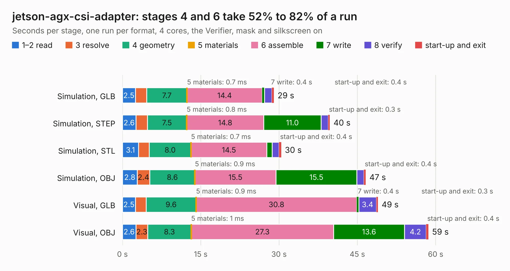

# 366. jetson-agx-csi-adapter

Board 366 of the 3,130 of [Corpus Testing](../Corpus-Testing.md), on [Corpus Page 4](../CorpusTestingPages/Corpus-Testing-04.md#366-jetson-agx-csi-adapter).

| Mode and format | 1–2 read | 3 resolve | 4 geometry | 5 materials | 6 assemble | 7 write | 8 verify | start-up and exit | Total |
|---|---:|---:|---:|---:|---:|---:|---:|---:|---:|
| Simulation, GLB | 2.5 | 2.2 | 7.7 | 0.7&nbsp;ms | 14.4 | 0.4 | 1.4 | 0.4 | 29.0 |
| Simulation, STEP | 2.6 | 2.2 | 7.5 | 0.8&nbsp;ms | 14.8 | 11.0 | 1.3 | 0.3 | 39.7 |
| Simulation, STL | 3.1 | 2.1 | 8.0 | 0.7&nbsp;ms | 14.5 | 1.0 | 1.3 | 0.4 | 30.4 |
| Simulation, OBJ | 2.8 | 2.4 | 8.6 | 0.9&nbsp;ms | 15.5 | 15.5 | 1.3 | 0.4 | 46.6 |
| Visual, GLB | 2.5 | 2.0 | 9.6 | 0.9&nbsp;ms | 30.8 | 0.4 | 3.4 | 0.3 | 49.0 |
| Visual, OBJ | 2.6 | 2.3 | 8.3 | 1&nbsp;ms | 27.3 | 13.6 | 4.2 | 0.4 | 58.6 |

<table align="center"><tr><td valign="top">

| Board | Repo: [antmicro/jetson-agx-csi-adapter](https://github.com/antmicro/jetson-agx-csi-adapter) Board: `jetson-agx-csi-adapter.kicad_pcb` |
|---|---|
| Complexity | 345&nbsp;/&nbsp;1000 (size&nbsp;215, features&nbsp;130) |
| KESE&nbsp;features | through vias, rounded, trapezoid or chamfered pads, arc tracks, filled zones, copper text, curved board outline, knockout text, stack-up, dielectric εr and tanδ, mask and silkscreen colours |
| Tested | 9th November 2026 |
| Copper&nbsp;layers | 4 |
| File&nbsp;format | KiCad 9 (20241229) |
| Parts,&nbsp;tracks,&nbsp;vias | 80, 2,929, 225 |
| Triangles,&nbsp;simulation | 2,205,664 in 193 parts |
| Verifier | PASS in all six runs |

</td><td valign="top">

<table>
<tr><th>File type</th><th>File size</th><th>Peak memory used</th></tr>
<tr><th colspan="3" align="left">Simulation</th></tr>
<tr><td>GLB</td><td align="right">74&nbsp;MB</td><td align="right">935&nbsp;MB</td></tr>
<tr><td>STEP</td><td align="right">344&nbsp;MB</td><td align="right">1.1&nbsp;GB</td></tr>
<tr><td>STL</td><td align="right">110&nbsp;MB</td><td align="right">935&nbsp;MB</td></tr>
<tr><td>OBJ</td><td align="right">230&nbsp;MB</td><td align="right">1.5&nbsp;GB</td></tr>
<tr><th colspan="3" align="left">Visual</th></tr>
<tr><td>GLB</td><td align="right">63&nbsp;MB</td><td align="right">1.2&nbsp;GB</td></tr>
<tr><td>OBJ</td><td align="right">196&nbsp;MB</td><td align="right">1.4&nbsp;GB</td></tr>
</table>

</td></tr></table>

| Previous | Next |
|:---|---:|
| [365. ir-irradiance-probe](b0365b_infrared-irradiance-probe_ir-irradiance-probe.md) | [367. jetson-agx-thor-baseboard](b0367b_jetson-agx-thor-baseboard_jetson-agx-thor-baseboard.md) |
