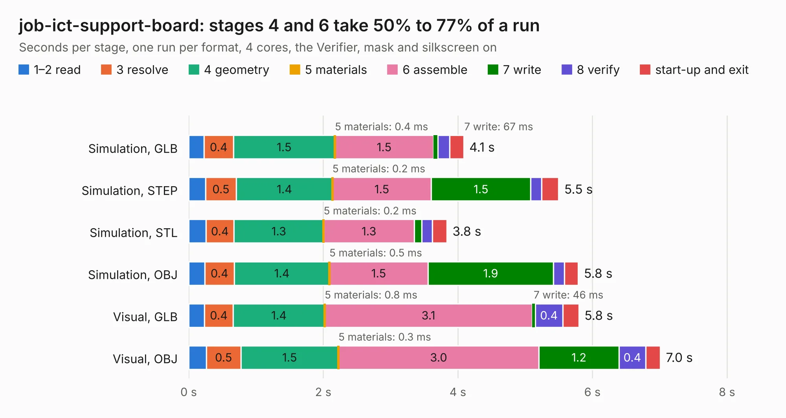

# 366. job-ict-support-board

Board 366 of the 3,100 of [Corpus Testing](../Corpus-Testing.md), on [Corpus Page 4](../CorpusTestingPages/Corpus-Testing-04.md#366-job-ict-support-board).

| Mode and format | 1–2 read | 3 resolve | 4 geometry | 5 materials | 6 assemble | 7 write | 8 verify | start-up and exit | Total |
|---|---:|---:|---:|---:|---:|---:|---:|---:|---:|
| Simulation, GLB | 0.2 | 0.4 | 1.5 | 0.4&nbsp;ms | 1.5 | 67&nbsp;ms | 0.2 | 0.2 | 4.1 |
| Simulation, STEP | 0.2 | 0.5 | 1.4 | 0.2&nbsp;ms | 1.5 | 1.5 | 0.2 | 0.3 | 5.5 |
| Simulation, STL | 0.3 | 0.4 | 1.3 | 0.2&nbsp;ms | 1.3 | 0.1 | 0.2 | 0.2 | 3.8 |
| Simulation, OBJ | 0.2 | 0.4 | 1.4 | 0.5&nbsp;ms | 1.5 | 1.9 | 0.2 | 0.2 | 5.8 |
| Visual, GLB | 0.2 | 0.4 | 1.4 | 0.8&nbsp;ms | 3.1 | 46&nbsp;ms | 0.4 | 0.2 | 5.8 |
| Visual, OBJ | 0.3 | 0.5 | 1.5 | 0.3&nbsp;ms | 3.0 | 1.2 | 0.4 | 0.2 | 7.0 |

<table align="center"><tr><td valign="top">

| Board | Repo: [antmicro/job-ict-support-board](https://github.com/antmicro/job-ict-support-board) Board: `job-ict-support-board.kicad_pcb` |
|---|---|
| Complexity | 112&nbsp;/&nbsp;1000 (size&nbsp;17, features&nbsp;95) |
| KESE&nbsp;features | rounded, trapezoid or chamfered pads, filled zones, knockout text, stack-up, dielectric εr and tanδ, copper finish, mask and silkscreen colours |
| Tested | 9th November 2026 |
| Copper&nbsp;layers | 2 |
| File&nbsp;format | KiCad 9 (20241229) |
| Parts,&nbsp;tracks,&nbsp;vias | 0, 0, 0 |
| Triangles,&nbsp;simulation | 434,326 in 38 parts |
| Note | no components |
| Verifier | PASS in all six runs |

</td><td valign="top">

<table>
<tr><th>File type</th><th>File size</th><th>Peak memory used</th></tr>
<tr><th colspan="3" align="left">Simulation</th></tr>
<tr><td>GLB</td><td align="right">15&nbsp;MB</td><td align="right">331&nbsp;MB</td></tr>
<tr><td>STEP</td><td align="right">66&nbsp;MB</td><td align="right">337&nbsp;MB</td></tr>
<tr><td>STL</td><td align="right">22&nbsp;MB</td><td align="right">315&nbsp;MB</td></tr>
<tr><td>OBJ</td><td align="right">44&nbsp;MB</td><td align="right">354&nbsp;MB</td></tr>
<tr><th colspan="3" align="left">Visual</th></tr>
<tr><td>GLB</td><td align="right">10&nbsp;MB</td><td align="right">317&nbsp;MB</td></tr>
<tr><td>OBJ</td><td align="right">30&nbsp;MB</td><td align="right">312&nbsp;MB</td></tr>
</table>

</td></tr></table>

| Previous | Next |
|:---|---:|
| [365. job-ict-bottom-board](b0365b_job-ict-bottom-board_job-ict-bottom-board.md) | [367. jetson-orin-baseboard-oculink-expansion](b0367b_job-oculink-expansion_jetson-orin-baseboard-oculink-expansion.md) |
