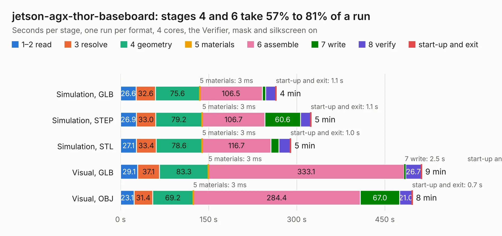

# 368. jetson-agx-thor-baseboard

Board 368 of the 3,139 of [Corpus Testing](../Corpus-Testing.md), on [Corpus Page 4](../CorpusTestingPages/Corpus-Testing-04.md#368-jetson-agx-thor-baseboard).

| Mode and format | 1–2 read | 3 resolve | 4 geometry | 5 materials | 6 assemble | 7 write | 8 verify | start-up and exit | Total |
|---|---:|---:|---:|---:|---:|---:|---:|---:|---:|
| Simulation, GLB | 26.6 | 32.6 | 75.6 | 3&nbsp;ms | 106.5 | 5.8 | 16.9 | 1.1 | 265.1 |
| Simulation, STEP | 26.9 | 33.0 | 79.2 | 3&nbsp;ms | 106.7 | 60.6 | 17.0 | 1.1 | 324.4 |
| Simulation, STL | 27.1 | 33.4 | 78.6 | 3&nbsp;ms | 116.7 | 13.6 | 19.5 | 1.0 | 289.9 |
| Simulation, OBJ |  |  |  |  |  |  |  |  | exceeded 11 GB on a 16 GB machine (stopped there, not a KESE failure); it will be run again on a machine with more memory |
| Visual, GLB | 29.1 | 37.1 | 83.3 | 3&nbsp;ms | 333.1 | 2.5 | 26.7 | 0.8 | 512.8 |
| Visual, OBJ | 23.1 | 31.4 | 69.2 | 3&nbsp;ms | 284.4 | 67.0 | 21.0 | 0.7 | 496.9 |

<table align="center"><tr><td valign="top">

| Board | Repo: [antmicro/jetson-agx-thor-baseboard](https://github.com/antmicro/jetson-agx-thor-baseboard) Board: `jetson-agx-thor-baseboard.kicad_pcb` |
|---|---|
| Complexity | 526&nbsp;/&nbsp;1000 (size&nbsp;351, features&nbsp;175) |
| KESE&nbsp;features | through vias, slotted holes, custom pads, rounded, trapezoid or chamfered pads, arc tracks, filled zones, copper drawings, knockout text, TrueType text, stack-up, dielectric εr and tanδ, copper finish, mask and silkscreen colours |
| Tested | 9th November 2026 to 10th November 2026 |
| Copper&nbsp;layers | 10 |
| File&nbsp;format | KiCad 9 (20241229) |
| Parts,&nbsp;tracks,&nbsp;vias | 1,025, 22,645, 3,223 |
| Triangles,&nbsp;simulation | 32,687,176 in 1419 parts |
| Verifier | Simulation, OBJ: exceeded 11 GB on a 16 GB machine (stopped there, not a KESE failure); it will be run again on a machine with more memory |
| Run&nbsp;again | Visual, OBJ: failed in the corpus run, run again with the memory cap raised from 11 GB to 14.5 GB, and passed |

</td><td valign="top">

<table>
<tr><th>File type</th><th>File size</th><th>Peak memory used</th></tr>
<tr><th colspan="3" align="left">Simulation</th></tr>
<tr><td>GLB</td><td align="right">1.1&nbsp;GB</td><td align="right">7.5&nbsp;GB</td></tr>
<tr><td>STEP</td><td align="right">3.3&nbsp;GB</td><td align="right">9.2&nbsp;GB</td></tr>
<tr><td>STL</td><td align="right">1.6&nbsp;GB</td><td align="right">7.3&nbsp;GB</td></tr>
<tr><td>OBJ</td><td align="right">–</td><td align="right">11&nbsp;GB</td></tr>
<tr><th colspan="3" align="left">Visual</th></tr>
<tr><td>GLB</td><td align="right">485&nbsp;MB</td><td align="right">8.6&nbsp;GB</td></tr>
<tr><td>OBJ</td><td align="right">1.6&nbsp;GB</td><td align="right">11&nbsp;GB</td></tr>
</table>

</td></tr></table>

| Previous | Next |
|:---|---:|
| [367. jetson-agx-csi-adapter](b0367b_jetson-agx-csi-adapter_jetson-agx-csi-adapter.md) | [369. jetson-nano-baseboard](b0369b_jetson-nano-baseboard_jetson-nano-baseboard.md) |
