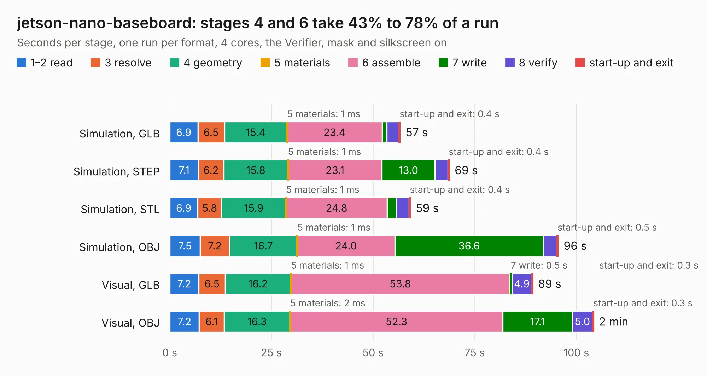

# 368. jetson-nano-baseboard

Board 368 of the 3,123 of [Corpus Testing](../Corpus-Testing.md), on [Corpus Page 4](../CorpusTestingPages/Corpus-Testing-04.md#368-jetson-nano-baseboard).

| Mode and format | 1–2 read | 3 resolve | 4 geometry | 5 materials | 6 assemble | 7 write | 8 verify | start-up and exit | Total |
|---|---:|---:|---:|---:|---:|---:|---:|---:|---:|
| Simulation, GLB | 6.9 | 6.5 | 15.4 | 1&nbsp;ms | 23.4 | 1.1 | 3.0 | 0.4 | 56.8 |
| Simulation, STEP | 7.1 | 6.2 | 15.8 | 1&nbsp;ms | 23.1 | 13.0 | 3.2 | 0.4 | 68.8 |
| Simulation, STL | 6.9 | 5.8 | 15.9 | 1&nbsp;ms | 24.8 | 2.2 | 3.1 | 0.4 | 59.3 |
| Simulation, OBJ | 7.5 | 7.2 | 16.7 | 1&nbsp;ms | 24.0 | 36.6 | 3.2 | 0.5 | 95.6 |
| Visual, GLB | 7.2 | 6.5 | 16.2 | 1&nbsp;ms | 53.8 | 0.5 | 4.9 | 0.3 | 89.4 |
| Visual, OBJ | 7.2 | 6.1 | 16.3 | 2&nbsp;ms | 52.3 | 17.1 | 5.0 | 0.3 | 104.3 |

<table align="center"><tr><td valign="top">

| Board | Repo: [antmicro/jetson-nano-baseboard](https://github.com/antmicro/jetson-nano-baseboard) Board: `jetson-nano-baseboard.kicad_pcb` |
|---|---|
| Complexity | 448&nbsp;/&nbsp;1000 (size&nbsp;313, features&nbsp;135) |
| KESE&nbsp;features | through vias, slotted holes, custom pads, rounded, trapezoid or chamfered pads, arc tracks, filled zones, copper drawings, copper text, stack-up, dielectric εr and tanδ |
| Tested | 9th November 2026 |
| Copper&nbsp;layers | 8 |
| File&nbsp;format | KiCad 9 (20241229) |
| Parts,&nbsp;tracks,&nbsp;vias | 326, 15,624, 794 |
| Triangles,&nbsp;simulation | 7,900,080 in 506 parts |
| Verifier | PASS in all six runs |

</td><td valign="top">

<table>
<tr><th>File type</th><th>File size</th><th>Peak memory used</th></tr>
<tr><th colspan="3" align="left">Simulation</th></tr>
<tr><td>GLB</td><td align="right">263&nbsp;MB</td><td align="right">2.0&nbsp;GB</td></tr>
<tr><td>STEP</td><td align="right">948&nbsp;MB</td><td align="right">2.7&nbsp;GB</td></tr>
<tr><td>STL</td><td align="right">395&nbsp;MB</td><td align="right">2.2&nbsp;GB</td></tr>
<tr><td>OBJ</td><td align="right">871&nbsp;MB</td><td align="right">5.2&nbsp;GB</td></tr>
<tr><th colspan="3" align="left">Visual</th></tr>
<tr><td>GLB</td><td align="right">130&nbsp;MB</td><td align="right">2.4&nbsp;GB</td></tr>
<tr><td>OBJ</td><td align="right">440&nbsp;MB</td><td align="right">3.0&nbsp;GB</td></tr>
</table>

</td></tr></table>

| Previous | Next |
|:---|---:|
| [367. jetson-agx-thor-baseboard](b0367b_jetson-agx-thor-baseboard_jetson-agx-thor-baseboard.md) | [369. jetson-orin-baseboard](b0369b_jetson-orin-baseboard_jetson-orin-baseboard.md) |
