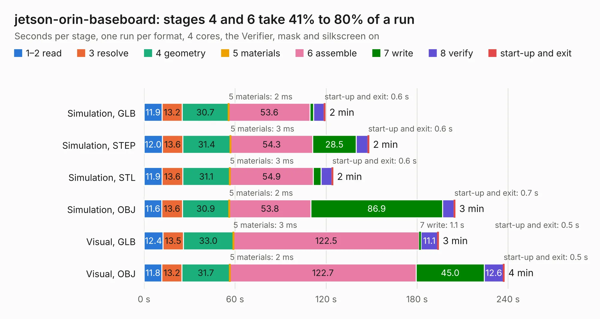

# 369. jetson-orin-baseboard

Board 369 of the 3,129 of [Corpus Testing](../Corpus-Testing.md), on [Corpus Page 4](../CorpusTestingPages/Corpus-Testing-04.md#369-jetson-orin-baseboard).

| Mode and format | 1–2 read | 3 resolve | 4 geometry | 5 materials | 6 assemble | 7 write | 8 verify | start-up and exit | Total |
|---|---:|---:|---:|---:|---:|---:|---:|---:|---:|
| Simulation, GLB | 11.9 | 13.2 | 30.7 | 2&nbsp;ms | 53.6 | 2.4 | 7.0 | 0.6 | 119.4 |
| Simulation, STEP | 12.0 | 13.6 | 31.4 | 3&nbsp;ms | 54.3 | 28.5 | 7.8 | 0.6 | 148.2 |
| Simulation, STL | 11.9 | 13.6 | 31.1 | 3&nbsp;ms | 54.9 | 5.1 | 7.3 | 0.6 | 124.4 |
| Simulation, OBJ | 11.6 | 13.6 | 30.9 | 2&nbsp;ms | 53.8 | 86.9 | 7.4 | 0.7 | 205.0 |
| Visual, GLB | 12.4 | 13.5 | 33.0 | 3&nbsp;ms | 122.5 | 1.1 | 11.1 | 0.5 | 194.1 |
| Visual, OBJ | 11.8 | 13.2 | 31.7 | 2&nbsp;ms | 122.7 | 45.0 | 12.6 | 0.5 | 237.4 |

<table align="center"><tr><td valign="top">

| Board | Repo: [antmicro/jetson-orin-baseboard](https://github.com/antmicro/jetson-orin-baseboard) Board: `jetson-orin-baseboard.kicad_pcb` |
|---|---|
| Complexity | 522&nbsp;/&nbsp;1000 (size&nbsp;327, features&nbsp;195) |
| KESE&nbsp;features | through vias, slotted holes, custom pads, rounded, trapezoid or chamfered pads, arc tracks, filled zones, copper drawings, copper text, curved board outline, knockout text, TrueType text, stack-up, dielectric εr and tanδ, copper finish, mask and silkscreen colours |
| Tested | 9th November 2026 |
| Copper&nbsp;layers | 8 |
| File&nbsp;format | KiCad 8 (20240108) |
| Parts,&nbsp;tracks,&nbsp;vias | 618, 14,181, 1,345 |
| Triangles,&nbsp;simulation | 13,533,484 in 817 parts |
| Verifier | PASS in all six runs |

</td><td valign="top">

<table>
<tr><th>File type</th><th>File size</th><th>Peak memory used</th></tr>
<tr><th colspan="3" align="left">Simulation</th></tr>
<tr><td>GLB</td><td align="right">455&nbsp;MB</td><td align="right">2.9&nbsp;GB</td></tr>
<tr><td>STEP</td><td align="right">1.7&nbsp;GB</td><td align="right">4.4&nbsp;GB</td></tr>
<tr><td>STL</td><td align="right">677&nbsp;MB</td><td align="right">2.9&nbsp;GB</td></tr>
<tr><td>OBJ</td><td align="right">1.5&nbsp;GB</td><td align="right">8.6&nbsp;GB</td></tr>
<tr><th colspan="3" align="left">Visual</th></tr>
<tr><td>GLB</td><td align="right">249&nbsp;MB</td><td align="right">4.2&nbsp;GB</td></tr>
<tr><td>OBJ</td><td align="right">822&nbsp;MB</td><td align="right">5.5&nbsp;GB</td></tr>
</table>

</td></tr></table>

| Previous | Next |
|:---|---:|
| [368. jetson-nano-baseboard](b0368b_jetson-nano-baseboard_jetson-nano-baseboard.md) | [370. job-ict-bottom-board](b0370b_job-ict-bottom-board_job-ict-bottom-board.md) |
