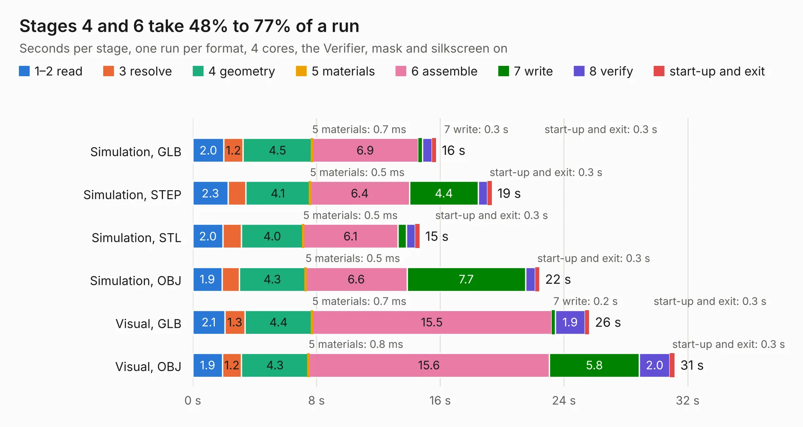

# 369. jetson-orin-baseboard-oculink-expansion

Board 369 of the 3,104 of [Corpus Testing](../Corpus-Testing.md), on [Corpus Page 4](../CorpusTestingPages/Corpus-Testing-04.md#369-jetson-orin-baseboard-oculink-expansion).

| Mode and format | 1–2 read | 3 resolve | 4 geometry | 5 materials | 6 assemble | 7 write | 8 verify | start-up and exit | Total |
|---|---:|---:|---:|---:|---:|---:|---:|---:|---:|
| Simulation, GLB | 2.0 | 1.2 | 4.5 | 0.7&nbsp;ms | 6.9 | 0.3 | 0.6 | 0.3 | 15.7 |
| Simulation, STEP | 2.3 | 1.2 | 4.1 | 0.5&nbsp;ms | 6.4 | 4.4 | 0.6 | 0.3 | 19.3 |
| Simulation, STL | 2.0 | 1.2 | 4.0 | 0.5&nbsp;ms | 6.1 | 0.5 | 0.6 | 0.3 | 14.7 |
| Simulation, OBJ | 1.9 | 1.1 | 4.3 | 0.5&nbsp;ms | 6.6 | 7.7 | 0.6 | 0.3 | 22.4 |
| Visual, GLB | 2.1 | 1.3 | 4.4 | 0.7&nbsp;ms | 15.5 | 0.2 | 1.9 | 0.3 | 25.6 |
| Visual, OBJ | 1.9 | 1.2 | 4.3 | 0.8&nbsp;ms | 15.6 | 5.8 | 2.0 | 0.3 | 31.2 |

<table align="center"><tr><td valign="top">

| Board | Repo: [antmicro/job-oculink-expansion](https://github.com/antmicro/job-oculink-expansion) Board: `jetson-orin-baseboard-oculink-expansion.kicad_pcb` |
|---|---|
| Complexity | 374&nbsp;/&nbsp;1000 (size&nbsp;254, features&nbsp;120) |
| KESE&nbsp;features | through vias, rounded, trapezoid or chamfered pads, arc tracks, filled zones, copper text, knockout text, stack-up, dielectric εr and tanδ, mask and silkscreen colours |
| Tested | 9th November 2026 |
| Copper&nbsp;layers | 4 |
| File&nbsp;format | KiCad 8 (20240108) |
| Parts,&nbsp;tracks,&nbsp;vias | 97, 1,265, 219 |
| Triangles,&nbsp;simulation | 1,861,222 in 153 parts |
| Verifier | PASS in all six runs |

</td><td valign="top">

<table>
<tr><th>File type</th><th>File size</th><th>Peak memory used</th></tr>
<tr><th colspan="3" align="left">Simulation</th></tr>
<tr><td>GLB</td><td align="right">64&nbsp;MB</td><td align="right">787&nbsp;MB</td></tr>
<tr><td>STEP</td><td align="right">312&nbsp;MB</td><td align="right">930&nbsp;MB</td></tr>
<tr><td>STL</td><td align="right">93&nbsp;MB</td><td align="right">801&nbsp;MB</td></tr>
<tr><td>OBJ</td><td align="right">194&nbsp;MB</td><td align="right">1.3&nbsp;GB</td></tr>
<tr><th colspan="3" align="left">Visual</th></tr>
<tr><td>GLB</td><td align="right">46&nbsp;MB</td><td align="right">984&nbsp;MB</td></tr>
<tr><td>OBJ</td><td align="right">142&nbsp;MB</td><td align="right">1.1&nbsp;GB</td></tr>
</table>

</td></tr></table>

| Previous | Next |
|:---|---:|
| [368. job-ict-support-board](b0368b_job-ict-support-board_job-ict-support-board.md) | [370. jetson-orin-baseboard-pcie-switch-expansion](b0370b_job-pcie-switch-expansion_jetson-orin-baseboard-pcie-switch-expansion.md) |
