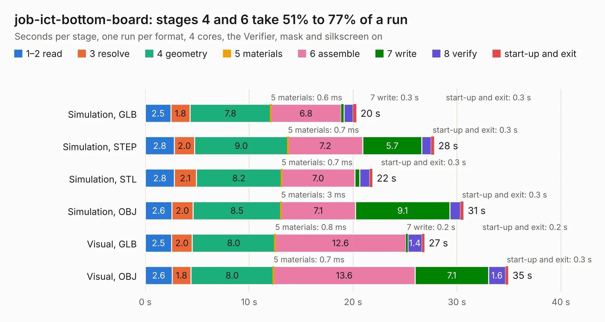

# 370. job-ict-bottom-board

Board 370 of the 3,122 of [Corpus Testing](../Corpus-Testing.md), on [Corpus Page 4](../CorpusTestingPages/Corpus-Testing-04.md#370-job-ict-bottom-board).

| Mode and format | 1–2 read | 3 resolve | 4 geometry | 5 materials | 6 assemble | 7 write | 8 verify | start-up and exit | Total |
|---|---:|---:|---:|---:|---:|---:|---:|---:|---:|
| Simulation, GLB | 2.5 | 1.8 | 7.8 | 0.6&nbsp;ms | 6.8 | 0.3 | 0.9 | 0.3 | 20.3 |
| Simulation, STEP | 2.8 | 2.0 | 9.0 | 0.7&nbsp;ms | 7.2 | 5.7 | 0.9 | 0.3 | 27.8 |
| Simulation, STL | 2.8 | 2.1 | 8.2 | 0.7&nbsp;ms | 7.0 | 0.5 | 0.9 | 0.3 | 21.9 |
| Simulation, OBJ | 2.6 | 2.0 | 8.5 | 3&nbsp;ms | 7.1 | 9.1 | 1.0 | 0.3 | 30.6 |
| Visual, GLB | 2.5 | 2.0 | 8.0 | 0.8&nbsp;ms | 12.6 | 0.2 | 1.4 | 0.2 | 26.9 |
| Visual, OBJ | 2.6 | 1.8 | 8.0 | 0.7&nbsp;ms | 13.6 | 7.1 | 1.6 | 0.3 | 34.9 |

<table align="center"><tr><td valign="top">

| Board | Repo: [antmicro/job-ict-bottom-board](https://github.com/antmicro/job-ict-bottom-board) Board: `job-ict-bottom-board.kicad_pcb` |
|---|---|
| Complexity | 323&nbsp;/&nbsp;1000 (size&nbsp;173, features&nbsp;150) |
| KESE&nbsp;features | through vias, custom pads, rounded, trapezoid or chamfered pads, filled zones, copper drawings, knockout text, TrueType text, stack-up, dielectric εr and tanδ, copper finish, mask and silkscreen colours |
| Tested | 9th November 2026 |
| Copper&nbsp;layers | 2 |
| File&nbsp;format | KiCad 9 (20241229) |
| Parts,&nbsp;tracks,&nbsp;vias | 93, 492, 64 |
| Triangles,&nbsp;simulation | 1,493,234 in 119 parts |
| Verifier | PASS in all six runs |

</td><td valign="top">

<table>
<tr><th>File type</th><th>File size</th><th>Peak memory used</th></tr>
<tr><th colspan="3" align="left">Simulation</th></tr>
<tr><td>GLB</td><td align="right">51&nbsp;MB</td><td align="right">653&nbsp;MB</td></tr>
<tr><td>STEP</td><td align="right">219&nbsp;MB</td><td align="right">798&nbsp;MB</td></tr>
<tr><td>STL</td><td align="right">75&nbsp;MB</td><td align="right">670&nbsp;MB</td></tr>
<tr><td>OBJ</td><td align="right">155&nbsp;MB</td><td align="right">1.1&nbsp;GB</td></tr>
<tr><th colspan="3" align="left">Visual</th></tr>
<tr><td>GLB</td><td align="right">37&nbsp;MB</td><td align="right">744&nbsp;MB</td></tr>
<tr><td>OBJ</td><td align="right">111&nbsp;MB</td><td align="right">851&nbsp;MB</td></tr>
</table>

</td></tr></table>

| Previous | Next |
|:---|---:|
| [369. jetson-orin-baseboard](b0369b_jetson-orin-baseboard_jetson-orin-baseboard.md) | [371. job-ict-support-board](b0371b_job-ict-support-board_job-ict-support-board.md) |
