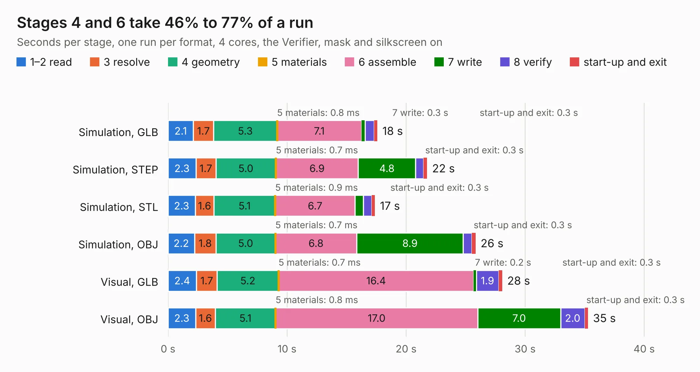

# 371. jetson-orin-baseboard-storage-expansion

Board 371 of the 3,109 of [Corpus Testing](../Corpus-Testing.md), on [Corpus Page 4](../CorpusTestingPages/Corpus-Testing-04.md#371-jetson-orin-baseboard-storage-expansion).

| Mode and format | 1–2 read | 3 resolve | 4 geometry | 5 materials | 6 assemble | 7 write | 8 verify | start-up and exit | Total |
|---|---:|---:|---:|---:|---:|---:|---:|---:|---:|
| Simulation, GLB | 2.1 | 1.7 | 5.3 | 0.8&nbsp;ms | 7.1 | 0.3 | 0.8 | 0.3 | 17.6 |
| Simulation, STEP | 2.3 | 1.7 | 5.0 | 0.7&nbsp;ms | 6.9 | 4.8 | 0.7 | 0.3 | 21.8 |
| Simulation, STL | 2.3 | 1.6 | 5.1 | 0.9&nbsp;ms | 6.7 | 0.7 | 0.7 | 0.3 | 17.4 |
| Simulation, OBJ | 2.2 | 1.8 | 5.0 | 0.7&nbsp;ms | 6.8 | 8.9 | 0.7 | 0.3 | 25.8 |
| Visual, GLB | 2.4 | 1.7 | 5.2 | 0.7&nbsp;ms | 16.4 | 0.2 | 1.9 | 0.3 | 28.1 |
| Visual, OBJ | 2.3 | 1.6 | 5.1 | 0.8&nbsp;ms | 17.0 | 7.0 | 2.0 | 0.3 | 35.3 |

<table align="center"><tr><td valign="top">

| Board | Repo: [antmicro/job-storage-expansion](https://github.com/antmicro/job-storage-expansion) Board: `jetson-orin-baseboard-storage-expansion.kicad_pcb` |
|---|---|
| Complexity | 411&nbsp;/&nbsp;1000 (size&nbsp;251, features&nbsp;160) |
| KESE&nbsp;features | through vias, slotted holes, custom pads, rounded, trapezoid or chamfered pads, arc tracks, filled zones, copper drawings, copper text, curved board outline, knockout text, stack-up, dielectric εr and tanδ |
| Tested | 9th November 2026 |
| Copper&nbsp;layers | 4 |
| File&nbsp;format | KiCad 9 (20241229) |
| Parts,&nbsp;tracks,&nbsp;vias | 88, 1,551, 378 |
| Triangles,&nbsp;simulation | 1,932,092 in 167 parts |
| Verifier | PASS in all six runs |

</td><td valign="top">

<table>
<tr><th>File type</th><th>File size</th><th>Peak memory used</th></tr>
<tr><th colspan="3" align="left">Simulation</th></tr>
<tr><td>GLB</td><td align="right">64&nbsp;MB</td><td align="right">850&nbsp;MB</td></tr>
<tr><td>STEP</td><td align="right">274&nbsp;MB</td><td align="right">1.0&nbsp;GB</td></tr>
<tr><td>STL</td><td align="right">97&nbsp;MB</td><td align="right">810&nbsp;MB</td></tr>
<tr><td>OBJ</td><td align="right">200&nbsp;MB</td><td align="right">1.4&nbsp;GB</td></tr>
<tr><th colspan="3" align="left">Visual</th></tr>
<tr><td>GLB</td><td align="right">48&nbsp;MB</td><td align="right">934&nbsp;MB</td></tr>
<tr><td>OBJ</td><td align="right">149&nbsp;MB</td><td align="right">1.1&nbsp;GB</td></tr>
</table>

</td></tr></table>

| Previous | Next |
|:---|---:|
| [370. jetson-orin-baseboard-pcie-switch-expansion](b0370b_job-pcie-switch-expansion_jetson-orin-baseboard-pcie-switch-expansion.md) | [372. kria-k26-devboard](b0372b_kria-k26-devboard_kria-k26-devboard.md) |
