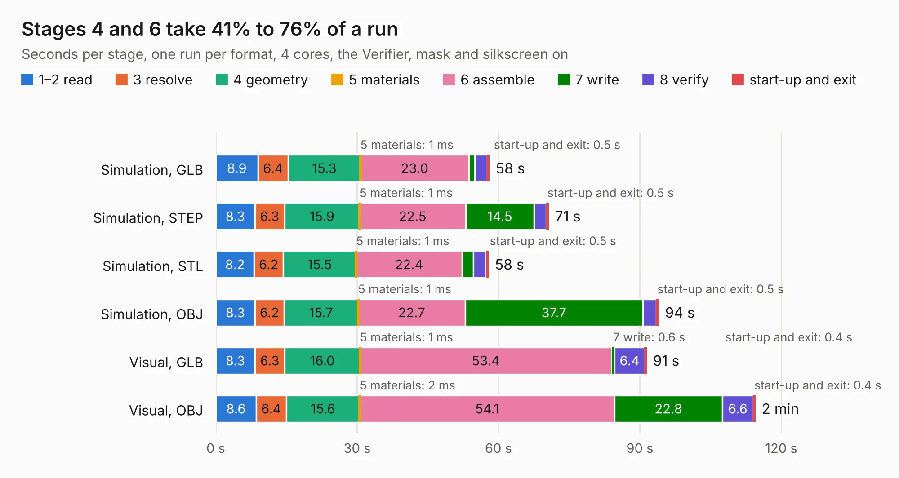

# 372. jetson-orin-baseboard-pcie-switch-expansion

Board 372 of the 3,117 of [Corpus Testing](../Corpus-Testing.md), on [Corpus Page 4](../CorpusTestingPages/Corpus-Testing-04.md#372-jetson-orin-baseboard-pcie-switch-expansion).

| Mode and format | 1–2 read | 3 resolve | 4 geometry | 5 materials | 6 assemble | 7 write | 8 verify | start-up and exit | Total |
|---|---:|---:|---:|---:|---:|---:|---:|---:|---:|
| Simulation, GLB | 8.9 | 6.4 | 15.3 | 1&nbsp;ms | 23.0 | 1.2 | 2.6 | 0.5 | 58.0 |
| Simulation, STEP | 8.3 | 6.3 | 15.9 | 1&nbsp;ms | 22.5 | 14.5 | 2.7 | 0.5 | 70.6 |
| Simulation, STL | 8.2 | 6.2 | 15.5 | 1&nbsp;ms | 22.4 | 2.5 | 2.6 | 0.5 | 57.8 |
| Simulation, OBJ | 8.3 | 6.2 | 15.7 | 1&nbsp;ms | 22.7 | 37.7 | 2.9 | 0.5 | 94.0 |
| Visual, GLB | 8.3 | 6.3 | 16.0 | 1&nbsp;ms | 53.4 | 0.6 | 6.4 | 0.4 | 91.4 |
| Visual, OBJ | 8.6 | 6.4 | 15.6 | 2&nbsp;ms | 54.1 | 22.8 | 6.6 | 0.4 | 114.5 |

<table align="center"><tr><td valign="top">

| Board | Repo: [antmicro/job-pcie-switch-expansion](https://github.com/antmicro/job-pcie-switch-expansion) Board: `jetson-orin-baseboard-pcie-switch-expansion.kicad_pcb` |
|---|---|
| Complexity | 489&nbsp;/&nbsp;1000 (size&nbsp;304, features&nbsp;185) |
| KESE&nbsp;features | through vias, custom pads, rounded, trapezoid or chamfered pads, arc tracks, filled zones, copper drawings, copper text, curved board outline, knockout text, TrueType text, stack-up, dielectric εr and tanδ, copper finish, mask and silkscreen colours |
| Tested | 9th November 2026 |
| Copper&nbsp;layers | 6 |
| File&nbsp;format | KiCad 10 (20260206) |
| Parts,&nbsp;tracks,&nbsp;vias | 297, 4,689, 779 |
| Triangles,&nbsp;simulation | 5,931,152 in 404 parts |
| Verifier | PASS in all six runs |

</td><td valign="top">

<table>
<tr><th>File type</th><th>File size</th><th>Peak memory used</th></tr>
<tr><th colspan="3" align="left">Simulation</th></tr>
<tr><td>GLB</td><td align="right">202&nbsp;MB</td><td align="right">1.9&nbsp;GB</td></tr>
<tr><td>STEP</td><td align="right">759&nbsp;MB</td><td align="right">2.2&nbsp;GB</td></tr>
<tr><td>STL</td><td align="right">297&nbsp;MB</td><td align="right">1.9&nbsp;GB</td></tr>
<tr><td>OBJ</td><td align="right">632&nbsp;MB</td><td align="right">3.9&nbsp;GB</td></tr>
<tr><th colspan="3" align="left">Visual</th></tr>
<tr><td>GLB</td><td align="right">122&nbsp;MB</td><td align="right">2.2&nbsp;GB</td></tr>
<tr><td>OBJ</td><td align="right">396&nbsp;MB</td><td align="right">2.9&nbsp;GB</td></tr>
</table>

</td></tr></table>

| Previous | Next |
|:---|---:|
| [371. jetson-orin-baseboard-oculink-expansion](b0371b_job-oculink-expansion_jetson-orin-baseboard-oculink-expansion.md) | [373. jetson-orin-baseboard-storage-expansion](b0373b_job-storage-expansion_jetson-orin-baseboard-storage-expansion.md) |
