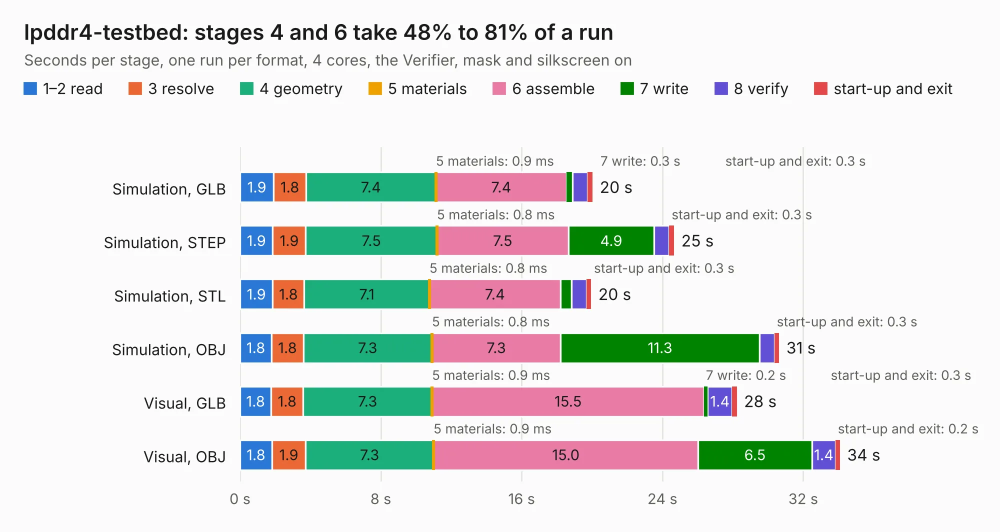

# 372. lpddr4-testbed

Board 372 of the 3,101 of [Corpus Testing](../Corpus-Testing.md), on [Corpus Page 4](../CorpusTestingPages/Corpus-Testing-04.md#372-lpddr4-testbed).

| Mode and format | 1–2 read | 3 resolve | 4 geometry | 5 materials | 6 assemble | 7 write | 8 verify | start-up and exit | Total |
|---|---:|---:|---:|---:|---:|---:|---:|---:|---:|
| Simulation, GLB | 1.9 | 1.8 | 7.4 | 0.9&nbsp;ms | 7.4 | 0.3 | 0.9 | 0.3 | 20.0 |
| Simulation, STEP | 1.9 | 1.9 | 7.5 | 0.8&nbsp;ms | 7.5 | 4.9 | 0.9 | 0.3 | 24.7 |
| Simulation, STL | 1.9 | 1.8 | 7.1 | 0.8&nbsp;ms | 7.4 | 0.6 | 0.8 | 0.3 | 20.0 |
| Simulation, OBJ | 1.8 | 1.8 | 7.3 | 0.8&nbsp;ms | 7.3 | 11.3 | 0.9 | 0.3 | 30.6 |
| Visual, GLB | 1.8 | 1.8 | 7.3 | 0.9&nbsp;ms | 15.5 | 0.2 | 1.4 | 0.3 | 28.2 |
| Visual, OBJ | 1.8 | 1.9 | 7.3 | 0.9&nbsp;ms | 15.0 | 6.5 | 1.4 | 0.2 | 34.1 |

<table align="center"><tr><td valign="top">

| Board | Repo: [antmicro/lpddr4-testbed](https://github.com/antmicro/lpddr4-testbed) Board: `lpddr4-testbed.kicad_pcb` |
|---|---|
| Complexity | 377&nbsp;/&nbsp;1000 (size&nbsp;267, features&nbsp;110) |
| KESE&nbsp;features | through vias, rounded, trapezoid or chamfered pads, arc tracks, filled zones, copper text, curved board outline, stack-up, dielectric εr and tanδ |
| Tested | 9th November 2026 |
| Copper&nbsp;layers | 6 |
| File&nbsp;format | KiCad 9 (20241229) |
| Parts,&nbsp;tracks,&nbsp;vias | 63, 1,498, 248 |
| Triangles,&nbsp;simulation | 2,042,424 in 275 parts |
| Verifier | PASS in all six runs |

</td><td valign="top">

<table>
<tr><th>File type</th><th>File size</th><th>Peak memory used</th></tr>
<tr><th colspan="3" align="left">Simulation</th></tr>
<tr><td>GLB</td><td align="right">69&nbsp;MB</td><td align="right">747&nbsp;MB</td></tr>
<tr><td>STEP</td><td align="right">283&nbsp;MB</td><td align="right">897&nbsp;MB</td></tr>
<tr><td>STL</td><td align="right">102&nbsp;MB</td><td align="right">840&nbsp;MB</td></tr>
<tr><td>OBJ</td><td align="right">216&nbsp;MB</td><td align="right">1.4&nbsp;GB</td></tr>
<tr><th colspan="3" align="left">Visual</th></tr>
<tr><td>GLB</td><td align="right">39&nbsp;MB</td><td align="right">844&nbsp;MB</td></tr>
<tr><td>OBJ</td><td align="right">121&nbsp;MB</td><td align="right">932&nbsp;MB</td></tr>
</table>

</td></tr></table>

| Previous | Next |
|:---|---:|
| [371. lpddr4-test-board](b0371b_lpddr4-test-board_lpddr4-test-board.md) | [373. lpddr5-testbed](b0373b_lpddr5-testbed_lpddr5-testbed.md) |
