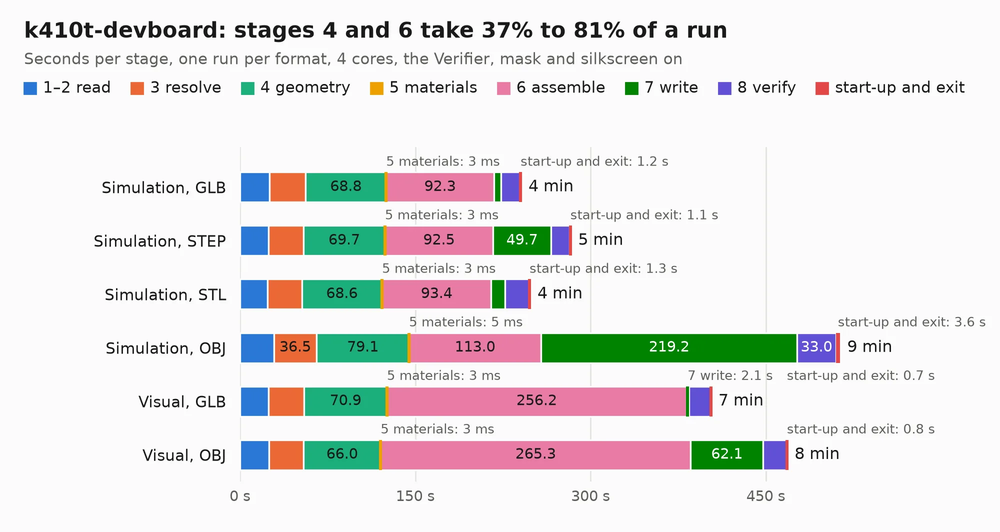

# 375. k410t-devboard

Board 375 of the 3,130 of [Corpus Testing](../Corpus-Testing.md), on [Corpus Page 4](../CorpusTestingPages/Corpus-Testing-04.md#375-k410t-devboard).

| Mode and format | 1–2 read | 3 resolve | 4 geometry | 5 materials | 6 assemble | 7 write | 8 verify | start-up and exit | Total |
|---|---:|---:|---:|---:|---:|---:|---:|---:|---:|
| Simulation, GLB | 25.1 | 31.1 | 68.8 | 3&nbsp;ms | 92.3 | 6.0 | 16.1 | 1.2 | 240.7 |
| Simulation, STEP | 24.5 | 29.8 | 69.7 | 3&nbsp;ms | 92.5 | 49.7 | 16.0 | 1.1 | 283.2 |
| Simulation, STL | 23.7 | 29.2 | 68.6 | 3&nbsp;ms | 93.4 | 11.7 | 20.5 | 1.3 | 248.4 |
| Simulation, OBJ | 29.0 | 36.5 | 79.1 | 5&nbsp;ms | 113.0 | 219.2 | 33.0 | 3.6 | 513.5 |
| Visual, GLB | 24.4 | 30.5 | 70.9 | 3&nbsp;ms | 256.2 | 2.1 | 18.5 | 0.7 | 403.3 |
| Visual, OBJ | 24.8 | 29.6 | 66.0 | 3&nbsp;ms | 265.3 | 62.1 | 19.9 | 0.8 | 468.5 |

<table align="center"><tr><td valign="top">

| Board | Repo: [antmicro/kintex-410t-devboard](https://github.com/antmicro/kintex-410t-devboard) Board: `k410t-devboard.kicad_pcb` |
|---|---|
| Complexity | 497&nbsp;/&nbsp;1000 (size&nbsp;367, features&nbsp;130) |
| KESE&nbsp;features | through vias, slotted holes, custom pads, rounded, trapezoid or chamfered pads, arc tracks, filled zones, copper drawings, stack-up, dielectric εr and tanδ, mask and silkscreen colours |
| Tested | 9th November 2026 to 11th November 2026 |
| Copper&nbsp;layers | 10 |
| File&nbsp;format | KiCad 9 (20241229) |
| Parts,&nbsp;tracks,&nbsp;vias | 962, 19,907, 2,762 |
| Triangles,&nbsp;simulation | 29,401,472 in 1433 parts |
| Verifier | PASS in all six runs |
| Run&nbsp;again | Simulation, OBJ: failed in the corpus run, run again with no memory cap and no time limit (swap added to a 16 GB machine), and passed |

</td><td valign="top">

<table>
<tr><th>File type</th><th>File size</th><th>Peak memory used</th></tr>
<tr><th colspan="3" align="left">Simulation</th></tr>
<tr><td>GLB</td><td align="right">978&nbsp;MB</td><td align="right">6.3&nbsp;GB</td></tr>
<tr><td>STEP</td><td align="right">2.9&nbsp;GB</td><td align="right">8.2&nbsp;GB</td></tr>
<tr><td>STL</td><td align="right">1.5&nbsp;GB</td><td align="right">6.2&nbsp;GB</td></tr>
<tr><td>OBJ</td><td align="right">3.3&nbsp;GB</td><td align="right">19&nbsp;GB</td></tr>
<tr><th colspan="3" align="left">Visual</th></tr>
<tr><td>GLB</td><td align="right">430&nbsp;MB</td><td align="right">7.8&nbsp;GB</td></tr>
<tr><td>OBJ</td><td align="right">1.5&nbsp;GB</td><td align="right">9.9&nbsp;GB</td></tr>
</table>

</td></tr></table>

| Previous | Next |
|:---|---:|
| [374. jetson-orin-baseboard-storage-expansion](b0374b_job-storage-expansion_jetson-orin-baseboard-storage-expansion.md) | [376. kria-k26-devboard](b0376b_kria-k26-devboard_kria-k26-devboard.md) |
