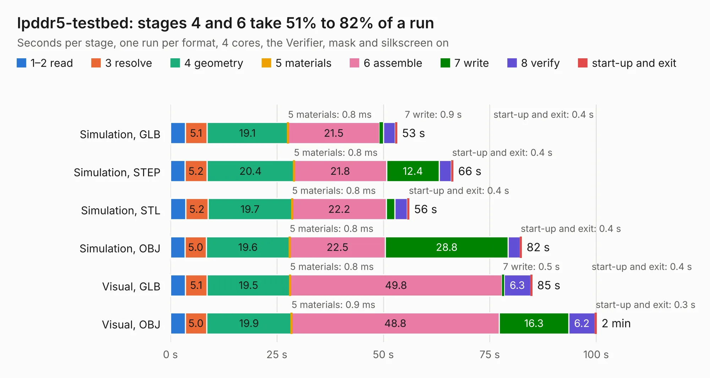

# 375. lpddr5-testbed

Board 375 of the 3,108 of [Corpus Testing](../Corpus-Testing.md), on [Corpus Page 4](../CorpusTestingPages/Corpus-Testing-04.md#375-lpddr5-testbed).

| Mode and format | 1–2 read | 3 resolve | 4 geometry | 5 materials | 6 assemble | 7 write | 8 verify | start-up and exit | Total |
|---|---:|---:|---:|---:|---:|---:|---:|---:|---:|
| Simulation, GLB | 3.5 | 5.1 | 19.1 | 0.8&nbsp;ms | 21.5 | 0.9 | 2.8 | 0.4 | 53.2 |
| Simulation, STEP | 3.4 | 5.2 | 20.4 | 0.8&nbsp;ms | 21.8 | 12.4 | 2.8 | 0.4 | 66.4 |
| Simulation, STL | 3.6 | 5.2 | 19.7 | 0.8&nbsp;ms | 22.2 | 2.0 | 2.9 | 0.4 | 56.0 |
| Simulation, OBJ | 3.4 | 5.0 | 19.6 | 0.8&nbsp;ms | 22.5 | 28.8 | 2.8 | 0.4 | 82.5 |
| Visual, GLB | 3.5 | 5.1 | 19.5 | 0.8&nbsp;ms | 49.8 | 0.5 | 6.3 | 0.4 | 85.0 |
| Visual, OBJ | 3.5 | 5.0 | 19.9 | 0.9&nbsp;ms | 48.8 | 16.3 | 6.2 | 0.3 | 100.1 |

<table align="center"><tr><td valign="top">

| Board | Repo: [antmicro/lpddr5-testbed](https://github.com/antmicro/lpddr5-testbed) Board: `lpddr5-testbed.kicad_pcb` |
|---|---|
| Complexity | 417&nbsp;/&nbsp;1000 (size&nbsp;302, features&nbsp;115) |
| KESE&nbsp;features | through vias, rounded, trapezoid or chamfered pads, arc tracks, filled zones, copper text, curved board outline, stack-up, dielectric εr and tanδ, mask and silkscreen colours |
| Tested | 9th November 2026 |
| Copper&nbsp;layers | 6 |
| File&nbsp;format | KiCad 9 (20241229) |
| Parts,&nbsp;tracks,&nbsp;vias | 152, 5,078, 590 |
| Triangles,&nbsp;simulation | 5,169,826 in 244 parts |
| Verifier | PASS in all six runs |

</td><td valign="top">

<table>
<tr><th>File type</th><th>File size</th><th>Peak memory used</th></tr>
<tr><th colspan="3" align="left">Simulation</th></tr>
<tr><td>GLB</td><td align="right">176&nbsp;MB</td><td align="right">1.5&nbsp;GB</td></tr>
<tr><td>STEP</td><td align="right">766&nbsp;MB</td><td align="right">1.9&nbsp;GB</td></tr>
<tr><td>STL</td><td align="right">259&nbsp;MB</td><td align="right">1.5&nbsp;GB</td></tr>
<tr><td>OBJ</td><td align="right">555&nbsp;MB</td><td align="right">3.4&nbsp;GB</td></tr>
<tr><th colspan="3" align="left">Visual</th></tr>
<tr><td>GLB</td><td align="right">100&nbsp;MB</td><td align="right">1.8&nbsp;GB</td></tr>
<tr><td>OBJ</td><td align="right">323&nbsp;MB</td><td align="right">2.3&nbsp;GB</td></tr>
</table>

</td></tr></table>

| Previous | Next |
|:---|---:|
| [374. lpddr4-testbed](b0374b_lpddr4-testbed_lpddr4-testbed.md) | [376. antmicro-m2-oculink-adapter-hw](b0376b_m2-oculink-adapter_antmicro-m2-oculink-adapter-hw.md) |
