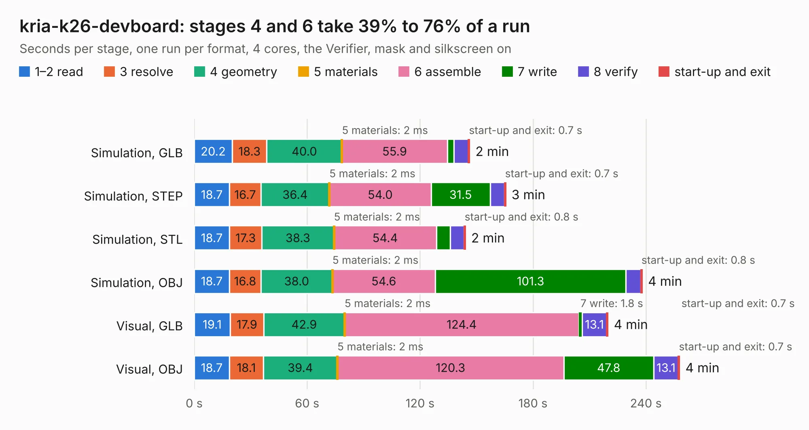

# 377. kria-k26-devboard

Board 377 of the 3,139 of [Corpus Testing](../Corpus-Testing.md), on [Corpus Page 4](../CorpusTestingPages/Corpus-Testing-04.md#377-kria-k26-devboard).

| Mode and format | 1–2 read | 3 resolve | 4 geometry | 5 materials | 6 assemble | 7 write | 8 verify | start-up and exit | Total |
|---|---:|---:|---:|---:|---:|---:|---:|---:|---:|
| Simulation, GLB | 20.2 | 18.3 | 40.0 | 2&nbsp;ms | 55.9 | 3.6 | 7.6 | 0.7 | 146.4 |
| Simulation, STEP | 18.7 | 16.7 | 36.4 | 2&nbsp;ms | 54.0 | 31.5 | 7.5 | 0.7 | 165.6 |
| Simulation, STL | 18.7 | 17.3 | 38.3 | 2&nbsp;ms | 54.4 | 7.5 | 7.2 | 0.8 | 144.1 |
| Simulation, OBJ | 18.7 | 16.8 | 38.0 | 2&nbsp;ms | 54.6 | 101.3 | 7.9 | 0.8 | 238.1 |
| Visual, GLB | 19.1 | 17.9 | 42.9 | 2&nbsp;ms | 124.4 | 1.8 | 13.1 | 0.7 | 219.9 |
| Visual, OBJ | 18.7 | 18.1 | 39.4 | 2&nbsp;ms | 120.3 | 47.8 | 13.1 | 0.7 | 257.9 |

<table align="center"><tr><td valign="top">

| Board | Repo: [antmicro/kria-k26-devboard](https://github.com/antmicro/kria-k26-devboard) Board: `kria-k26-devboard.kicad_pcb` |
|---|---|
| Complexity | 491&nbsp;/&nbsp;1000 (size&nbsp;336, features&nbsp;155) |
| KESE&nbsp;features | through vias, slotted holes, custom pads, rounded, trapezoid or chamfered pads, arc tracks, filled zones, copper drawings, copper text, stack-up, dielectric εr and tanδ, copper finish, mask and silkscreen colours |
| Tested | 9th November 2026 |
| Copper&nbsp;layers | 8 |
| File&nbsp;format | KiCad 7 (20221018) |
| Parts,&nbsp;tracks,&nbsp;vias | 577, 20,506, 1,901 |
| Triangles,&nbsp;simulation | 15,836,218 in 822 parts |
| Verifier | PASS in all six runs |

</td><td valign="top">

<table>
<tr><th>File type</th><th>File size</th><th>Peak memory used</th></tr>
<tr><th colspan="3" align="left">Simulation</th></tr>
<tr><td>GLB</td><td align="right">527&nbsp;MB</td><td align="right">4.3&nbsp;GB</td></tr>
<tr><td>STEP</td><td align="right">1.6&nbsp;GB</td><td align="right">5.2&nbsp;GB</td></tr>
<tr><td>STL</td><td align="right">792&nbsp;MB</td><td align="right">4.0&nbsp;GB</td></tr>
<tr><td>OBJ</td><td align="right">1.7&nbsp;GB</td><td align="right">10&nbsp;GB</td></tr>
<tr><th colspan="3" align="left">Visual</th></tr>
<tr><td>GLB</td><td align="right">256&nbsp;MB</td><td align="right">4.6&nbsp;GB</td></tr>
<tr><td>OBJ</td><td align="right">853&nbsp;MB</td><td align="right">5.8&nbsp;GB</td></tr>
</table>

</td></tr></table>

| Previous | Next |
|:---|---:|
| [376. k410t-devboard](b0376b_kintex-410t-devboard_k410t-devboard.md) | [378. lpddr4-test-board](b0378b_lpddr4-test-board_lpddr4-test-board.md) |
