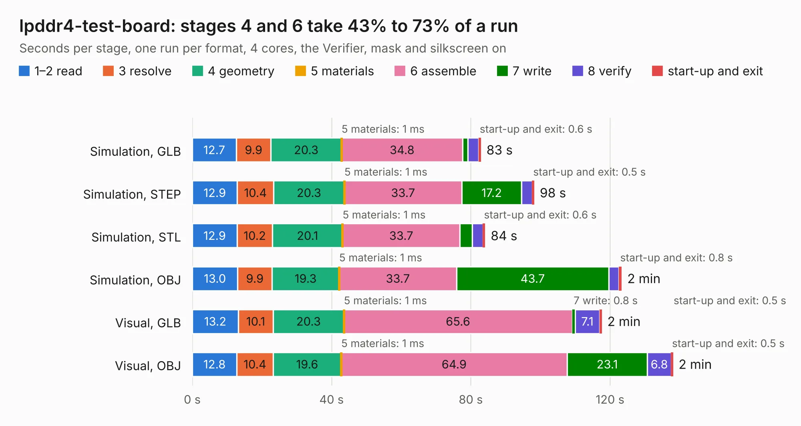

# 377. lpddr4-test-board

Board 377 of the 3,126 of [Corpus Testing](../Corpus-Testing.md), on [Corpus Page 4](../CorpusTestingPages/Corpus-Testing-04.md#377-lpddr4-test-board).

| Mode and format | 1–2 read | 3 resolve | 4 geometry | 5 materials | 6 assemble | 7 write | 8 verify | start-up and exit | Total |
|---|---:|---:|---:|---:|---:|---:|---:|---:|---:|
| Simulation, GLB | 12.7 | 9.9 | 20.3 | 1&nbsp;ms | 34.8 | 1.5 | 3.1 | 0.6 | 82.9 |
| Simulation, STEP | 12.9 | 10.4 | 20.3 | 1&nbsp;ms | 33.7 | 17.2 | 3.1 | 0.5 | 98.2 |
| Simulation, STL | 12.9 | 10.2 | 20.1 | 1&nbsp;ms | 33.7 | 3.6 | 3.1 | 0.6 | 84.1 |
| Simulation, OBJ | 13.0 | 9.9 | 19.3 | 1&nbsp;ms | 33.7 | 43.7 | 2.9 | 0.8 | 123.3 |
| Visual, GLB | 13.2 | 10.1 | 20.3 | 1&nbsp;ms | 65.6 | 0.8 | 7.1 | 0.5 | 117.6 |
| Visual, OBJ | 12.8 | 10.4 | 19.6 | 1&nbsp;ms | 64.9 | 23.1 | 6.8 | 0.5 | 138.0 |

<table align="center"><tr><td valign="top">

| Board | Repo: [antmicro/lpddr4-test-board](https://github.com/antmicro/lpddr4-test-board) Board: `lpddr4-test-board.kicad_pcb` |
|---|---|
| Complexity | 514&nbsp;/&nbsp;1000 (size&nbsp;324, features&nbsp;190) |
| KESE&nbsp;features | through vias, blind and buried vias, slotted holes, custom pads, rounded, trapezoid or chamfered pads, arc tracks, filled zones, copper drawings, copper text, TrueType text, stack-up, dielectric εr and tanδ |
| Tested | 9th November 2026 |
| Copper&nbsp;layers | 8 |
| File&nbsp;format | KiCad 9 (20241229) |
| Parts,&nbsp;tracks,&nbsp;vias | 445, 5,712, 1,214 |
| Triangles,&nbsp;simulation | 9,482,776 in 688 parts |
| Verifier | PASS in all six runs |

</td><td valign="top">

<table>
<tr><th>File type</th><th>File size</th><th>Peak memory used</th></tr>
<tr><th colspan="3" align="left">Simulation</th></tr>
<tr><td>GLB</td><td align="right">314&nbsp;MB</td><td align="right">2.6&nbsp;GB</td></tr>
<tr><td>STEP</td><td align="right">1.0&nbsp;GB</td><td align="right">3.6&nbsp;GB</td></tr>
<tr><td>STL</td><td align="right">474&nbsp;MB</td><td align="right">2.6&nbsp;GB</td></tr>
<tr><td>OBJ</td><td align="right">1.0&nbsp;GB</td><td align="right">6.3&nbsp;GB</td></tr>
<tr><th colspan="3" align="left">Visual</th></tr>
<tr><td>GLB</td><td align="right">171&nbsp;MB</td><td align="right">3.1&nbsp;GB</td></tr>
<tr><td>OBJ</td><td align="right">569&nbsp;MB</td><td align="right">3.9&nbsp;GB</td></tr>
</table>

</td></tr></table>

| Previous | Next |
|:---|---:|
| [376. kria-k26-devboard](b0376b_kria-k26-devboard_kria-k26-devboard.md) | [378. lpddr4-testbed](b0378b_lpddr4-testbed_lpddr4-testbed.md) |
