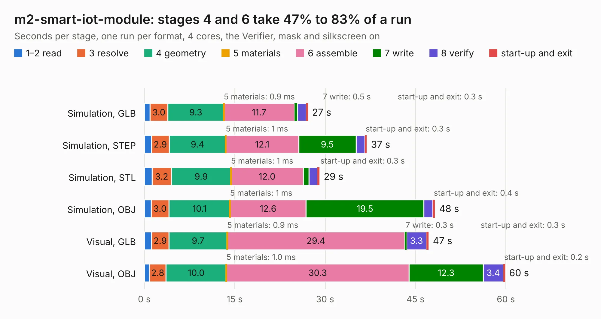

# 378. m2-smart-iot-module

Board 378 of the 3,108 of [Corpus Testing](../Corpus-Testing.md), on [Corpus Page 4](../CorpusTestingPages/Corpus-Testing-04.md#378-m2-smart-iot-module).

| Mode and format | 1–2 read | 3 resolve | 4 geometry | 5 materials | 6 assemble | 7 write | 8 verify | start-up and exit | Total |
|---|---:|---:|---:|---:|---:|---:|---:|---:|---:|
| Simulation, GLB | 0.9 | 3.0 | 9.3 | 0.9&nbsp;ms | 11.7 | 0.5 | 1.4 | 0.3 | 27.1 |
| Simulation, STEP | 1.2 | 2.9 | 9.4 | 1&nbsp;ms | 12.1 | 9.5 | 1.4 | 0.3 | 36.9 |
| Simulation, STL | 1.3 | 3.2 | 9.9 | 1&nbsp;ms | 12.0 | 0.9 | 1.4 | 0.3 | 29.1 |
| Simulation, OBJ | 1.1 | 3.0 | 10.1 | 1&nbsp;ms | 12.6 | 19.5 | 1.5 | 0.4 | 48.2 |
| Visual, GLB | 1.2 | 2.9 | 9.7 | 0.9&nbsp;ms | 29.4 | 0.3 | 3.3 | 0.3 | 47.2 |
| Visual, OBJ | 0.9 | 2.8 | 10.0 | 1.0&nbsp;ms | 30.3 | 12.3 | 3.4 | 0.2 | 59.8 |

<table align="center"><tr><td valign="top">

| Board | Repo: [antmicro/m2-smart-iot-module](https://github.com/antmicro/m2-smart-iot-module) Board: `m2-smart-iot-module.kicad_pcb` |
|---|---|
| Complexity | 393&nbsp;/&nbsp;1000 (size&nbsp;268, features&nbsp;125) |
| KESE&nbsp;features | through vias, custom pads, rounded, trapezoid or chamfered pads, arc tracks, filled zones, copper drawings, curved board outline, stack-up, dielectric εr and tanδ |
| Tested | 9th November 2026 |
| Copper&nbsp;layers | 4 |
| File&nbsp;format | KiCad 10 (20260206) |
| Parts,&nbsp;tracks,&nbsp;vias | 195, 1,615, 435 |
| Triangles,&nbsp;simulation | 2,528,042 in 263 parts |
| Verifier | PASS in all six runs |

</td><td valign="top">

<table>
<tr><th>File type</th><th>File size</th><th>Peak memory used</th></tr>
<tr><th colspan="3" align="left">Simulation</th></tr>
<tr><td>GLB</td><td align="right">87&nbsp;MB</td><td align="right">817&nbsp;MB</td></tr>
<tr><td>STEP</td><td align="right">423&nbsp;MB</td><td align="right">1.1&nbsp;GB</td></tr>
<tr><td>STL</td><td align="right">126&nbsp;MB</td><td align="right">876&nbsp;MB</td></tr>
<tr><td>OBJ</td><td align="right">271&nbsp;MB</td><td align="right">1.7&nbsp;GB</td></tr>
<tr><th colspan="3" align="left">Visual</th></tr>
<tr><td>GLB</td><td align="right">61&nbsp;MB</td><td align="right">1.1&nbsp;GB</td></tr>
<tr><td>OBJ</td><td align="right">190&nbsp;MB</td><td align="right">1.3&nbsp;GB</td></tr>
</table>

</td></tr></table>

| Previous | Next |
|:---|---:|
| [377. m2-pcie-adapter](b0377b_m2-pcie-adapter_m2-pcie-adapter.md) | [379. machxo5-espi-debugger](b0379b_machx05-espi-debugger_machxo5-espi-debugger.md) |
