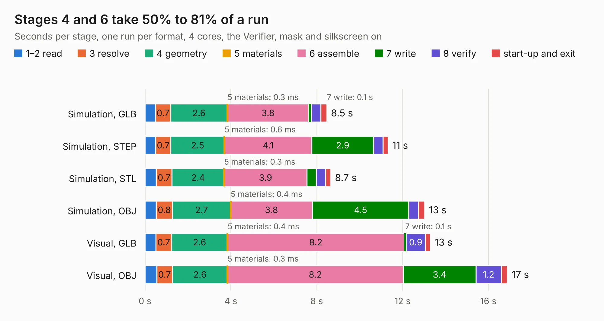

# 380. antmicro-m2-oculink-adapter-hw

Board 380 of the 3,120 of [Corpus Testing](../Corpus-Testing.md), on [Corpus Page 4](../CorpusTestingPages/Corpus-Testing-04.md#380-antmicro-m2-oculink-adapter-hw).

| Mode and format | 1–2 read | 3 resolve | 4 geometry | 5 materials | 6 assemble | 7 write | 8 verify | start-up and exit | Total |
|---|---:|---:|---:|---:|---:|---:|---:|---:|---:|
| Simulation, GLB | 0.5 | 0.7 | 2.6 | 0.3&nbsp;ms | 3.8 | 0.1 | 0.4 | 0.3 | 8.5 |
| Simulation, STEP | 0.5 | 0.7 | 2.5 | 0.6&nbsp;ms | 4.1 | 2.9 | 0.4 | 0.2 | 11.3 |
| Simulation, STL | 0.5 | 0.7 | 2.4 | 0.3&nbsp;ms | 3.9 | 0.4 | 0.4 | 0.2 | 8.7 |
| Simulation, OBJ | 0.5 | 0.8 | 2.7 | 0.4&nbsp;ms | 3.8 | 4.5 | 0.4 | 0.3 | 13.0 |
| Visual, GLB | 0.5 | 0.7 | 2.6 | 0.4&nbsp;ms | 8.2 | 0.1 | 0.9 | 0.2 | 13.3 |
| Visual, OBJ | 0.5 | 0.7 | 2.6 | 0.3&nbsp;ms | 8.2 | 3.4 | 1.2 | 0.3 | 16.9 |

<table align="center"><tr><td valign="top">

| Board | Repo: [antmicro/m2-oculink-adapter](https://github.com/antmicro/m2-oculink-adapter) Board: `antmicro-m2-oculink-adapter-hw.kicad_pcb` |
|---|---|
| Complexity | 296&nbsp;/&nbsp;1000 (size&nbsp;181, features&nbsp;115) |
| KESE&nbsp;features | through vias, rounded, trapezoid or chamfered pads, arc tracks, filled zones, copper text, curved board outline, stack-up, dielectric εr and tanδ, mask and silkscreen colours |
| Tested | 9th November 2026 |
| Copper&nbsp;layers | 4 |
| File&nbsp;format | KiCad 9 (20241229) |
| Parts,&nbsp;tracks,&nbsp;vias | 19, 577, 183 |
| Triangles,&nbsp;simulation | 873,538 in 72 parts |
| Verifier | PASS in all six runs |

</td><td valign="top">

<table>
<tr><th>File type</th><th>File size</th><th>Peak memory used</th></tr>
<tr><th colspan="3" align="left">Simulation</th></tr>
<tr><td>GLB</td><td align="right">30&nbsp;MB</td><td align="right">440&nbsp;MB</td></tr>
<tr><td>STEP</td><td align="right">132&nbsp;MB</td><td align="right">533&nbsp;MB</td></tr>
<tr><td>STL</td><td align="right">44&nbsp;MB</td><td align="right">429&nbsp;MB</td></tr>
<tr><td>OBJ</td><td align="right">89&nbsp;MB</td><td align="right">638&nbsp;MB</td></tr>
<tr><th colspan="3" align="left">Visual</th></tr>
<tr><td>GLB</td><td align="right">22&nbsp;MB</td><td align="right">590&nbsp;MB</td></tr>
<tr><td>OBJ</td><td align="right">67&nbsp;MB</td><td align="right">584&nbsp;MB</td></tr>
</table>

</td></tr></table>

| Previous | Next |
|:---|---:|
| [379. lpddr5-testbed](b0379b_lpddr5-testbed_lpddr5-testbed.md) | [381. m2-pcie-adapter](b0381b_m2-pcie-adapter_m2-pcie-adapter.md) |
