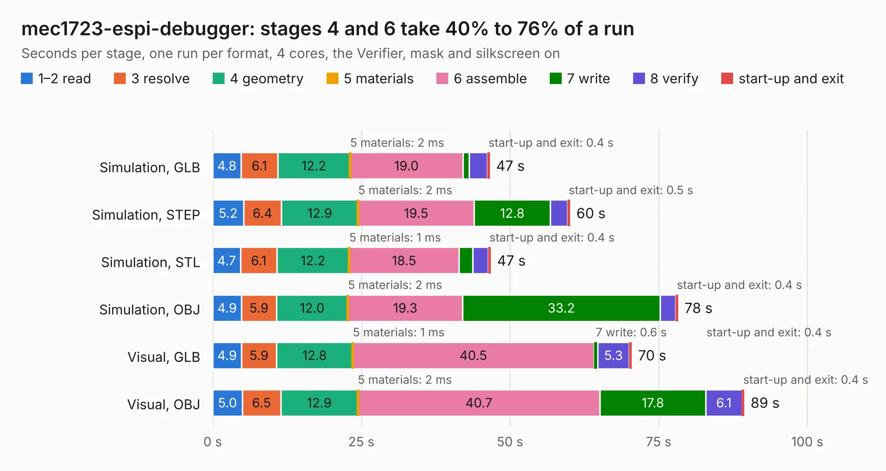

# 380. mec1723-espi-debugger

Board 380 of the 3,109 of [Corpus Testing](../Corpus-Testing.md), on [Corpus Page 4](../CorpusTestingPages/Corpus-Testing-04.md#380-mec1723-espi-debugger).

| Mode and format | 1–2 read | 3 resolve | 4 geometry | 5 materials | 6 assemble | 7 write | 8 verify | start-up and exit | Total |
|---|---:|---:|---:|---:|---:|---:|---:|---:|---:|
| Simulation, GLB | 4.8 | 6.1 | 12.2 | 2&nbsp;ms | 19.0 | 1.0 | 3.1 | 0.4 | 46.6 |
| Simulation, STEP | 5.2 | 6.4 | 12.9 | 2&nbsp;ms | 19.5 | 12.8 | 2.8 | 0.5 | 60.1 |
| Simulation, STL | 4.7 | 6.1 | 12.2 | 1&nbsp;ms | 18.5 | 2.3 | 2.6 | 0.4 | 46.8 |
| Simulation, OBJ | 4.9 | 5.9 | 12.0 | 2&nbsp;ms | 19.3 | 33.2 | 2.6 | 0.4 | 78.3 |
| Visual, GLB | 4.9 | 5.9 | 12.8 | 1&nbsp;ms | 40.5 | 0.6 | 5.3 | 0.4 | 70.5 |
| Visual, OBJ | 5.0 | 6.5 | 12.9 | 2&nbsp;ms | 40.7 | 17.8 | 6.1 | 0.4 | 89.4 |

<table align="center"><tr><td valign="top">

| Board | Repo: [antmicro/mec1723-espi-debugger](https://github.com/antmicro/mec1723-espi-debugger) Board: `mec1723-espi-debugger.kicad_pcb` |
|---|---|
| Complexity | 471&nbsp;/&nbsp;1000 (size&nbsp;301, features&nbsp;170) |
| KESE&nbsp;features | through vias, slotted holes, custom pads, rounded, trapezoid or chamfered pads, arc tracks, filled zones, copper drawings, copper text, knockout text, stack-up, dielectric εr and tanδ, copper finish, mask and silkscreen colours |
| Tested | 9th November 2026 |
| Copper&nbsp;layers | 8 |
| File&nbsp;format | KiCad 10 (20260206) |
| Parts,&nbsp;tracks,&nbsp;vias | 212, 3,327, 470 |
| Triangles,&nbsp;simulation | 4,657,560 in 302 parts |
| Verifier | PASS in all six runs |

</td><td valign="top">

<table>
<tr><th>File type</th><th>File size</th><th>Peak memory used</th></tr>
<tr><th colspan="3" align="left">Simulation</th></tr>
<tr><td>GLB</td><td align="right">158&nbsp;MB</td><td align="right">1.3&nbsp;GB</td></tr>
<tr><td>STEP</td><td align="right">528&nbsp;MB</td><td align="right">1.6&nbsp;GB</td></tr>
<tr><td>STL</td><td align="right">233&nbsp;MB</td><td align="right">1.3&nbsp;GB</td></tr>
<tr><td>OBJ</td><td align="right">497&nbsp;MB</td><td align="right">3.0&nbsp;GB</td></tr>
<tr><th colspan="3" align="left">Visual</th></tr>
<tr><td>GLB</td><td align="right">86&nbsp;MB</td><td align="right">1.6&nbsp;GB</td></tr>
<tr><td>OBJ</td><td align="right">283&nbsp;MB</td><td align="right">2.0&nbsp;GB</td></tr>
</table>

</td></tr></table>

| Previous | Next |
|:---|---:|
| [379. machxo5-espi-debugger](b0379b_machx05-espi-debugger_machxo5-espi-debugger.md) | [381. microphone-board](b0381b_microphone-board_microphone-board.md) |
