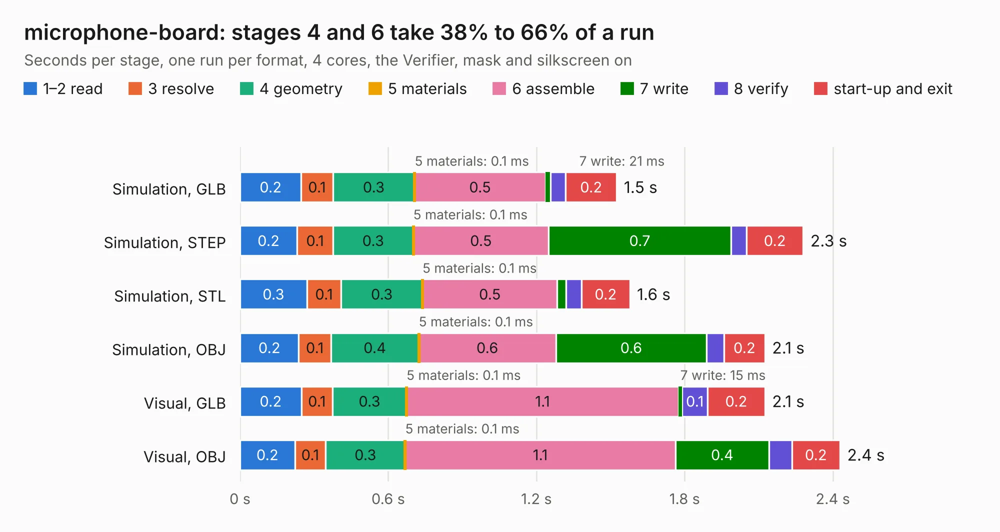

# 380. microphone-board

Board 380 of the 3,103 of [Corpus Testing](../Corpus-Testing.md), on [Corpus Page 4](../CorpusTestingPages/Corpus-Testing-04.md#380-microphone-board).

| Mode and format | 1–2 read | 3 resolve | 4 geometry | 5 materials | 6 assemble | 7 write | 8 verify | start-up and exit | Total |
|---|---:|---:|---:|---:|---:|---:|---:|---:|---:|
| Simulation, GLB | 0.2 | 0.1 | 0.3 | 0.1&nbsp;ms | 0.5 | 21&nbsp;ms | 60&nbsp;ms | 0.2 | 1.5 |
| Simulation, STEP | 0.2 | 0.1 | 0.3 | 0.1&nbsp;ms | 0.5 | 0.7 | 63&nbsp;ms | 0.2 | 2.3 |
| Simulation, STL | 0.3 | 0.1 | 0.3 | 0.1&nbsp;ms | 0.5 | 35&nbsp;ms | 63&nbsp;ms | 0.2 | 1.6 |
| Simulation, OBJ | 0.2 | 0.1 | 0.4 | 0.1&nbsp;ms | 0.6 | 0.6 | 70&nbsp;ms | 0.2 | 2.1 |
| Visual, GLB | 0.2 | 0.1 | 0.3 | 0.1&nbsp;ms | 1.1 | 15&nbsp;ms | 0.1 | 0.2 | 2.1 |
| Visual, OBJ | 0.2 | 0.1 | 0.3 | 0.1&nbsp;ms | 1.1 | 0.4 | 92&nbsp;ms | 0.2 | 2.4 |

<table align="center"><tr><td valign="top">

| Board | Repo: [antmicro/microphone-board](https://github.com/antmicro/microphone-board) Board: `microphone-board.kicad_pcb` |
|---|---|
| Complexity | 273&nbsp;/&nbsp;1000 (size&nbsp;143, features&nbsp;130) |
| KESE&nbsp;features | through vias, custom pads, rounded, trapezoid or chamfered pads, arc tracks, filled zones, copper drawings, curved board outline, stack-up, dielectric εr and tanδ, mask and silkscreen colours |
| Tested | 9th November 2026 |
| Copper&nbsp;layers | 4 |
| File&nbsp;format | KiCad 8 (20240108) |
| Parts,&nbsp;tracks,&nbsp;vias | 12, 60, 28 |
| Triangles,&nbsp;simulation | 147,964 in 16 parts |
| Verifier | PASS in all six runs |

</td><td valign="top">

<table>
<tr><th>File type</th><th>File size</th><th>Peak memory used</th></tr>
<tr><th colspan="3" align="left">Simulation</th></tr>
<tr><td>GLB</td><td align="right">5.1&nbsp;MB</td><td align="right">204&nbsp;MB</td></tr>
<tr><td>STEP</td><td align="right">22&nbsp;MB</td><td align="right">212&nbsp;MB</td></tr>
<tr><td>STL</td><td align="right">7.4&nbsp;MB</td><td align="right">211&nbsp;MB</td></tr>
<tr><td>OBJ</td><td align="right">14&nbsp;MB</td><td align="right">201&nbsp;MB</td></tr>
<tr><th colspan="3" align="left">Visual</th></tr>
<tr><td>GLB</td><td align="right">3.4&nbsp;MB</td><td align="right">163&nbsp;MB</td></tr>
<tr><td>OBJ</td><td align="right">9.4&nbsp;MB</td><td align="right">163&nbsp;MB</td></tr>
</table>

</td></tr></table>

| Previous | Next |
|:---|---:|
| [379. mec1723-espi-debugger](b0379b_mec1723-espi-debugger_mec1723-espi-debugger.md) | [381. altera-modular-agilex-5-dc-scm](b0381b_modular-agilex5e-dc-scm_altera-modular-agilex-5-dc-scm.md) |
