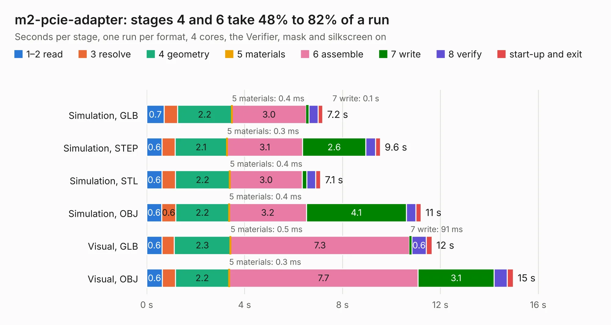

# 381. m2-pcie-adapter

Board 381 of the 3,120 of [Corpus Testing](../Corpus-Testing.md), on [Corpus Page 4](../CorpusTestingPages/Corpus-Testing-04.md#381-m2-pcie-adapter).

| Mode and format | 1–2 read | 3 resolve | 4 geometry | 5 materials | 6 assemble | 7 write | 8 verify | start-up and exit | Total |
|---|---:|---:|---:|---:|---:|---:|---:|---:|---:|
| Simulation, GLB | 0.7 | 0.5 | 2.2 | 0.4&nbsp;ms | 3.0 | 0.1 | 0.4 | 0.2 | 7.2 |
| Simulation, STEP | 0.6 | 0.5 | 2.1 | 0.3&nbsp;ms | 3.1 | 2.6 | 0.4 | 0.2 | 9.6 |
| Simulation, STL | 0.6 | 0.5 | 2.2 | 0.4&nbsp;ms | 3.0 | 0.2 | 0.4 | 0.2 | 7.1 |
| Simulation, OBJ | 0.6 | 0.6 | 2.2 | 0.4&nbsp;ms | 3.2 | 4.1 | 0.4 | 0.2 | 11.2 |
| Visual, GLB | 0.6 | 0.5 | 2.3 | 0.5&nbsp;ms | 7.3 | 91&nbsp;ms | 0.6 | 0.2 | 11.7 |
| Visual, OBJ | 0.6 | 0.5 | 2.2 | 0.3&nbsp;ms | 7.7 | 3.1 | 0.5 | 0.2 | 15.0 |

<table align="center"><tr><td valign="top">

| Board | Repo: [antmicro/m2-pcie-adapter](https://github.com/antmicro/m2-pcie-adapter) Board: `m2-pcie-adapter.kicad_pcb` |
|---|---|
| Complexity | 288&nbsp;/&nbsp;1000 (size&nbsp;178, features&nbsp;110) |
| KESE&nbsp;features | through vias, rounded, trapezoid or chamfered pads, arc tracks, filled zones, copper text, curved board outline, stack-up, dielectric εr and tanδ |
| Tested | 9th November 2026 |
| Copper&nbsp;layers | 4 |
| File&nbsp;format | KiCad 9 (20241229) |
| Parts,&nbsp;tracks,&nbsp;vias | 16, 787, 92 |
| Triangles,&nbsp;simulation | 808,562 in 81 parts |
| Verifier | PASS in all six runs |

</td><td valign="top">

<table>
<tr><th>File type</th><th>File size</th><th>Peak memory used</th></tr>
<tr><th colspan="3" align="left">Simulation</th></tr>
<tr><td>GLB</td><td align="right">28&nbsp;MB</td><td align="right">497&nbsp;MB</td></tr>
<tr><td>STEP</td><td align="right">142&nbsp;MB</td><td align="right">498&nbsp;MB</td></tr>
<tr><td>STL</td><td align="right">40&nbsp;MB</td><td align="right">453&nbsp;MB</td></tr>
<tr><td>OBJ</td><td align="right">83&nbsp;MB</td><td align="right">586&nbsp;MB</td></tr>
<tr><th colspan="3" align="left">Visual</th></tr>
<tr><td>GLB</td><td align="right">21&nbsp;MB</td><td align="right">538&nbsp;MB</td></tr>
<tr><td>OBJ</td><td align="right">63&nbsp;MB</td><td align="right">600&nbsp;MB</td></tr>
</table>

</td></tr></table>

| Previous | Next |
|:---|---:|
| [380. antmicro-m2-oculink-adapter-hw](b0380b_m2-oculink-adapter_antmicro-m2-oculink-adapter-hw.md) | [382. m2-smart-iot-module](b0382b_m2-smart-iot-module_m2-smart-iot-module.md) |
