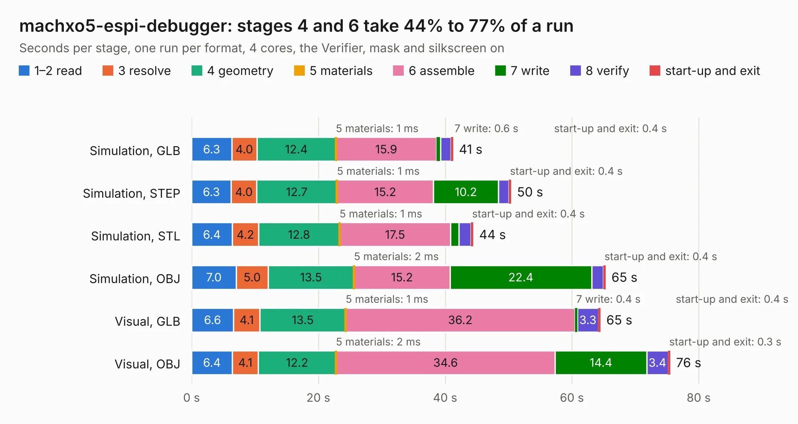

# 383. machxo5-espi-debugger

Board 383 of the 3,128 of [Corpus Testing](../Corpus-Testing.md), on [Corpus Page 4](../CorpusTestingPages/Corpus-Testing-04.md#383-machxo5-espi-debugger).

| Mode and format | 1–2 read | 3 resolve | 4 geometry | 5 materials | 6 assemble | 7 write | 8 verify | start-up and exit | Total |
|---|---:|---:|---:|---:|---:|---:|---:|---:|---:|
| Simulation, GLB | 6.3 | 4.0 | 12.4 | 1&nbsp;ms | 15.9 | 0.6 | 1.7 | 0.4 | 41.3 |
| Simulation, STEP | 6.3 | 4.0 | 12.7 | 1&nbsp;ms | 15.2 | 10.2 | 1.6 | 0.4 | 50.4 |
| Simulation, STL | 6.4 | 4.2 | 12.8 | 1&nbsp;ms | 17.5 | 1.3 | 1.9 | 0.4 | 44.5 |
| Simulation, OBJ | 7.0 | 5.0 | 13.5 | 2&nbsp;ms | 15.2 | 22.4 | 1.8 | 0.4 | 65.3 |
| Visual, GLB | 6.6 | 4.1 | 13.5 | 1&nbsp;ms | 36.2 | 0.4 | 3.3 | 0.4 | 64.5 |
| Visual, OBJ | 6.4 | 4.1 | 12.2 | 2&nbsp;ms | 34.6 | 14.4 | 3.4 | 0.3 | 75.5 |

<table align="center"><tr><td valign="top">

| Board | Repo: [antmicro/machx05-espi-debugger](https://github.com/antmicro/machx05-espi-debugger) Board: `machxo5-espi-debugger.kicad_pcb` |
|---|---|
| Complexity | 461&nbsp;/&nbsp;1000 (size&nbsp;291, features&nbsp;170) |
| KESE&nbsp;features | through vias, slotted holes, custom pads, rounded, trapezoid or chamfered pads, arc tracks, filled zones, copper drawings, copper text, knockout text, stack-up, dielectric εr and tanδ, copper finish, mask and silkscreen colours |
| Tested | 9th November 2026 |
| Copper&nbsp;layers | 6 |
| File&nbsp;format | KiCad 10 (20260206) |
| Parts,&nbsp;tracks,&nbsp;vias | 227, 2,121, 491 |
| Triangles,&nbsp;simulation | 3,681,402 in 482 parts |
| Verifier | PASS in all six runs |

</td><td valign="top">

<table>
<tr><th>File type</th><th>File size</th><th>Peak memory used</th></tr>
<tr><th colspan="3" align="left">Simulation</th></tr>
<tr><td>GLB</td><td align="right">122&nbsp;MB</td><td align="right">1.3&nbsp;GB</td></tr>
<tr><td>STEP</td><td align="right">478&nbsp;MB</td><td align="right">1.5&nbsp;GB</td></tr>
<tr><td>STL</td><td align="right">184&nbsp;MB</td><td align="right">1.3&nbsp;GB</td></tr>
<tr><td>OBJ</td><td align="right">382&nbsp;MB</td><td align="right">2.4&nbsp;GB</td></tr>
<tr><th colspan="3" align="left">Visual</th></tr>
<tr><td>GLB</td><td align="right">81&nbsp;MB</td><td align="right">1.5&nbsp;GB</td></tr>
<tr><td>OBJ</td><td align="right">259&nbsp;MB</td><td align="right">1.9&nbsp;GB</td></tr>
</table>

</td></tr></table>

| Previous | Next |
|:---|---:|
| [382. m2-smart-iot-module](b0382b_m2-smart-iot-module_m2-smart-iot-module.md) | [384. mec1723-espi-debugger](b0384b_mec1723-espi-debugger_mec1723-espi-debugger.md) |
