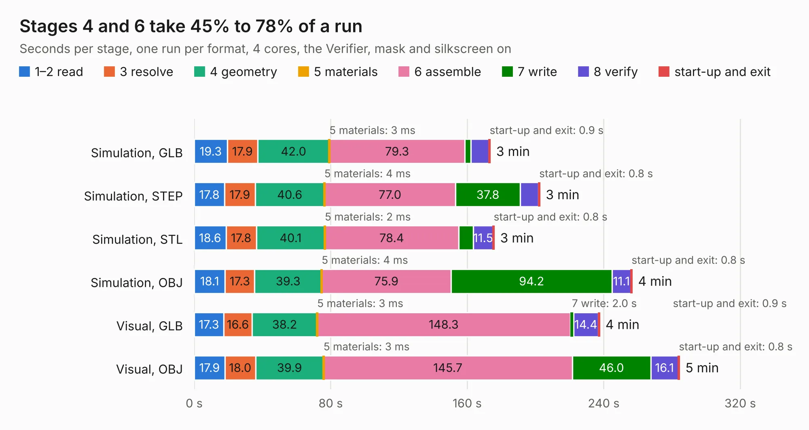

# 386. altera-modular-agilex-5-dc-scm

Board 386 of the 3,120 of [Corpus Testing](../Corpus-Testing.md), on [Corpus Page 4](../CorpusTestingPages/Corpus-Testing-04.md#386-altera-modular-agilex-5-dc-scm).

| Mode and format | 1–2 read | 3 resolve | 4 geometry | 5 materials | 6 assemble | 7 write | 8 verify | start-up and exit | Total |
|---|---:|---:|---:|---:|---:|---:|---:|---:|---:|
| Simulation, GLB | 19.3 | 17.9 | 42.0 | 3&nbsp;ms | 79.3 | 3.6 | 10.6 | 0.9 | 173.6 |
| Simulation, STEP | 17.8 | 17.9 | 40.6 | 4&nbsp;ms | 77.0 | 37.8 | 10.8 | 0.8 | 202.6 |
| Simulation, STL | 18.6 | 17.8 | 40.1 | 2&nbsp;ms | 78.4 | 8.6 | 11.5 | 0.8 | 175.9 |
| Simulation, OBJ | 18.1 | 17.3 | 39.3 | 4&nbsp;ms | 75.9 | 94.2 | 11.1 | 0.8 | 256.7 |
| Visual, GLB | 17.3 | 16.6 | 38.2 | 3&nbsp;ms | 148.3 | 2.0 | 14.4 | 0.9 | 237.6 |
| Visual, OBJ | 17.9 | 18.0 | 39.9 | 3&nbsp;ms | 145.7 | 46.0 | 16.1 | 0.8 | 284.5 |

<table align="center"><tr><td valign="top">

| Board | Repo: [antmicro/modular-agilex5e-dc-scm](https://github.com/antmicro/modular-agilex5e-dc-scm) Board: `altera-modular-agilex-5-dc-scm.kicad_pcb` |
|---|---|
| Complexity | 520&nbsp;/&nbsp;1000 (size&nbsp;340, features&nbsp;180) |
| KESE&nbsp;features | through vias, slotted holes, custom pads, rounded, trapezoid or chamfered pads, arc tracks, filled zones, copper drawings, copper text, curved board outline, knockout text, stack-up, dielectric εr and tanδ, copper finish, mask and silkscreen colours |
| Tested | 9th November 2026 |
| Copper&nbsp;layers | 8 |
| File&nbsp;format | KiCad 10 (20260206) |
| Parts,&nbsp;tracks,&nbsp;vias | 782, 15,441, 1,606 |
| Triangles,&nbsp;simulation | 15,504,394 in 963 parts |
| Verifier | PASS in all six runs |

</td><td valign="top">

<table>
<tr><th>File type</th><th>File size</th><th>Peak memory used</th></tr>
<tr><th colspan="3" align="left">Simulation</th></tr>
<tr><td>GLB</td><td align="right">520&nbsp;MB</td><td align="right">3.6&nbsp;GB</td></tr>
<tr><td>STEP</td><td align="right">1.8&nbsp;GB</td><td align="right">5.0&nbsp;GB</td></tr>
<tr><td>STL</td><td align="right">775&nbsp;MB</td><td align="right">3.7&nbsp;GB</td></tr>
<tr><td>OBJ</td><td align="right">1.7&nbsp;GB</td><td align="right">10&nbsp;GB</td></tr>
<tr><th colspan="3" align="left">Visual</th></tr>
<tr><td>GLB</td><td align="right">282&nbsp;MB</td><td align="right">4.9&nbsp;GB</td></tr>
<tr><td>OBJ</td><td align="right">934&nbsp;MB</td><td align="right">6.4&nbsp;GB</td></tr>
</table>

</td></tr></table>

| Previous | Next |
|:---|---:|
| [385. microphone-board](b0385b_microphone-board_microphone-board.md) | [387. myra-sip-interposer](b0387b_myra-sip-interposer_myra-sip-interposer.md) |
