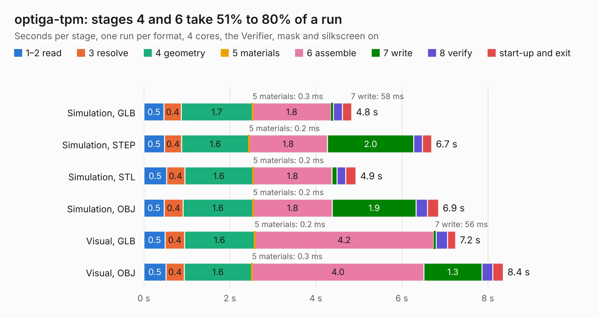

# 386. optiga-tpm

Board 386 of the 3,106 of [Corpus Testing](../Corpus-Testing.md), on [Corpus Page 4](../CorpusTestingPages/Corpus-Testing-04.md#386-optiga-tpm).

| Mode and format | 1–2 read | 3 resolve | 4 geometry | 5 materials | 6 assemble | 7 write | 8 verify | start-up and exit | Total |
|---|---:|---:|---:|---:|---:|---:|---:|---:|---:|
| Simulation, GLB | 0.5 | 0.4 | 1.7 | 0.3&nbsp;ms | 1.8 | 58&nbsp;ms | 0.2 | 0.2 | 4.8 |
| Simulation, STEP | 0.5 | 0.4 | 1.6 | 0.2&nbsp;ms | 1.8 | 2.0 | 0.2 | 0.2 | 6.7 |
| Simulation, STL | 0.5 | 0.4 | 1.6 | 0.2&nbsp;ms | 1.8 | 0.1 | 0.2 | 0.2 | 4.9 |
| Simulation, OBJ | 0.5 | 0.4 | 1.6 | 0.2&nbsp;ms | 1.8 | 1.9 | 0.3 | 0.3 | 6.9 |
| Visual, GLB | 0.5 | 0.4 | 1.6 | 0.2&nbsp;ms | 4.2 | 56&nbsp;ms | 0.3 | 0.2 | 7.2 |
| Visual, OBJ | 0.5 | 0.4 | 1.6 | 0.3&nbsp;ms | 4.0 | 1.3 | 0.2 | 0.2 | 8.4 |

<table align="center"><tr><td valign="top">

| Board | Repo: [antmicro/optiga-tpm](https://github.com/antmicro/optiga-tpm) Board: `optiga-tpm.kicad_pcb` |
|---|---|
| Complexity | 302&nbsp;/&nbsp;1000 (size&nbsp;182, features&nbsp;120) |
| KESE&nbsp;features | through vias, rounded, trapezoid or chamfered pads, filled zones, copper text, knockout text, stack-up, dielectric εr and tanδ, copper finish, mask and silkscreen colours |
| Tested | 9th November 2026 |
| Copper&nbsp;layers | 2 |
| File&nbsp;format | KiCad 10 (20260206) |
| Parts,&nbsp;tracks,&nbsp;vias | 22, 189, 27 |
| Triangles,&nbsp;simulation | 339,494 in 70 parts |
| Verifier | PASS in all six runs |

</td><td valign="top">

<table>
<tr><th>File type</th><th>File size</th><th>Peak memory used</th></tr>
<tr><th colspan="3" align="left">Simulation</th></tr>
<tr><td>GLB</td><td align="right">12&nbsp;MB</td><td align="right">302&nbsp;MB</td></tr>
<tr><td>STEP</td><td align="right">77&nbsp;MB</td><td align="right">331&nbsp;MB</td></tr>
<tr><td>STL</td><td align="right">17&nbsp;MB</td><td align="right">298&nbsp;MB</td></tr>
<tr><td>OBJ</td><td align="right">35&nbsp;MB</td><td align="right">312&nbsp;MB</td></tr>
<tr><th colspan="3" align="left">Visual</th></tr>
<tr><td>GLB</td><td align="right">8.5&nbsp;MB</td><td align="right">342&nbsp;MB</td></tr>
<tr><td>OBJ</td><td align="right">25&nbsp;MB</td><td align="right">308&nbsp;MB</td></tr>
</table>

</td></tr></table>

| Previous | Next |
|:---|---:|
| [385. oculink-to-pcie-adapter](b0385b_oculink-pcie-adapter_oculink-to-pcie-adapter.md) | [387. bmc-reference-osm](b0387b_osm-l-bmc-som_bmc-reference-osm.md) |
