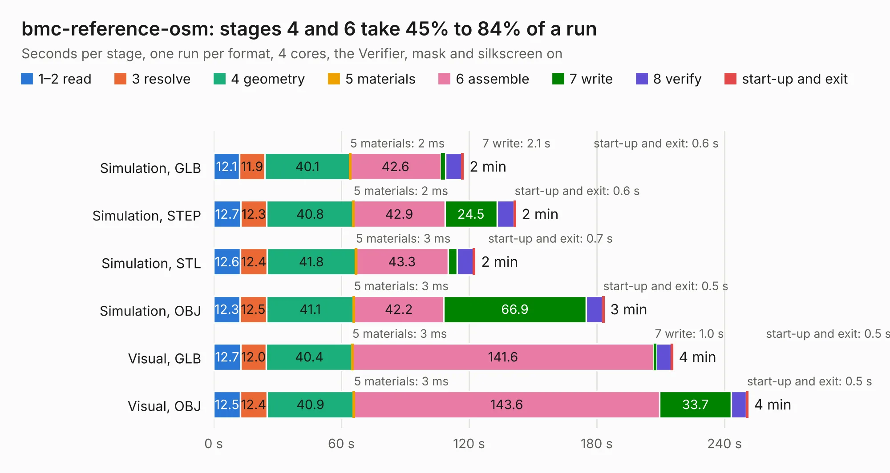

# 387. bmc-reference-osm

Board 387 of the 3,109 of [Corpus Testing](../Corpus-Testing.md), on [Corpus Page 4](../CorpusTestingPages/Corpus-Testing-04.md#387-bmc-reference-osm).

| Mode and format | 1–2 read | 3 resolve | 4 geometry | 5 materials | 6 assemble | 7 write | 8 verify | start-up and exit | Total |
|---|---:|---:|---:|---:|---:|---:|---:|---:|---:|
| Simulation, GLB | 12.1 | 11.9 | 40.1 | 2&nbsp;ms | 42.6 | 2.1 | 7.8 | 0.6 | 117.2 |
| Simulation, STEP | 12.7 | 12.3 | 40.8 | 2&nbsp;ms | 42.9 | 24.5 | 8.0 | 0.6 | 141.7 |
| Simulation, STL | 12.6 | 12.4 | 41.8 | 3&nbsp;ms | 43.3 | 4.1 | 7.8 | 0.7 | 122.7 |
| Simulation, OBJ | 12.3 | 12.5 | 41.1 | 3&nbsp;ms | 42.2 | 66.9 | 7.8 | 0.5 | 183.3 |
| Visual, GLB | 12.7 | 12.0 | 40.4 | 3&nbsp;ms | 141.6 | 1.0 | 7.3 | 0.5 | 215.6 |
| Visual, OBJ | 12.5 | 12.4 | 40.9 | 3&nbsp;ms | 143.6 | 33.7 | 7.2 | 0.5 | 250.9 |

<table align="center"><tr><td valign="top">

| Board | Repo: [antmicro/osm-l-bmc-som](https://github.com/antmicro/osm-l-bmc-som) Board: `bmc-reference-osm.kicad_pcb` |
|---|---|
| Complexity | 553&nbsp;/&nbsp;1000 (size&nbsp;338, features&nbsp;215) |
| KESE&nbsp;features | through vias, blind and buried vias, microvias, custom pads, rounded, trapezoid or chamfered pads, arc tracks, filled zones, copper drawings, TrueType text, stack-up, dielectric εr and tanδ, mask and silkscreen colours |
| Tested | 9th November 2026 |
| Copper&nbsp;layers | 10 |
| File&nbsp;format | KiCad 9 (20241229) |
| Parts,&nbsp;tracks,&nbsp;vias | 376, 7,768, 1,763 |
| Triangles,&nbsp;simulation | 11,357,820 in 1082 parts |
| Verifier | PASS in all six runs |

</td><td valign="top">

<table>
<tr><th>File type</th><th>File size</th><th>Peak memory used</th></tr>
<tr><th colspan="3" align="left">Simulation</th></tr>
<tr><td>GLB</td><td align="right">371&nbsp;MB</td><td align="right">2.7&nbsp;GB</td></tr>
<tr><td>STEP</td><td align="right">1.2&nbsp;GB</td><td align="right">3.8&nbsp;GB</td></tr>
<tr><td>STL</td><td align="right">568&nbsp;MB</td><td align="right">2.8&nbsp;GB</td></tr>
<tr><td>OBJ</td><td align="right">1.2&nbsp;GB</td><td align="right">7.2&nbsp;GB</td></tr>
<tr><th colspan="3" align="left">Visual</th></tr>
<tr><td>GLB</td><td align="right">179&nbsp;MB</td><td align="right">3.4&nbsp;GB</td></tr>
<tr><td>OBJ</td><td align="right">592&nbsp;MB</td><td align="right">4.0&nbsp;GB</td></tr>
</table>

</td></tr></table>

| Previous | Next |
|:---|---:|
| [386. optiga-tpm](b0386b_optiga-tpm_optiga-tpm.md) | [388. OV5640-dual-camera-board](b0388b_ov5640-dual-camera-board_OV5640-dual-camera-board.md) |
