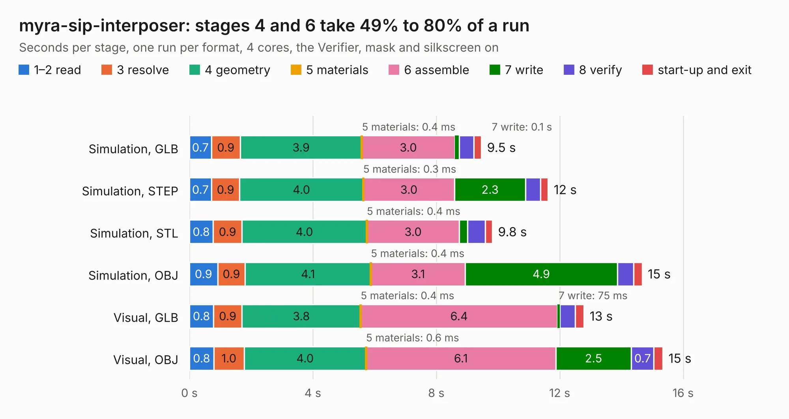

# 388. myra-sip-interposer

Board 388 of the 3,132 of [Corpus Testing](../Corpus-Testing.md), on [Corpus Page 4](../CorpusTestingPages/Corpus-Testing-04.md#388-myra-sip-interposer).

| Mode and format | 1–2 read | 3 resolve | 4 geometry | 5 materials | 6 assemble | 7 write | 8 verify | start-up and exit | Total |
|---|---:|---:|---:|---:|---:|---:|---:|---:|---:|
| Simulation, GLB | 0.7 | 0.9 | 3.9 | 0.4&nbsp;ms | 3.0 | 0.1 | 0.5 | 0.2 | 9.5 |
| Simulation, STEP | 0.7 | 0.9 | 4.0 | 0.3&nbsp;ms | 3.0 | 2.3 | 0.5 | 0.2 | 11.6 |
| Simulation, STL | 0.8 | 0.9 | 4.0 | 0.4&nbsp;ms | 3.0 | 0.3 | 0.6 | 0.2 | 9.8 |
| Simulation, OBJ | 0.9 | 0.9 | 4.1 | 0.4&nbsp;ms | 3.1 | 4.9 | 0.5 | 0.3 | 14.7 |
| Visual, GLB | 0.8 | 0.9 | 3.8 | 0.4&nbsp;ms | 6.4 | 75&nbsp;ms | 0.5 | 0.3 | 12.8 |
| Visual, OBJ | 0.8 | 1.0 | 4.0 | 0.6&nbsp;ms | 6.1 | 2.5 | 0.7 | 0.3 | 15.3 |

<table align="center"><tr><td valign="top">

| Board | Repo: [antmicro/myra-sip-interposer](https://github.com/antmicro/myra-sip-interposer) Board: `myra-sip-interposer.kicad_pcb` |
|---|---|
| Complexity | 405&nbsp;/&nbsp;1000 (size&nbsp;240, features&nbsp;165) |
| KESE&nbsp;features | through vias, custom pads, rounded, trapezoid or chamfered pads, filled zones, copper drawings, stack-up, dielectric εr and tanδ, copper finish, castellated pads, plated board edge |
| Tested | 9th November 2026 |
| Copper&nbsp;layers | 4 |
| File&nbsp;format | KiCad 7 (20221018) |
| Parts,&nbsp;tracks,&nbsp;vias | 31, 354, 164 |
| Triangles,&nbsp;simulation | 866,652 in 96 parts |
| Verifier | PASS in all six runs |

</td><td valign="top">

<table>
<tr><th>File type</th><th>File size</th><th>Peak memory used</th></tr>
<tr><th colspan="3" align="left">Simulation</th></tr>
<tr><td>GLB</td><td align="right">29&nbsp;MB</td><td align="right">377&nbsp;MB</td></tr>
<tr><td>STEP</td><td align="right">103&nbsp;MB</td><td align="right">446&nbsp;MB</td></tr>
<tr><td>STL</td><td align="right">43&nbsp;MB</td><td align="right">396&nbsp;MB</td></tr>
<tr><td>OBJ</td><td align="right">86&nbsp;MB</td><td align="right">607&nbsp;MB</td></tr>
<tr><th colspan="3" align="left">Visual</th></tr>
<tr><td>GLB</td><td align="right">15&nbsp;MB</td><td align="right">483&nbsp;MB</td></tr>
<tr><td>OBJ</td><td align="right">46&nbsp;MB</td><td align="right">449&nbsp;MB</td></tr>
</table>

</td></tr></table>

| Previous | Next |
|:---|---:|
| [387. altera-modular-agilex-5-dc-scm](b0387b_modular-agilex5e-dc-scm_altera-modular-agilex-5-dc-scm.md) | [389. oculink-to-10gbe-adapter](b0389b_oculink-10gbe-adapter_oculink-to-10gbe-adapter.md) |
