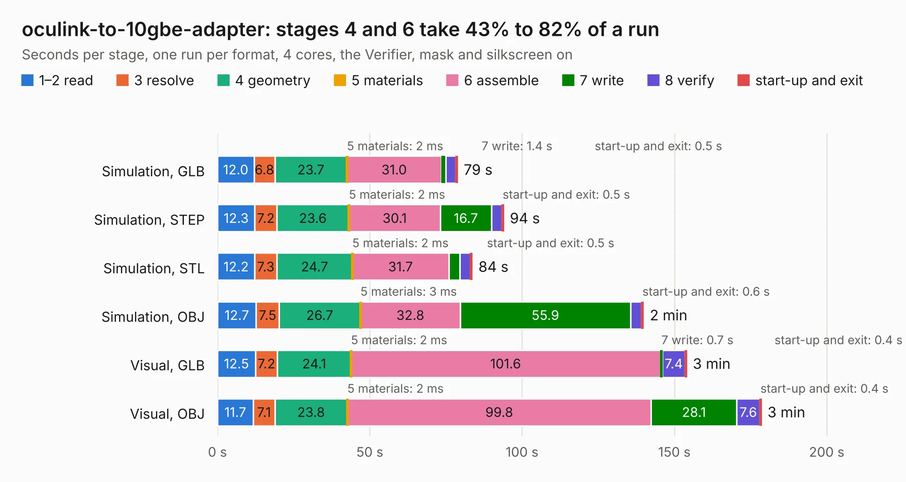

# 388. oculink-to-10gbe-adapter

Board 388 of the 3,122 of [Corpus Testing](../Corpus-Testing.md), on [Corpus Page 4](../CorpusTestingPages/Corpus-Testing-04.md#388-oculink-to-10gbe-adapter).

| Mode and format | 1–2 read | 3 resolve | 4 geometry | 5 materials | 6 assemble | 7 write | 8 verify | start-up and exit | Total |
|---|---:|---:|---:|---:|---:|---:|---:|---:|---:|
| Simulation, GLB | 12.0 | 6.8 | 23.7 | 2&nbsp;ms | 31.0 | 1.4 | 3.3 | 0.5 | 78.7 |
| Simulation, STEP | 12.3 | 7.2 | 23.6 | 2&nbsp;ms | 30.1 | 16.7 | 3.5 | 0.5 | 93.9 |
| Simulation, STL | 12.2 | 7.3 | 24.7 | 2&nbsp;ms | 31.7 | 3.6 | 3.5 | 0.5 | 83.5 |
| Simulation, OBJ | 12.7 | 7.5 | 26.7 | 3&nbsp;ms | 32.8 | 55.9 | 3.6 | 0.6 | 139.8 |
| Visual, GLB | 12.5 | 7.2 | 24.1 | 2&nbsp;ms | 101.6 | 0.7 | 7.4 | 0.4 | 153.9 |
| Visual, OBJ | 11.7 | 7.1 | 23.8 | 2&nbsp;ms | 99.8 | 28.1 | 7.6 | 0.4 | 178.5 |

<table align="center"><tr><td valign="top">

| Board | Repo: [antmicro/oculink-10gbe-adapter](https://github.com/antmicro/oculink-10gbe-adapter) Board: `oculink-to-10gbe-adapter.kicad_pcb` |
|---|---|
| Complexity | 466&nbsp;/&nbsp;1000 (size&nbsp;311, features&nbsp;155) |
| KESE&nbsp;features | through vias, slotted holes, custom pads, rounded, trapezoid or chamfered pads, arc tracks, filled zones, copper drawings, copper text, knockout text, stack-up, dielectric εr and tanδ, mask and silkscreen colours |
| Tested | 9th November 2026 |
| Copper&nbsp;layers | 8 |
| File&nbsp;format | KiCad 9 (20241229) |
| Parts,&nbsp;tracks,&nbsp;vias | 460, 2,463, 1,174 |
| Triangles,&nbsp;simulation | 9,149,554 in 437 parts |
| Verifier | PASS in all six runs |

</td><td valign="top">

<table>
<tr><th>File type</th><th>File size</th><th>Peak memory used</th></tr>
<tr><th colspan="3" align="left">Simulation</th></tr>
<tr><td>GLB</td><td align="right">295&nbsp;MB</td><td align="right">2.7&nbsp;GB</td></tr>
<tr><td>STEP</td><td align="right">962&nbsp;MB</td><td align="right">3.5&nbsp;GB</td></tr>
<tr><td>STL</td><td align="right">458&nbsp;MB</td><td align="right">2.8&nbsp;GB</td></tr>
<tr><td>OBJ</td><td align="right">950&nbsp;MB</td><td align="right">5.8&nbsp;GB</td></tr>
<tr><th colspan="3" align="left">Visual</th></tr>
<tr><td>GLB</td><td align="right">167&nbsp;MB</td><td align="right">3.0&nbsp;GB</td></tr>
<tr><td>OBJ</td><td align="right">537&nbsp;MB</td><td align="right">3.7&nbsp;GB</td></tr>
</table>

</td></tr></table>

| Previous | Next |
|:---|---:|
| [387. myra-sip-interposer](b0387b_myra-sip-interposer_myra-sip-interposer.md) | [389. oculink-to-pcie-adapter](b0389b_oculink-pcie-adapter_oculink-to-pcie-adapter.md) |
