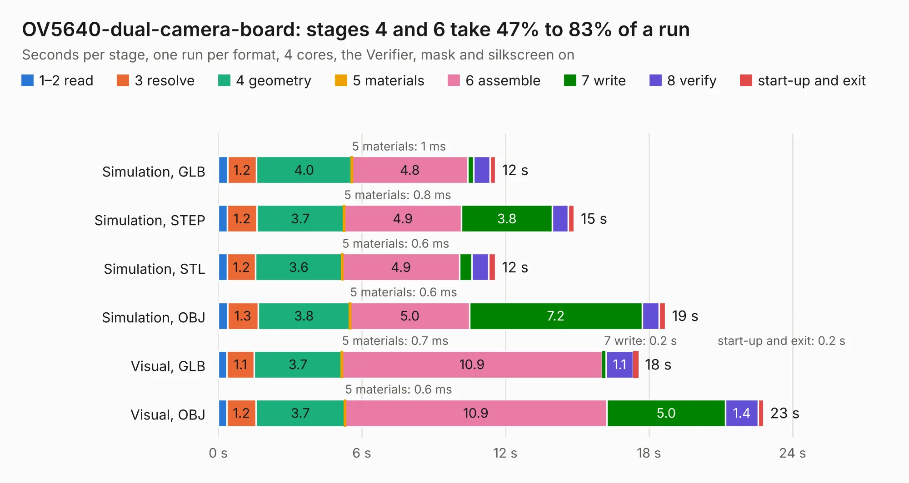

# 388. OV5640-dual-camera-board

Board 388 of the 3,108 of [Corpus Testing](../Corpus-Testing.md), on [Corpus Page 4](../CorpusTestingPages/Corpus-Testing-04.md#388-ov5640-dual-camera-board).

| Mode and format | 1–2 read | 3 resolve | 4 geometry | 5 materials | 6 assemble | 7 write | 8 verify | start-up and exit | Total |
|---|---:|---:|---:|---:|---:|---:|---:|---:|---:|
| Simulation, GLB | 0.4 | 1.2 | 4.0 | 1&nbsp;ms | 4.8 | 0.2 | 0.7 | 0.2 | 11.6 |
| Simulation, STEP | 0.4 | 1.2 | 3.7 | 0.8&nbsp;ms | 4.9 | 3.8 | 0.7 | 0.3 | 14.9 |
| Simulation, STL | 0.4 | 1.2 | 3.6 | 0.6&nbsp;ms | 4.9 | 0.5 | 0.7 | 0.3 | 11.6 |
| Simulation, OBJ | 0.4 | 1.3 | 3.8 | 0.6&nbsp;ms | 5.0 | 7.2 | 0.7 | 0.3 | 18.7 |
| Visual, GLB | 0.4 | 1.1 | 3.7 | 0.7&nbsp;ms | 10.9 | 0.2 | 1.1 | 0.2 | 17.6 |
| Visual, OBJ | 0.4 | 1.2 | 3.7 | 0.6&nbsp;ms | 10.9 | 5.0 | 1.4 | 0.2 | 22.8 |

<table align="center"><tr><td valign="top">

| Board | Repo: [antmicro/ov5640-dual-camera-board](https://github.com/antmicro/ov5640-dual-camera-board) Board: `OV5640-dual-camera-board.kicad_pcb` |
|---|---|
| Complexity | 308&nbsp;/&nbsp;1000 (size&nbsp;203, features&nbsp;105) |
| KESE&nbsp;features | through vias, rounded, trapezoid or chamfered pads, arc tracks, filled zones, copper text, stack-up, dielectric εr and tanδ, mask and silkscreen colours |
| Tested | 9th November 2026 |
| Copper&nbsp;layers | 4 |
| File&nbsp;format | KiCad 6 (20211014) |
| Parts,&nbsp;tracks,&nbsp;vias | 82, 943, 234 |
| Triangles,&nbsp;simulation | 1,484,392 in 137 parts |
| Verifier | PASS in all six runs |

</td><td valign="top">

<table>
<tr><th>File type</th><th>File size</th><th>Peak memory used</th></tr>
<tr><th colspan="3" align="left">Simulation</th></tr>
<tr><td>GLB</td><td align="right">51&nbsp;MB</td><td align="right">688&nbsp;MB</td></tr>
<tr><td>STEP</td><td align="right">231&nbsp;MB</td><td align="right">752&nbsp;MB</td></tr>
<tr><td>STL</td><td align="right">74&nbsp;MB</td><td align="right">666&nbsp;MB</td></tr>
<tr><td>OBJ</td><td align="right">154&nbsp;MB</td><td align="right">990&nbsp;MB</td></tr>
<tr><th colspan="3" align="left">Visual</th></tr>
<tr><td>GLB</td><td align="right">34&nbsp;MB</td><td align="right">711&nbsp;MB</td></tr>
<tr><td>OBJ</td><td align="right">103&nbsp;MB</td><td align="right">774&nbsp;MB</td></tr>
</table>

</td></tr></table>

| Previous | Next |
|:---|---:|
| [387. bmc-reference-osm](b0387b_osm-l-bmc-som_bmc-reference-osm.md) | [389. ov9281-dual-camera-board](b0389b_ov9281-camera-board_ov9281-dual-camera-board.md) |
