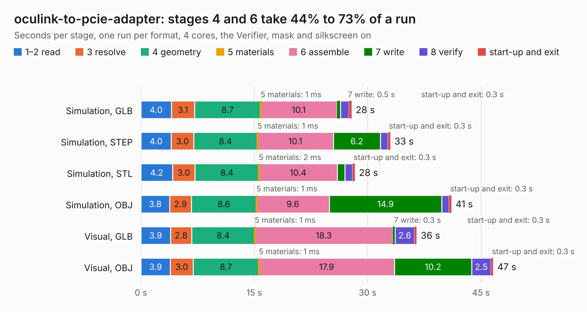

# 390. oculink-to-pcie-adapter

Board 390 of the 3,131 of [Corpus Testing](../Corpus-Testing.md), on [Corpus Page 4](../CorpusTestingPages/Corpus-Testing-04.md#390-oculink-to-pcie-adapter).

| Mode and format | 1–2 read | 3 resolve | 4 geometry | 5 materials | 6 assemble | 7 write | 8 verify | start-up and exit | Total |
|---|---:|---:|---:|---:|---:|---:|---:|---:|---:|
| Simulation, GLB | 4.0 | 3.1 | 8.7 | 1&nbsp;ms | 10.1 | 0.5 | 1.1 | 0.3 | 27.9 |
| Simulation, STEP | 4.0 | 3.0 | 8.4 | 1&nbsp;ms | 10.1 | 6.2 | 1.0 | 0.3 | 33.0 |
| Simulation, STL | 4.2 | 3.0 | 8.4 | 2&nbsp;ms | 10.4 | 1.0 | 1.0 | 0.3 | 28.3 |
| Simulation, OBJ | 3.8 | 2.9 | 8.6 | 1&nbsp;ms | 9.6 | 14.9 | 1.0 | 0.3 | 41.1 |
| Visual, GLB | 3.9 | 2.8 | 8.4 | 1&nbsp;ms | 18.3 | 0.3 | 2.6 | 0.3 | 36.5 |
| Visual, OBJ | 3.9 | 3.0 | 8.7 | 1&nbsp;ms | 17.9 | 10.2 | 2.5 | 0.3 | 46.6 |

<table align="center"><tr><td valign="top">

| Board | Repo: [antmicro/oculink-pcie-adapter](https://github.com/antmicro/oculink-pcie-adapter) Board: `oculink-to-pcie-adapter.kicad_pcb` |
|---|---|
| Complexity | 366&nbsp;/&nbsp;1000 (size&nbsp;221, features&nbsp;145) |
| KESE&nbsp;features | through vias, slotted holes, custom pads, rounded, trapezoid or chamfered pads, arc tracks, filled zones, copper drawings, knockout text, stack-up, dielectric εr and tanδ, mask and silkscreen colours |
| Tested | 9th November 2026 |
| Copper&nbsp;layers | 4 |
| File&nbsp;format | KiCad 9 (20241229) |
| Parts,&nbsp;tracks,&nbsp;vias | 144, 1,642, 583 |
| Triangles,&nbsp;simulation | 2,446,380 in 211 parts |
| Verifier | PASS in all six runs |

</td><td valign="top">

<table>
<tr><th>File type</th><th>File size</th><th>Peak memory used</th></tr>
<tr><th colspan="3" align="left">Simulation</th></tr>
<tr><td>GLB</td><td align="right">83&nbsp;MB</td><td align="right">934&nbsp;MB</td></tr>
<tr><td>STEP</td><td align="right">283&nbsp;MB</td><td align="right">1.2&nbsp;GB</td></tr>
<tr><td>STL</td><td align="right">122&nbsp;MB</td><td align="right">881&nbsp;MB</td></tr>
<tr><td>OBJ</td><td align="right">253&nbsp;MB</td><td align="right">1.6&nbsp;GB</td></tr>
<tr><th colspan="3" align="left">Visual</th></tr>
<tr><td>GLB</td><td align="right">56&nbsp;MB</td><td align="right">1.2&nbsp;GB</td></tr>
<tr><td>OBJ</td><td align="right">172&nbsp;MB</td><td align="right">1.4&nbsp;GB</td></tr>
</table>

</td></tr></table>

| Previous | Next |
|:---|---:|
| [389. oculink-to-10gbe-adapter](b0389b_oculink-10gbe-adapter_oculink-to-10gbe-adapter.md) | [391. optiga-tpm](b0391b_optiga-tpm_optiga-tpm.md) |
