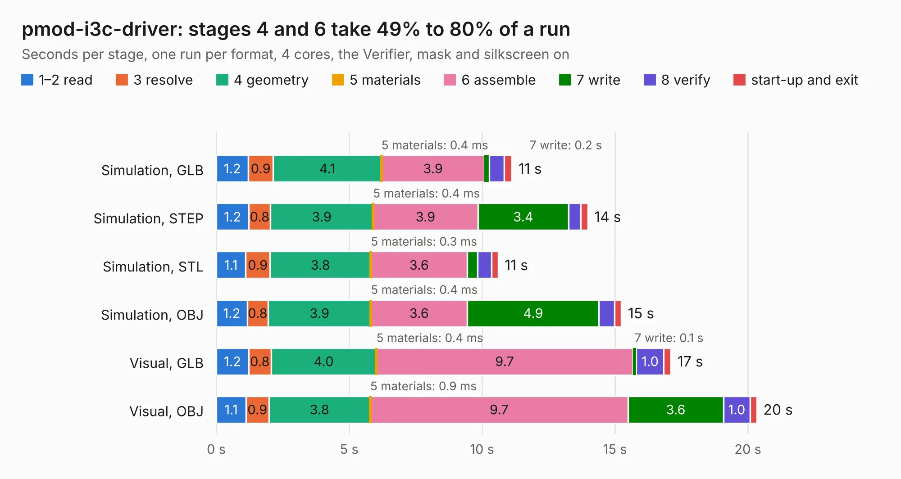

# 390. pmod-i3c-driver

Board 390 of the 3,110 of [Corpus Testing](../Corpus-Testing.md), on [Corpus Page 4](../CorpusTestingPages/Corpus-Testing-04.md#390-pmod-i3c-driver).

| Mode and format | 1–2 read | 3 resolve | 4 geometry | 5 materials | 6 assemble | 7 write | 8 verify | start-up and exit | Total |
|---|---:|---:|---:|---:|---:|---:|---:|---:|---:|
| Simulation, GLB | 1.2 | 0.9 | 4.1 | 0.4&nbsp;ms | 3.9 | 0.2 | 0.6 | 0.3 | 11.1 |
| Simulation, STEP | 1.2 | 0.8 | 3.9 | 0.4&nbsp;ms | 3.9 | 3.4 | 0.4 | 0.3 | 14.0 |
| Simulation, STL | 1.1 | 0.9 | 3.8 | 0.3&nbsp;ms | 3.6 | 0.4 | 0.5 | 0.3 | 10.6 |
| Simulation, OBJ | 1.2 | 0.8 | 3.9 | 0.4&nbsp;ms | 3.6 | 4.9 | 0.6 | 0.3 | 15.2 |
| Visual, GLB | 1.2 | 0.8 | 4.0 | 0.4&nbsp;ms | 9.7 | 0.1 | 1.0 | 0.3 | 17.1 |
| Visual, OBJ | 1.1 | 0.9 | 3.8 | 0.9&nbsp;ms | 9.7 | 3.6 | 1.0 | 0.3 | 20.3 |

<table align="center"><tr><td valign="top">

| Board | Repo: [antmicro/pmod-i3c-driver](https://github.com/antmicro/pmod-i3c-driver) Board: `pmod-i3c-driver.kicad_pcb` |
|---|---|
| Complexity | 304&nbsp;/&nbsp;1000 (size&nbsp;189, features&nbsp;115) |
| KESE&nbsp;features | through vias, slotted holes, rounded, trapezoid or chamfered pads, filled zones, copper text, knockout text, stack-up, dielectric εr and tanδ, mask and silkscreen colours |
| Tested | 9th November 2026 |
| Copper&nbsp;layers | 4 |
| File&nbsp;format | KiCad 9 (20241229) |
| Parts,&nbsp;tracks,&nbsp;vias | 62, 610, 83 |
| Triangles,&nbsp;simulation | 1,045,598 in 59 parts |
| Verifier | PASS in all six runs |

</td><td valign="top">

<table>
<tr><th>File type</th><th>File size</th><th>Peak memory used</th></tr>
<tr><th colspan="3" align="left">Simulation</th></tr>
<tr><td>GLB</td><td align="right">36&nbsp;MB</td><td align="right">504&nbsp;MB</td></tr>
<tr><td>STEP</td><td align="right">162&nbsp;MB</td><td align="right">564&nbsp;MB</td></tr>
<tr><td>STL</td><td align="right">52&nbsp;MB</td><td align="right">489&nbsp;MB</td></tr>
<tr><td>OBJ</td><td align="right">106&nbsp;MB</td><td align="right">785&nbsp;MB</td></tr>
<tr><th colspan="3" align="left">Visual</th></tr>
<tr><td>GLB</td><td align="right">23&nbsp;MB</td><td align="right">629&nbsp;MB</td></tr>
<tr><td>OBJ</td><td align="right">69&nbsp;MB</td><td align="right">697&nbsp;MB</td></tr>
</table>

</td></tr></table>

| Previous | Next |
|:---|---:|
| [389. ov9281-dual-camera-board](b0389b_ov9281-camera-board_ov9281-dual-camera-board.md) | [391. pmod-i3c-sensor-board](b0391b_pmod-i3c-sensor-board_pmod-i3c-sensor-board.md) |
